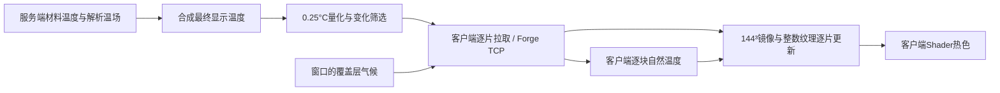

# 红外视野的数据路径与现场诊断

- Status: `Current; local WAN timeout reproduced and fixed; reported overseas-client cause remains unconfirmed`
- Last verified: `2026-11-15`（新增“自然温度底色”“色标”“非地形像素”，缺失值不着色；真实客户端E2E默认场景按自然温度底色重新通过；其余内容 `2026-11-08`，“验证边界”中2026-11-08的记录描述当时的蓝色占位）
- Scope: 红外温度来源、自然温度底色、色标、传输内容、接收驱动分片、渐进显示、生命周期及客户端/服务端诊断
- Code anchors: `FHRequestInfraredViewDataSyncPacket`, `FHContinueInfraredViewPacket`, `InfraredTransfers`, `InfraredCapture`, `InfraredBrickCodec`, `InfraredNaturalClimate`, `InfraredNaturalFill`, `InfraredDisplayCache`, `InfraredViewRenderer`, `InfraredDiagnostics`, `InfraredClientCommand`, `InfraredServerCommand`

## 数据路径



服务端继续拥有物理热模拟和材料状态。`InfraredCapture`读取既有材料温度，再按原优先级合成能量塔等解析场；不因红外读取而创建物理驻留。网络发送最终显示值，不发送求解矩阵、材料焓或完整模拟状态。具体温度权威和合成公式见[世界温度](world-climate-and-temperature.md)。

有限显示值的编码为 `q = clamp(round(4 * T), -32767, 32767)`，T单位°C，q为有符号short；`-32768`专用于缺失数据。0.25°C是显示量化步长，不是物理模拟步长。场合成在量化前完成。

业务数据是温度标量，同时需要Brick地址、窗口中心、覆盖/删除位图和提交编号，使客户端能定位、合并或清除已有值。每个Brick表示4³个方块：全相同值用一个short，多个值按字典或64个short择小；缺失值有独立编码。ACK只结束一次请求，不代表收到温度。

网络合同和带宽测量由[数据生命周期与集成](data-lifecycle-and-integration.md#network-and-consumers)维护。固定场去重、窗口重叠和8MiB计量显示缓存属于派生数据优化，不决定真实温度是否存在；缓存miss会重发。

## 自然温度底色

服务端只发送有材料温度或解析场的方块，其余方块是INVALID。客户端用这些方块的自然温度填上，红外因此显示整个
环境的底色，热场的扰动叠在上面。自然温度与热场静止时的背景（`NaturalProfile`）是同一组项，取空气公式
`WorldTemperature.naturalAir`（不乘方块气候系数），所以进出热场的方块读数一致：

```text
T = max(absoluteZero, D + B(Brick中心) + A(y) + climate[窗口区块][min(cover, limit)])
```

- 服务端只发送客户端算不出的部分：`InfraredNaturalClimate`，即窗口9×9个区块每个覆盖厚度的气候
  （没有白幕的区块共用一张表，有白幕的区块各一张）、超平坦标志和绝对零度下限。它随回复的第一片发送；
  没有白幕、覆盖上限16时约160字节（81字节区块索引加17个float）。请求携带客户端已有的
  `knownNaturalRevision`（内容哈希）；版本相同且没有别的变化时，回复仍可为空。
  不跟踪它的调用方传 `InfraredNaturalClimate.UNTRACKED`，保持原来的空回复规则。
- 维度 `D`、群系 `B`、海拔 `A` 和覆盖层 `cover` 由客户端用自己的方块、群系和同步来的 `WorldTempData` /
  `BiomeTempData` 计算。覆盖层复用 `ClimateCoverColumns`；客户端不读 `WorldTemperature` 的群系/维度缓存，
  那些缓存属于服务端线程。
- `InfraredNaturalFill` 保存一份144³的自然温度，空气保持INVALID。只在红外开启时计算，每个客户端tick最多
  算32个Page，从窗口中心向外。上传时，镜像里INVALID的位置用这份值填。
- 以下情况重算：新的气候版本（气候每小时变化、白幕、配置）重算全部Page；窗口移动只算新进入的Page；
  客户端区块到达时重算该列；客户端已读过覆盖层的区块里方块变化时，`LevelChunkMixin_ClimateCover` 经
  `ClimateCover.clientBlockChanges` 通知，重算所在Page；不透光性改变时，同一列下方的Page也重算。

气候表只随数据回复送达，ACK不带它。所以客户端还没有可读材料基准时，一个尚未发布过的温场按“没有温场”抓取，
回复照常发出（见[世界温度](world-climate-and-temperature.md)中关于读竞争的规则）；否则新世界里在第一次有驻留发布之前
（例如点燃第一个篝火之前），整个视野都会停在缺失值。

此前曾有过按Page估计的整窗口背景（729个值的背景包和第二张背景纹理），已经删除；现在没有背景包，也没有第二张纹理。

## 色标

`infrared_view.fsh` 的 `temperatureToColor` 在 `MIN_TEMP = -50` 到 `MAX_TEMP = 50`°C 之间按色标点线性插值，
范围外取端点颜色（`2026-11-15` 起；此前是 −20..20°C 的 蓝→橙→黄→红，色相会折返，−6.8°C 和 +13.2°C 同为橙色）：

| 温度 | 颜色 | RGB |
|---:|---|---|
| −50°C | 紫 | (0.5, 0, 1) |
| −30°C | 蓝 | (0, 0, 1) |
| 0°C | 青 | (0, 1, 1) |
| 25°C | 绿，适宜温度 | (0, 1, 0) |
| 37.5°C | 黄 | (1, 1, 0) |
| 50°C | 红 | (1, 0, 0) |

相邻色标点在色相环上相差一个60°扇区，所以每段线性混合就是一段色相扫描，色相单调、饱和度不变；
20°C约为 (0, 1, 0.2)，30°C约为 (0.4, 1, 0)，都还是绿。最终颜色乘0.43、alpha 0.43后预乘叠加在原画面上。
缺失值（INVALID）`discard`，该像素保持原画面不着色，所以紫色只表示真实的 −50°C 及以下。
`InfraredPhysicalE2eClient.color` 复刻这张色标，用于真实客户端E2E的帧颜色校验。

## 非地形像素读表面后面的方块

只有 SOLID 和 CUTOUT 地形经过捕获pass，按精确owner取温度。冰、水、半透明玻璃等透明层以及实体，用深度重建
camera-relative 位置，再读144³纹理。这类表面正好落在方块边界上，深度重建的微小误差会让 `floor()` 在方块本身和
它前面的空气之间来回跳；冰河在红外下因此曾是缺失色底加乱跳的条纹，视角一动就闪。现在先用屏幕空间导数
`cross(dFdx(world), dFdy(world))` 求表面法线（在任何 `discard` 之前计算，导数才有定义），朝远离相机的一侧沿法线
走 `SURFACE_DEPTH = 0.05` 格再取格；法线退化时沿视线走。2×2像素块跨越不同表面的轮廓边上，法线可能不准。

## 不着色不等于没有温度

有了自然温度底色以后，方块仍不着色只有这几种情况：空气（实体等遮挡像素读到的是空气格）、客户端还没加载的区块，
以及刚打开或刚移动后尚未算到的Page。只看不着色，仍不能区分这些情况与尚未回复、分片尚未提交或显示异常。

客户端最多一个未完成请求。FIRST开始CPU暂存并上传收到的附近Page，后续每片上传变化Page；缺失位置保持INVALID、不着色。即使`staging=true`、`commits=0`，已收到的热源也可以显示。LAST才提交完整增量基准、覆盖位图和epoch，并结束pending；部分显示不能作为下一次delta的基准。慢响应不被固定2秒编号更新淘汰。

`InfraredTransfers`保存每名观察者的当前回复，首次只发送一片。`FHContinueInfraredViewPacket(requestId,nextPart)`在客户端完成处理后申请下一片，LAST也有接收回执；通常requestId和part均较小时正文只有2B。首片上限32KiB，后续片上限128KiB，均预留2048B头部预算；按附近Section优先编码，避免先等待整片远处温场。回复在LAST回执、取消、被新请求取代、离线、换维度、世界卸载或停服时释放。状态意外缺失时发送ACK，让客户端保留可见部分并按既有节奏重新获取full。传输期间按1秒游戏时间维持现有物理输入的红外变化跟踪，不启动新的物理驻留。

144³窗口包含729个16³ Section；实际只发送选中的温度记录。全RAW理论上限为46656个Brick×131B，约5.83MiB记录正文，再分为多个受回执控制的片；这不是普通篝火场景的实际包大小。此方式限制单次排入连接的红外数据，不保证任意带宽、其他模组负载和TCP拥塞下的固定首色延迟。固定场的带宽结果不能代表所有首次full。

网络通道后缀为`:infrared-stream-1`，客户端和服务端均需实现继续/取消/最终回执合同；0.7.11构建包含此合同。

材料之外的实体遮挡仍按既有环境显示近似处理，不是实体体温测量。扫描范围64格、色标、alpha和地形归属规则见世界温度文档；诊断不改变这些规则。

## 现场诊断

诊断命令本身不改变显示状态（`resync`除外）。以下命令只查询玩家自己，不要求队长或OP；客户端命令只在本地执行，服务端命令通过普通聊天命令路径查询。

1. 在有问题的客户端启用 `/fh_ir trace true`，并执行 `/fh_ir_server trace true`。
2. 保持同一个热源和位置，按I关掉再打开，观察一次请求过程。
3. 执行 `/fh_ir status` 和 `/fh_ir_server status`，保存两行输出。
4. 客户端`latest.log`查看`IR_CLIENT_SEND/PART/ACK/COMMIT/REJECT`；服务端日志查看`IR_SERVER_REQUEST/RESPONSE`，按玩家和请求编号对应。
5. 执行 `/fh_ir trace false`、`/fh_ir_server trace false`结束本轮跟踪。

`/fh_ir resync`释放当前等待并请求新的full，保留显示直到替换；它是主动重同步，不是故障原因证明。跟踪默认关闭，客户端退出世界及服务端离线/停服会清除对应跟踪状态。

| 观察 | 能证明什么 |
|---|---|
| 客户端sent增长，服务端没有对应REQUEST | 请求未进入该服务端红外处理器；需要核对这段实际链路 |
| 服务端RESPONSE有validSamples，客户端没有PART/ACK | 服务端已生成回复，客户端处理器尚未观察到该回复 |
| 客户端PART增长但commits不增长，staging=true | 已开始渐进显示，完整基准尚未完成LAST提交 |
| commits增长、validMirrorSamples>0，但画面仍不着色 | 数据已进入客户端镜像；继续检查上传、地形深度捕获和Shader采样 |
| 服务端full探测NO_VALID_SAMPLES | 该次查询未产生有效温度，不应先归因为带宽 |
| 有效值的maxC≤−50 | 全紫是合法色标结果 |

客户端状态包含open、pending、waitMs、请求/回复/ACK/提交/忽略计数、staging、基准有效性、镜像有效样本数及范围、纹理存在、实际叠加帧计数和最近地形深度标记。`validMirrorSamples`描述CPU数据，不能单独证明GPU上传及最终着色成功；`commits`描述完整基准次数，不计部分显示。

服务端`status`强制读取当前位置完整显示，绕过显示去重基准，不改变客户端事务；它与“那次回复真的发送/接收”仍是两个证据。其Summary区分NO_SNAPSHOT和NO_VALID_SAMPLES；普通请求的NO_SNAPSHOT也可以表示没有变化，trace中的delta只统计变化记录。客户端PART的accepted只表示编号/开关匹配，最终提交以COMMIT为准。需要将客户端和服务端同一请求的日志合看。

## 验证边界

### 自然温度底色以后的真实客户端E2E

`2026-11-15`起，服务端没有发送值的方块在GPU纹理里显示客户端算出的自然温度（见[自然温度底色](#自然温度底色)），下面
2026-11-08记录中“材料退出或删除后GPU变为INVALID”的期望不再成立。`InfraredPhysicalE2eClient`和脚本现在这样检查：

- 暖点`-4,67,0`与冷点`4,67,0`的GPU值：最后提交的display在代理独立解析的线上回复里有值时等于线上值；没有值时等于
  客户端在该方块的自然温度（`InfraredViewRenderer.naturalAt`，即上传时合并的`InfraredNaturalFill`值）；两者都没有
  （空气、窗口外或尚未算到）才是INVALID。
- 客户端自然温度与服务端对同一方块的`WorldTemperature.naturalAir`（`physical-state.json`的`naturalWarmQ`/`naturalColdQ`）
  相差不超过一个0.25°C量化步长。E2E服务端关闭了昼夜循环，气候时钟不走，整轮都可以这样对照。
- `heated`要求线上有材料值；`removed`时空气没有自然温度，GPU仍为INVALID、像素不着色；`restored`显示自然温度，或
  不高于基线+0.5°C的新材料值；`--cooling-only`的`natural-cleared`要求线上变为INVALID、GPU回到铁块的自然温度，
  12秒检查改为“客户端已提交的线上值仍是材料值”。
- 帧颜色按当前色标（`InfraredPhysicalE2eClient.color`），只有GPU值为INVALID时期望未着色画面。人工解析场景
  （`InfraredE2eClient`）的冷色像素只计蓝到紫（`b>r+32`且`b>g+64`）：约−11°C的青蓝自然底色不计入，否则底色本身
  就满足−40°C参考场的像素条件。
- 脚本的线上解析：FIRST片在epoch之后带可选的`InfraredNaturalClimate`，现在跳过它并把大小记为`naturalBytes`；
  `infrared_view_s2c`的消息编号按`FHNetwork.registerMessages`的注册顺序从源码算出（`CBaseNetwork`从1依次编号），
  不再写死。11-10以后新增的城镇消息已把它从61推到66，写死的61会把别的消息当成红外回复解析。

`2026-11-15`默认真实篝火场景（`physical-campfires-3s-rtt-16KiBps`）按这些期望通过，含启动导出约2分43秒，两个客户端
均通过。暖点铁块的材料基线为−10.01°C（q=−40）；点火后线上与GPU同为−9.50°C，熄火后为−9.25°C。冷点`4,67,0`整轮
线上没有值，GPU显示自然温度−10.00°C，旧期望正是在这里误报失败。两点的客户端自然温度与服务端`naturalAir`都是
−10.00°C（q=−40）。删除后线上、客户端自然温度与GPU均为INVALID；重新放置后线上仍没有值，GPU回到自然温度−10.00°C
（慢客户端判定时服务端已有LIVE −10.00°C的新材料，还没进入已提交的display）。帧颜色与期望色的误差：heated 0.45、
restored 0.62（上限60），与未着色画面分别相差113、115。慢连接只建立一个TCP会话，红外回复帧15个、最大正文921B、
最大帧543B、合计4752B；服务端没有Timed out。运行环境为macOS 15.0.1 arm64、Apple M3 Max（OpenGL 4.1 Metal）、
Java 17.0.20、Forge 47.3.0开发启动、Embeddium 0.3.31-beta.53、Oculus 1.7.0，配置为源码默认值。数字见
[验证摘要](validation/infrared-physical-e2e-2026-11-15.json)。

本轮观察到：每个非空回复的第一片都带约165B的自然气候表。`knownNaturalRevision`只让本来为空的回复保持为空，
修订号相同的非空回复照发。慢连接15个回复的正文（压缩前）共8405B，其中自然气候表2475B，约29%。本轮没有改生产代码。

本轮没有重跑`--cooling-only`和`--analytic-stress-only`；后者冷色像素判定的修改尚未在真实客户端上运行过。本节以下
2026-11-08的记录按当时写成：当时没有自然温度底色，缺失值显示蓝色占位。

### 持续开启红外时的自然冷却

`--cooling-only`使用露天单个真实煤燃料篝火，解析场为0；目标铁块保持原位，点火/熄灭之外不改动它，客户端保持红外开启，不调用resync或重连。2026-11-08的两轮均通过：开发图形库组合以及整合包的Embeddium0.3.31/Oculus1.8.0组合。此处仍采用Forge47.3.0开发启动，不能等同于完整整合包或远端运行。

本次场景在熄火后约53游戏秒自然退出目标材料记录。实际网络值从温度量化值−41回落到−42，再变为INVALID；GPU及目标方块像素自动跟随。同页仍有其他有效材料，目标清除包为`full=false`，不是整页清空或全量重同步。独立完整读取在清除包生成之后约4秒才执行，同样读到目标INVALID，没有给客户端发送full。两条慢连接均只建立一个TCP会话。

报告的“重进后归零”只观察了刚进入时的状态，未提供首包完成后的材料温度对照。`InfraredViewRenderer.reset`会清空显示缓存，首包前也会显示无数据蓝色；这不等于实测0°C，也不能单独证明服务器已经冷却。当前两轮没有复现持续冻结，本轮没有据此更改生产同步逻辑或宣称现场问题已修好。自然散热时间受真实热容量和边界换热影响，不应把等待时间本身当成冷却完成的判断。

具体曲线、实际增量包和GPU/像素证据见[自然冷却验证](validation/infrared-natural-cooling-2026-11-08.json)。首次封闭房间长测遇到测试文件读写竞争，停止前材料仍有余热、实际回包与GPU一致；测试文件现用原子替换，并重试瞬态缺失，未将该I/O失败归因于热模拟。

解析温度修正区与连续空气后端是独立机制。真实篝火通过燃料、物理热源和连续Air/材料传热供热，不会注册下面压力测试中的解析场。红外的物理分支读取后端已发布的材料温度，解析场只在最终取样处合成；网络不发送连续空气求解器的完整系数、矩阵或全部Air体素。约2MB压力正文来自测试驱动创建的192个局部球形ADD_DELTA区及全窗口零增量覆盖，不能用来代表篝火或连续空气后端的日常流量。

真实后端联机验证为脚本默认场景（也可显式使用`--physical-only`），驱动为`InfraredPhysicalE2e`与`InfraredPhysicalE2eClient`。该轮已通过：5个真实煤燃料篝火，使用打火石点火、铁铲熄灭，全程解析场为0。近源连续Air明显高于远处，发布为8项基函数；目标材料来源为LIVE，从约−10.90°C升至约−10.34°C。客户端按较早的实际网络采样显示−10.50°C，两端GPU均精确匹配独立解析的对应display包；最终像素符合该温度的色标。熄火后Air下降，材料仍可能受余热继续升温，不能要求它立即变冷。删除材料清除GPU旧值；重新放置后等待区块网格更新，画面也不沿用旧热色。

本轮慢客户端最大温度回复正文770B、经实际Minecraft压缩及Forge封装后的最大帧515B，整轮红外服务端下行（含ACK）3352B。它不包含其他游戏数据、C2S、TCP/IP头或重传，也不是所有大型基地的上限。该场景的数据量不能与约2MB的人工全窗口解析负载混称。

本地复现入口为`python Scripts/run-infrared-network-e2e.py --java "C:/Program Files/Java/jdk-17/bin/java.exe"`（`--java`默认取`$JAVA_HOME/bin/java`，Windows上为`java.exe`），默认运行真实篝火/连续Air场景，只写`build/infrared-network-e2e/`。脚本通过独立init脚本导出当前工作区Forge启动参数，逐次准备后运行专用服和两个隐藏窗口客户端。`--root`指定运行目录；`--offline`使用已缓存依赖；`--gradle-init`可追加现有构建环境配置。`--analytic-stress-only`单独运行人工参考和传输压力测试：300ms RTT、3s RTT、3s RTT+16KiB/s全窗口、同限制下192个重叠解析场，以及快客户端关闭红外的单慢观察者场景。这些解析场轮次记录40→60°C、删除恢复、GL_R16I读回及PNG颜色变化，渐进显示另记录preview；不代表连续Air的供热模型或典型流量。代理模拟TCP传播延迟和限速，不注入丢包或模拟重传。

此前带宽与状态测试覆盖服务器查询、编解码、窗口镜像和事务逻辑。2026-11-08新增真实专用服、两个真实客户端、保序TCP延迟/限速代理、GL_R16I读回和PNG验证。旧版在300ms RTT、3s RTT和3s RTT+16KiB/s的570328B场景能显示、升温及删除恢复；192个重叠参考场产生1987907B/三个旧分片时，慢客户端尚未收到第一片即被服务器判定Timed out，而快客户端正常。该本地故障支持修复发送排队，但不能单独确认它就是那位国外玩家遇到的全部原因；现场是否同时发生连接超时尚未核实。

人工解析参考/传输压力的五轮也全部通过，GPU温度依次为40°C、60°C、移除后约−11°C，冷参考始终−40°C；PNG也验证热色出现与退去。最终首片32KiB的约1.99MB压力场在打开后约3.54s显示附近热色（`staging=true, commits=0`），约133.85s完成全量基准，随后升温、删除更新通过且没有超时断线。只有慢观察者开启红外时约3.58s显示附近热色、22.94s完成窗口，后续为delta，没有反复全量下载。时间是本次实际运行中的采样观测，非固定延迟承诺，也不是物理后端的供热速度。24项GameTest及assemble通过。

完整数字与范围见[验证摘要](validation/infrared-streaming-e2e-2026-11-08.json)；真实篝火供热及拆除重放置后的冷状态已在同一慢客户端验证。所有E2E驱动仅在显式JVM属性开启并且加载gameTest源集时运行，不进入生产JAR。开发运行库为Forge47.3.0、Embeddium0.3.31-beta.53、Oculus1.7.0；没有将其冒充整包全部模组、远端GPU或真实跨国路由的等价环境。
