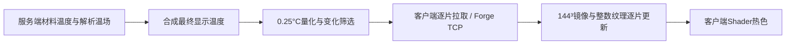

# 红外视野的数据路径与现场诊断

- Status: `Current; local WAN timeout reproduced and fixed; reported overseas-client cause remains unconfirmed`
- Last verified: `2026-11-08`
- Scope: 红外温度来源、传输内容、接收驱动分片、渐进显示、生命周期及客户端/服务端诊断
- Code anchors: `FHRequestInfraredViewDataSyncPacket`, `FHContinueInfraredViewPacket`, `InfraredTransfers`, `InfraredCapture`, `InfraredBrickCodec`, `InfraredDisplayCache`, `InfraredViewRenderer`, `InfraredDiagnostics`, `InfraredClientCommand`, `InfraredServerCommand`

## 数据路径

服务端继续拥有物理热模拟和材料状态。`InfraredCapture`读取既有材料温度，再按原优先级合成能量塔等解析场；不因红外读取而创建物理驻留。网络发送最终显示值，不发送求解矩阵、材料焓或完整模拟状态。具体温度权威和合成公式见[世界温度](world-climate-and-temperature.md)。

有限显示值的编码为 `q = clamp(round(4 * T), -32767, 32767)`，T单位°C，q为有符号short；`-32768`专用于缺失数据。0.25°C是显示量化步长，不是物理模拟步长。场合成在量化前完成。

业务数据是温度标量，同时需要Brick地址、窗口中心、覆盖/删除位图和提交编号，使客户端能定位、合并或清除已有值。每个Brick表示4³个方块：全相同值用一个short，多个值按字典或64个short择小；缺失值有独立编码。ACK只结束一次请求，不代表收到温度。

网络合同和带宽测量由[数据生命周期与集成](data-lifecycle-and-integration.md#network-and-consumers)维护。固定场去重、窗口重叠和8MiB计量显示缓存属于派生数据优化，不决定真实温度是否存在；缓存miss会重发。

## 蓝色不等于已经收到温度

缺失数据采用蓝色占位，而有效值不高于色标下限−20°C也呈蓝色。因此只看蓝色，不能区分尚未回复、空窗口、分片尚未提交、真实冷温度或显示异常。

客户端最多一个未完成请求。FIRST开始CPU暂存并上传收到的附近Page，后续每片上传变化Page；缺失位置保持INVALID/蓝色。即使`staging=true`、`commits=0`，已收到的热源也可以显示。LAST才提交完整增量基准、覆盖位图和epoch，并结束pending；部分显示不能作为下一次delta的基准。慢响应不被固定2秒编号更新淘汰。

`InfraredTransfers`保存每名观察者的当前回复，首次只发送一片。`FHContinueInfraredViewPacket(requestId,nextPart)`在客户端完成处理后申请下一片，LAST也有接收回执；通常requestId和part均较小时正文只有2B。首片上限32KiB，后续片上限128KiB，均预留2048B头部预算；按附近Section优先编码，避免先等待整片远处温场。回复在LAST回执、取消、被新请求取代、离线、换维度、世界卸载或停服时释放。状态意外缺失时发送ACK，让客户端保留可见部分并按既有节奏重新获取full。传输期间按1秒游戏时间维持现有物理输入的红外变化跟踪，不启动新的物理驻留。

144³窗口包含729个16³ Section；实际只发送选中的温度记录。全RAW理论上限为46656个Brick×131B，约5.83MiB记录正文，再分为多个受回执控制的片；这不是普通篝火场景的实际包大小。此方式限制单次排入连接的红外数据，不保证任意带宽、其他模组负载和TCP拥塞下的固定首色延迟。固定场的带宽结果不能代表所有首次full。

网络通道后缀为`:infrared-stream-1`，客户端和服务端均需实现继续/取消/最终回执合同；0.7.11构建包含此合同。

材料之外的实体遮挡仍按既有环境显示近似处理，不是实体体温测量。扫描范围64格、色标、alpha和地形归属规则见世界温度文档；诊断不改变这些规则。

## 现场诊断

诊断命令本身不改变显示状态（`resync`除外）。以下命令只查询玩家自己，不要求队长或OP；客户端命令只在本地执行，服务端命令通过普通聊天命令路径查询。

1. 在有问题的客户端启用 `/fh_ir trace true`，并执行 `/fh_ir_server trace true`。
2. 保持同一个热源和位置，按I关掉再打开，观察一次请求过程。
3. 执行 `/fh_ir status` 和 `/fh_ir_server status`，保存两行输出。
4. 客户端`latest.log`查看`IR_CLIENT_SEND/PART/ACK/COMMIT/REJECT`；服务端日志查看`IR_SERVER_REQUEST/RESPONSE`，按玩家和请求编号对应。
5. 执行 `/fh_ir trace false`、`/fh_ir_server trace false`结束本轮跟踪。

`/fh_ir resync`释放当前等待并请求新的full，保留显示直到替换；它是主动重同步，不是故障原因证明。跟踪默认关闭，客户端退出世界及服务端离线/停服会清除对应跟踪状态。

| 观察 | 能证明什么 |
|---|---|
| 客户端sent增长，服务端没有对应REQUEST | 请求未进入该服务端红外处理器；需要核对这段实际链路 |
| 服务端RESPONSE有validSamples，客户端没有PART/ACK | 服务端已生成回复，客户端处理器尚未观察到该回复 |
| 客户端PART增长但commits不增长，staging=true | 已开始渐进显示，完整基准尚未完成LAST提交 |
| commits增长、validMirrorSamples>0且maxC>−20，仍全蓝 | 数据已进入客户端镜像；继续检查上传、地形深度捕获和Shader采样 |
| 服务端full探测NO_VALID_SAMPLES | 该次查询未产生有效温度，不应先归因为带宽 |
| 有效值的maxC≤−20 | 蓝色可能是合法色标结果 |

客户端状态包含open、pending、waitMs、请求/回复/ACK/提交/忽略计数、staging、基准有效性、镜像有效样本数及范围、纹理存在、实际叠加帧计数和最近地形深度标记。`validMirrorSamples`描述CPU数据，不能单独证明GPU上传及最终着色成功；`commits`描述完整基准次数，不计部分显示。

服务端`status`强制读取当前位置完整显示，绕过显示去重基准，不改变客户端事务；它与“那次回复真的发送/接收”仍是两个证据。其Summary区分NO_SNAPSHOT和NO_VALID_SAMPLES；普通请求的NO_SNAPSHOT也可以表示没有变化，trace中的delta只统计变化记录。客户端PART的accepted只表示编号/开关匹配，最终提交以COMMIT为准。需要将客户端和服务端同一请求的日志合看。

## 验证边界

### 持续开启红外时的自然冷却

`--cooling-only`使用露天单个真实煤燃料篝火，解析场为0；目标铁块保持原位，点火/熄灭之外不改动它，客户端保持红外开启，不调用resync或重连。2026-11-08的两轮均通过：开发图形库组合以及整合包的Embeddium0.3.31/Oculus1.8.0组合。此处仍采用Forge47.3.0开发启动，不能等同于完整整合包或远端运行。

本次场景在熄火后约53游戏秒自然退出目标材料记录。实际网络值从温度量化值−41回落到−42，再变为INVALID；GPU及目标方块像素自动跟随。同页仍有其他有效材料，目标清除包为`full=false`，不是整页清空或全量重同步。独立完整读取在清除包生成之后约4秒才执行，同样读到目标INVALID，没有给客户端发送full。两条慢连接均只建立一个TCP会话。

报告的“重进后归零”只观察了刚进入时的状态，未提供首包完成后的材料温度对照。`InfraredViewRenderer.reset`会清空显示缓存，首包前也会显示无数据蓝色；这不等于实测0°C，也不能单独证明服务器已经冷却。当前两轮没有复现持续冻结，本轮没有据此更改生产同步逻辑或宣称现场问题已修好。自然散热时间受真实热容量和边界换热影响，不应把等待时间本身当成冷却完成的判断。

具体曲线、实际增量包和GPU/像素证据见[自然冷却验证](validation/infrared-natural-cooling-2026-11-08.json)。首次封闭房间长测遇到测试文件读写竞争，停止前材料仍有余热、实际回包与GPU一致；测试文件现用原子替换，并重试瞬态缺失，未将该I/O失败归因于热模拟。

解析温度修正区与连续空气后端是独立机制。真实篝火通过燃料、物理热源和连续Air/材料传热供热，不会注册下面压力测试中的解析场。红外的物理分支读取后端已发布的材料温度，解析场只在最终取样处合成；网络不发送连续空气求解器的完整系数、矩阵或全部Air体素。约2MB压力正文来自测试驱动创建的192个局部球形ADD_DELTA区及全窗口零增量覆盖，不能用来代表篝火或连续空气后端的日常流量。

真实后端联机验证为脚本默认场景（也可显式使用`--physical-only`），驱动为`InfraredPhysicalE2e`与`InfraredPhysicalE2eClient`。该轮已通过：5个真实煤燃料篝火，使用打火石点火、铁铲熄灭，全程解析场为0。近源连续Air明显高于远处，发布为8项基函数；目标材料来源为LIVE，从约−10.90°C升至约−10.34°C。客户端按较早的实际网络采样显示−10.50°C，两端GPU均精确匹配独立解析的对应display包；最终像素符合该温度的色标。熄火后Air下降，材料仍可能受余热继续升温，不能要求它立即变冷。删除材料清除GPU旧值；重新放置后等待区块网格更新，画面也不沿用旧热色。

本轮慢客户端最大温度回复正文770B、经实际Minecraft压缩及Forge封装后的最大帧515B，整轮红外服务端下行（含ACK）3352B。它不包含其他游戏数据、C2S、TCP/IP头或重传，也不是所有大型基地的上限。该场景的数据量不能与约2MB的人工全窗口解析负载混称。

本地复现入口为`python Scripts/run-infrared-network-e2e.py --java "C:/Program Files/Java/jdk-17/bin/java.exe"`，默认运行真实篝火/连续Air场景，只写`build/infrared-network-e2e/`。脚本通过独立init脚本导出当前工作区Forge启动参数，逐次准备后运行专用服和两个隐藏窗口客户端。`--root`指定运行目录；`--offline`使用已缓存依赖；`--gradle-init`可追加现有构建环境配置。`--analytic-stress-only`单独运行人工参考和传输压力测试：300ms RTT、3s RTT、3s RTT+16KiB/s全窗口、同限制下192个重叠解析场，以及快客户端关闭红外的单慢观察者场景。这些解析场轮次记录40→60°C、删除恢复、GL_R16I读回及PNG颜色变化，渐进显示另记录preview；不代表连续Air的供热模型或典型流量。代理模拟TCP传播延迟和限速，不注入丢包或模拟重传。

此前带宽与状态测试覆盖服务器查询、编解码、窗口镜像和事务逻辑。2026-11-08新增真实专用服、两个真实客户端、保序TCP延迟/限速代理、GL_R16I读回和PNG验证。旧版在300ms RTT、3s RTT和3s RTT+16KiB/s的570328B场景能显示、升温及删除恢复；192个重叠参考场产生1987907B/三个旧分片时，慢客户端尚未收到第一片即被服务器判定Timed out，而快客户端正常。该本地故障支持修复发送排队，但不能单独确认它就是那位国外玩家遇到的全部原因；现场是否同时发生连接超时尚未核实。

人工解析参考/传输压力的五轮也全部通过，GPU温度依次为40°C、60°C、移除后约−11°C，冷参考始终−40°C；PNG也验证热色出现与退去。最终首片32KiB的约1.99MB压力场在打开后约3.54s显示附近热色（`staging=true, commits=0`），约133.85s完成全量基准，随后升温、删除更新通过且没有超时断线。只有慢观察者开启红外时约3.58s显示附近热色、22.94s完成窗口，后续为delta，没有反复全量下载。时间是本次实际运行中的采样观测，非固定延迟承诺，也不是物理后端的供热速度。24项GameTest及assemble通过。

完整数字与范围见[验证摘要](validation/infrared-streaming-e2e-2026-11-08.json)；真实篝火供热及拆除重放置后的冷状态已在同一慢客户端验证。所有E2E驱动仅在显式JVM属性开启并且加载gameTest源集时运行，不进入生产JAR。开发运行库为Forge47.3.0、Embeddium0.3.31-beta.53、Oculus1.7.0；没有将其冒充整包全部模组、远端GPU或真实跨国路由的等价环境。
