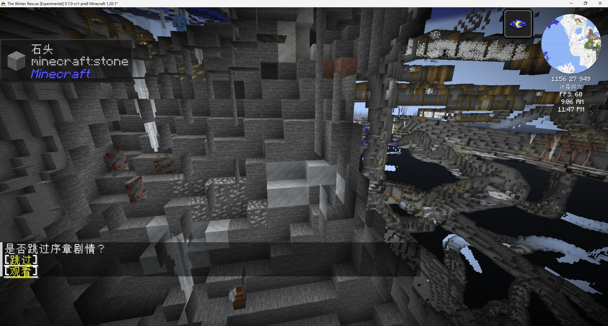
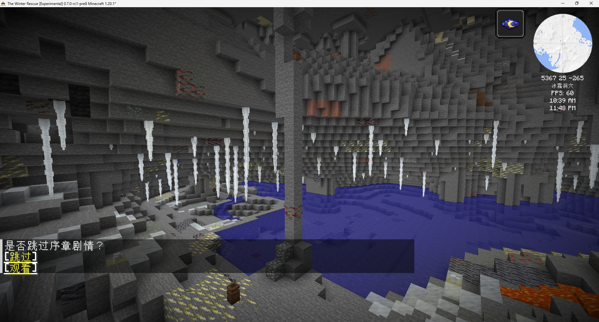
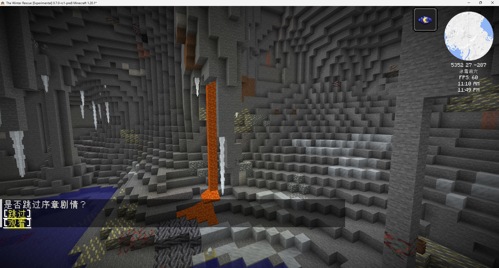
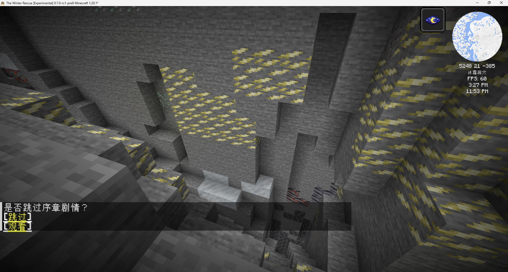

# 冰霜洞穴首版实现详解与实测对照

- Status: `Partial`——已核对本版源码、整合包数据、既有测试记录和用户截图；景观未达到用户预期，自然温泉与最终平衡未验收。
- Last verified: `2026-10-22`。
- Author: `OpenAI Codex；实现说明与反馈整理`。
- Scope: 当前 `the_winter_rescue:ice_caves` 的地形依赖、冰面、冰锥、晶体、矿物、温泉及实际观察；供用户据此提出下一版修改意见。
- Version: FH `7f1682104`；TWR `43073952`；两库分支均为 `ice-caves`。
- Code anchors: `IceCaveSpace`、`IceCaveSurfaceFeature`、`IceCaveSpringFeature`、`IcicleFeature`、`CavePyrolusiteFeature`、`FHBlocks`、`FHFluids`、`PlayerThermalModel`。
- Data anchors: TWR `worldgen/biome/ice_caves.json`、`worldgen/placed_feature/cave/ice_*.json`、`cave/icicle.json`；FH `biome_temperature/ice_caves.json`。

本文说明当前已经写入代码的行为。截图反馈、实现局限和待验收项分别标注；未把拟议改法写成已实现功能。具体玩法代码与数据仍是最终依据。

## 1. 先看结论：现在实际生成了什么

当前版本在既有洞穴骨架上增加了零散冰斑、下垂冰锥、少量晶体、较高密度矿物，以及需要严格地形条件的温泉候选点。它没有完成连续冰壁、整湖薄冰和大片冰刺群的景观组合。

| 要素 | 当前行为 | 用户观察或实现差距 |
| --- | --- | --- |
| 洞穴形状 | 沿用 TWR 原有噪声、雕刻器、含水层与结构 | 巨大洞厅、岩柱、矿井仍是原有地形体系的结果 |
| 冰壁与冰面 | 在找到的洞底附近做约 5×5 范围的小块替换 | 高墙、洞顶没有连续覆冰；裸岩仍占主体 |
| 薄冰湖 | 宽厅偶尔产生一个单格水坑和一块薄冰 | 没有给现有洞内湖泊铺整片薄冰 |
| 冰锥 | 寻找洞顶后向下放置 1～8 格长的功能冰锥 | 没有地面向上的大型冰刺，也没有统一的冰刺群落布局 |
| 冰晶与荧石晶体 | 宽厅冰斑附近可出现一组；温泉入口另有局部标记 | 依赖前置冰斑成功，实际样本很少 |
| 矿物 | 普通矿脉算法配合较高尝试次数，额外加入软锰矿 | 用户看到高暴露率和大片相邻矿物；普通矿脉配置过密 |
| 温泉 | 尝试在深部宽厅找到稳定盆地，放置一格深温泉 | 人工池功能已测试；自然池出现频率未确认 |

这版实现侧重了“小范围替换、保留裸石、不改变洞穴骨架”，但没有对连续冰覆盖率、整片湖面和大型冰刺景观建立生成规则。它与用户明确提出的视觉目标存在实质差距。

## 2. 版本、部署和文件分工

2026-10-21 本地提交后，开发实例的 `.minecraft` 仓库已从 TWR 本地仓库同步到 `43073952`，位于：

`D:/games/minecraft/prismlauncher/instances/The-Winter-Rescue-Development/.minecraft`

实例使用重新构建的 `mods/frostedheart-1.20.1-0.7.7.jar`。源码提交与整合包提交分别管理；只更新整合包 JSON 不会获得新方块和 Java 生成器，只更新 JAR 也不会自动更新整合包的生成频率。这次部署没有 push。详见[部署日记](../../diary/2026-10-21_23-24-20_ice-caves-local-test-deployment.md)。

| 仓库 | 负责内容 | 主要入口 |
| --- | --- | --- |
| FrostedHeart | 方块、物品、液体、生成算法、体温接入、流体采集限制 | [FHFeatures.java](../../src/main/java/com/teammoeg/frostedheart/content/world/FHFeatures.java)、[FHBlocks.java](../../src/main/java/com/teammoeg/frostedheart/bootstrap/common/FHBlocks.java)、[FHFluids.java](../../src/main/java/com/teammoeg/frostedheart/bootstrap/common/FHFluids.java) |
| TheWinterRescue | 哪个群系使用哪些生成器、次数、高度、矿脉尺寸 | [ice_caves.json](../../../TheWinterRescue/kubejs/data/the_winter_rescue/worldgen/biome/ice_caves.json)、[placed_feature/cave](../../../TheWinterRescue/kubejs/data/the_winter_rescue/worldgen/placed_feature/cave) |

这些世界生成改动只作用于新生成地形。已有区块不会补涂冰、重新布矿或补建温泉；方块生成后继续服从现有方块、流体和温度运行规则。

放置配置使用 `minecraft:biome` 筛选候选入口；自定义生成器并未对每一个将要改写的相邻方块再次核验群系。因此局部冰斑或池体不是沿三维群系边界逐格裁切的，边界处的实际表现也需要观察。

## 3. 地形骨架与生成顺序

### 3.1 洞穴主体来自哪里

本次没有新增独立维度或新的洞穴群系，也没有重写大型洞穴形状。

- TWR 的 [normal 世界预设](../../../TheWinterRescue/kubejs/data/minecraft/worldgen/world_preset/normal.json) 使用多噪声群系选择，已有 `the_winter_rescue:ice_caves` 条目。
- [overworld 噪声设置](../../../TheWinterRescue/kubejs/data/minecraft/worldgen/noise_settings/overworld.json) 引用 `the_winter_rescue:overworld/noise_router/twr_final_density`。
- [twr_final_density](../../../TheWinterRescue/kubejs/data/the_winter_rescue/worldgen/density_function/overworld/noise_router/twr_final_density.json) 为 `min(原版 final_density + biome_addition_density, biome_excavation_density)`。这些是已有骨架，本次没有调整。
- 冰洞群系保留 `minecraft:cave`、`minecraft:canyon` 雕刻器；地下水还受含水层影响。
- 矿井等结构、地下熔岩湖、水泉和熔岩泉没有被本次功能移除。截图中的矿井和熔岩，因此不代表温泉生成器在放置这些内容。

群系 JSON 的 `temperature: 1` 是 Minecraft 群系参数；FH 的[冰洞温度配方](../../src/generated/resources/data/frostedheart/recipes/biome_temperature/ice_caves.json)为附加修正 `-5.0°C`。它不表示洞内恒温 -5°C，实际温度还取决于气候、深度及当前温度系统。

### 3.2 本次内容处在什么阶段

下表编号是群系 `features` 数组的零起始阶段索引；表内只概括与本次有关的内容，不穷举全局 biome modifier。

| 阶段索引 | 当前冰洞群系中的相关内容 |
| --- | --- |
| 0 | `the_winter_rescue:cave/icicle` 功能冰锥 |
| 1 | 原版地下与地表熔岩湖 |
| 2～3 | 紫水晶晶洞、地牢 |
| 4 | 新增 `ice_cave_spring` 温泉 |
| 6 | 新增冰洞矿物、软锰矿，以及原有原版矿物和石材等 |
| 7～8 | 虫蚀石、水泉、熔岩泉 |
| 9 | 发光地衣、新增 `ice_cave_surface` 冰面与晶体 |

这带来两个实际关联：

1. **矿物先于冰面生成。**后面的冰面只替换石头、深板岩、凝灰岩，矿石会被保留下来，不会被冰面规则覆盖。
2. **温泉先于后续装饰生成。**冰面生成器会避开温泉水旁边的地面，保留池岸；但“温泉前的地形符合条件”不等于整个后续生成过程一定保留该位置不变。

## 4. 如何区分宽厅和窄道

代码：[IceCaveSpace.java](../../src/main/java/com/teammoeg/frostedheart/content/world/features/IceCaveSpace.java)。

当前没有把整个洞穴识别成一个“房间”。每次生成在一个候选点附近局部检查，满足下列条件才算宽厅：

1. 候选点开始向上连续 5 格均为空气。
2. 东、西、南、北至少 3 个方向可连续走出 4 格。
3. 每个方向检查的通道都有两格高空气。

因此，这只是**候选点附近的空间判定**。同一大洞厅中的岩柱旁、斜坡边、低矮平台，都可能被判为非宽厅；它没有输出整个洞厅面积、宽度或危险等级。

地面寻找 `findFloorAir` 要求脚部和头部位置为空气，下面有可接受地面。景观与温泉的地面只接受 `stone`、`deepslate`、`tuff`。软锰矿使用的 `nearWideAir` 则接受上表面坚固的地面，包括矿石与冰，避免已经放置的矿石改变空间分类。

`nearWideAir` 在水平偏移 `-3、0、3` 的九个位置搜索附近地面，垂直搜索范围为上下 5 格。没有找到宽厅时按另一档概率处理；这包含窄道附近和无法找到空气的岩体内部，不能把所有这类矿脉都理解成“已确认在窄洞里”。

## 5. 冰面、冰壁与薄冰：当前算法逐步说明

代码：[IceCaveSurfaceFeature.java](../../src/main/java/com/teammoeg/frostedheart/content/world/features/IceCaveSurfaceFeature.java)。配置：[ice_cave_surface.json](../../../TheWinterRescue/kubejs/data/the_winter_rescue/worldgen/placed_feature/cave/ice_cave_surface.json)。

### 5.1 尝试入口

- 每区块 32 次候选尝试。
- 原始候选高度均匀分布在 Y=-48～40。
- 水平坐标先被限制到当前区块本地坐标 4～11，随后上下搜索最多 8 格，找到第一处合格洞底。
- 找不到就结束该次尝试；32 次不是 32 片成功冰面。

限制坐标使本次写入留在当前区块，但也会将原本分散的候选点压向区块内部。它没有补偿区块边缘覆盖，也没有跨区块拼接连续冰片的机制。这个限制属于现有实现取舍；不是“世界生成只能在区块中心做”的引擎要求。

### 5.2 真正替换的区域

找到洞底空气坐标 `floor` 后，遍历 `dx,dz=-2..2` 且 `dx²+dz²≤5` 的 21 个位置。这些位置**全部使用同一个 Y**，不会逐列跟随斜坡上下找表面。

每个位置执行：

1. 当前位置不是空气则跳过。
2. 正下方是石头、深板岩或凝灰岩，且不紧邻温泉时，以 2/3 概率替换为 `minecraft:ice`。
3. 对当前空气格同一高度的四个水平相邻方块，各以 3/4 概率将可接受岩石替换成普通冰。

这里的“保留约三分之一石面”只指**一次尝试中的合格地面格**，不是全洞最终保留比例；重复尝试还可能继续改动先前留下的岩石。

当前没有沿高墙向上扫描、给洞顶涂冰、沿不规则表面连片生长、增加多层冰壳厚度，或主动用浮冰/蓝冰制作大块冰体。实现所谓“冰壁”，主要是洞底同一高度紧邻空气的一圈小墙面。

### 5.3 薄冰究竟如何生成

只有“判为宽厅并且这次确实替换了岩石”的尝试，才有 1/8 概率进入薄冰分支。随后只选一个位置，再检查该处有两格空气、下面已经是冰、再下面是可接受岩石。

成功后，生成器把下层岩石换为水，把上层冰换为 `frostedheart:thin_ice`。这是**一块薄冰盖着一格新挖出的水坑**。

它没有检查既有湖面、没有追踪湖岸、没有给含水层水面成片结冰，也没有为整片冰湖规划厚薄分区。截图 2 的大湖不会因为这条分支而整湖结冰。当前也没有在这里放置 `layered_thin_ice`。

薄冰放置后的踩踏、跑步加速开裂、冲击、热裂与回冻，复用既有系统，见[薄冰说明](../climate/thin-ice.md)。生成形态不足和薄冰方块本身是否会开裂，是两件需要分别验收的事情。

### 5.4 为什么截图仍以裸岩为主

由代码直接可知：尝试只寻找局部洞底，垂直范围有限；每次只改很小且同一高度的片区；大面积高墙与洞顶不在处理范围；矿石以及其他不在三种岩石名单中的方块不会被这条规则改成冰。

这些条件足以解释初始覆盖不足。普通冰生成后还可能受既有温度/相变机制影响，但目前没有对截图位置做生成前后追踪，不能将实际缺冰数量归因于“先生成后融化”。

## 6. 冰锥和“密集冰刺”的区别

代码：[IcicleFeature.java](../../src/main/java/com/teammoeg/frostedheart/content/world/features/IcicleFeature.java)、[IcicleBlock.java](../../src/main/java/com/teammoeg/frostedheart/content/climate/block/IcicleBlock.java)。配置：[cave/icicle.json](../../../TheWinterRescue/kubejs/data/the_winter_rescue/worldgen/placed_feature/cave/icicle.json)。

当前复用之前开发的 `frostedheart:icicle` 功能冰锥，替换了原先普通冰柱式的配置。主要步骤如下：

1. 配置连续使用 `count=50` 和 `count=5`，即过滤前名义上每区块 250 次候选；最终成功数量远低于该值。
2. 采样高度 Y=20～75，并向上扫描最多 8 格寻找实心顶面。该高度是入口范围，最终根部位置可能因扫描而变化。
3. 根部必须为空气，上面的支撑面必须向下坚固。
4. `hasNearbyRoot` 检查水平 ±2 格、垂直 ±1 格范围内是否已有冰锥根部；有则拒绝，形成主动间隔。
5. 目标长度为 `clamp(round(2 + Gaussian(0,1) × 3.75), 1, 8)`；只沿连续空气向下生长，遇到障碍提前停止。
6. 放置根、身、尾、尖的对应形态。

所以继续增大 count 也不意味着冰锥可以无限变密：顶面条件、空气条件和根部排斥都会限制结果。世界生成入口又集中在这段高度，深部不能依靠同一配置获得相同覆盖。

当前没有向上生长的大型地面冰刺、粗细变化的实体冰塔、多个冰刺组成的景观簇，或围绕湖岸分配密集区域的规则。用户所说的“密密麻麻的冰刺”若包含这些造型，当前实现没有覆盖。

放置后，冰锥仍使用既有生长、材料温度、断裂、坠落与滴水机制；自然长度上限为 8。房檐冰溜子 `eave_icicles` 是另一个已有方块，本次没有把它设为冰洞的主要群落生成器。详见[冰锥说明](../climate/icicle.md)与[冰溜子说明](../climate/eave-icicles.md)。

## 7. 冰晶、荧石晶体与资源表现

### 7.1 放在哪里

普通晶体生成依附于第 5 节冰面尝试：先满足宽厅且改动过岩石，再在附近尝试最多 8 个空气位置。找到相邻冰块后，将该冰块换成荧石晶体块，并在它旁边放一个可附着的冰晶；成功即结束，所以单次冰面尝试最多生成一组。

冰晶支撑不成立时会把荧石晶体退回普通冰。普通晶体不是独立到处散布的装饰；冰面覆盖稀少会连带减少它。温泉入口使用另外一段局部标记代码，可不经过普通冰面分支生成。

### 7.2 方块与掉落

| ID（省略 `frostedheart:`） | 当前外观/行为 | 来源与掉落 |
| --- | --- | --- |
| `ice_crystal` | 基于 `AmethystClusterBlock(7,3,...)`，六向附着的小型半透明棱晶簇；光照 1 | 精准采集才掉本体；失去支撑会破坏 |
| `glowstone_crystal` | 半透明整方块，淡黄色着色 `0xE9D78A`；光照 7 | 无论是否精准采集，都掉 2 个 `glowstone_shard` |
| `glowstone_shard` | 荧石晶体碎片 | 尚无加工链；不是现实 fluorite/萤石，也未作为原版荧石粉标签替代品 |
| `hydrothermal_rock` | 深色玄武岩风格，顶面浅色方解石沉积点 | 温泉底部装饰；掉本体，不供热 |
| `pyrolusite_ore` / `deepslate_pyrolusite_ore` | 暂用既有铅矿视觉表达深色矿物 | 石镐级别；掉 `raw_pyrolusite`，时运影响数量，精准采集保留矿石；默认无挖掘经验 |
| `raw_pyrolusite` | 暂用煤炭物品纹理 | 已有原矿标签，尚无首版加工配方 |

晶体采用既有冰纹理和模型构造；这些是首版临时美术与数值，并未经过最终视觉验收。完整定义见[冰洞方块说明](../climate/ice-cave-blocks.md)。

## 8. 温泉如何选址、造池和回暖

### 8.1 世界生成：频率不等于池子数量

代码：[IceCaveSpringFeature.java](../../src/main/java/com/teammoeg/frostedheart/content/world/features/IceCaveSpringFeature.java)。配置：[ice_cave_spring.json](../../../TheWinterRescue/kubejs/data/the_winter_rescue/worldgen/placed_feature/cave/ice_cave_spring.json)。

当前配置是每区块 4 次候选，每次独立通过 1/2 概率过滤，均匀采样 Y=-40～0。因此平均是**每区块 2 次候选尝试**，不是每区块 2 个泉池，也不是每两个区块必有泉池。

此前每六区块一次候选的设置，在两轮 48 个冰洞内部区块样本中都没有找到泉水源。之后提高了次数；**提高后的自然生成结果尚未完整复测**。

### 8.2 盆地条件

1. 将水平入口限制到本地坐标 7～8，再以水平偏移 `0、-2、2` 检查九个洞底列；实际中心坐标落在 5～10。
2. 每列上下搜索最多 8 格，找到可接受地面。
3. 中心 Y 必须 ≤0；在洞底或洞底上一格能通过宽厅判定。
4. 检查半径约 3 格的 37 列（`dx²+dz²≤10`）：两格下方必须是石头、深板岩或凝灰岩；一格上方必须是空气；中间两层只能是空气或这三种岩石。

这允许局部一格高低差，却不能接受深坑、缺床、矿石铺底或复杂材料混合。候选次数增加不改变这些拒绝条件。

### 8.3 成功后生成什么

- 清掉盆地范围内的一格凸起；必要时给外围浅凹补石，保留干岸。
- 在 `dx²+dz²≤4` 的 13 格位置放温泉源，水面下凹一格，形成最多约 5 格跨度的小池。
- 每个池底独立以 75% 概率使用 `hydrothermal_rock`，25% 使用方解石。这是期望比例，不保证每池精确分成两种固定数量。
- 尝试寻找一个短入口，在距中心 2～4 格内通过局部冰/荧石晶体/冰晶提示池子；不是远距离引导路线，也不保证四周都有标记。
- 后续冰面生成对温泉水旁八邻域地面做避让，保留紧邻池水的石岸。

没有专门生成蒸汽粒子、气泡柱、裸露熔岩热源或供热设备。当前“热液痕迹”主要由池底方块承担。

### 8.4 液体与身体换热

`hot_spring` / `flowing_hot_spring` 使用原版水贴图和浅蓝色着色。源与流动水都参与接触回暖；允许自然流动，禁止相邻源合成无限源；没有桶物品，也没有使其冻结的相变配方。

Forge 液体元数据温度是 311 K 的近似值；玩家接触边界精确使用 `HOT_SPRING_TEMPERATURE_C=38°C`。它没有给周围空气加温，没有设置特殊世界热场或材料初始热量，装饰池底也不提供热量。

玩家每个部位通过实际液体高度算浸泡比例，先处理岩浆，再处理温泉，再处理普通水剩余接触带，避免同一片身体重复计算两种水。温泉复用水的换热路径：

`G_spring = 0.51 × gain × I × A × f / (R_tissue + 1/[100 × (1-W)])`

这里 `G_spring` 单位为 W/K；`gain=64` 是当前暂定温泉倍率，普通水不乘它；`I` 为现有衣物环境交换因子；`A` 为该部位面积（m²）；`f` 为浸泡比例（0～1）；`R_tissue=0.04 m²·K/W`；`W` 为该部位衣物防水比例。接触面积或有效介质系数不大于零时返回零换热，而不是直接计算除零表达式。热功率还要乘水温与该部位温度的差，再进入现有身体能量积分和部位间交换。

额外倍率是用户明确批准的温泉玩法调参，目的是改善一格深浅泡的恢复速度；它不是普通水原本没有换热加成。普通水原有系数为 100 W/(m²·K)、倍率 0.51；空气使用随风等变化的对流系数加 4.7 W/(m²·K)，再乘 0.0824。

一格源水上方为空气时水面高度约 8/9 格。对约 1.8 格高站立玩家，浸泡比例约 0.494：脚全浸、腿约 86%、手约 31%，躯干和头没有直接浸水。实际回暖受露出部位散热、饥饿、衣物、湿身和身体内部交换共同影响，不能理解成直接把核心体温设为 38°C。

离水后接触回暖消失，已有 Wet 效果继续存在。TWR 新世界服务端默认 `temperatureChangeRate=0.5`；已有存档的实际配置要单独核对。完整机制与接口见[温泉说明](../climate/hot-spring.md)和[玩家体温说明](../climate/player-temperature.md)。

### 8.5 采集限制覆盖到哪里

已有实现拦截桶取源、原版玻璃瓶、Create 开口管与软管抽取路径、IE 世界流体抽取助手和 Supplementaries 水龙头提供流体路径。流体自身不支持无限源转换。

桶、实际流动、相邻源不复制、Create 开口管、IE 抽取等已有自动验证；玻璃瓶、水龙头和完整软管滑轮装置仍需客户端交互验收。不能将已写入拦截代码等同于所有整合包搬运方式均已经试玩通过。

## 9. 矿物生成：大小、频率、总量和暴露率

### 9.1 生成方法与宿主

黄铁矿、锌、铅、银采用原版 `minecraft:ore` 算法；软锰矿通过自定义概率门后调用同一个 `Feature.ORE`。生成目标使用 `minecraft:stone_ore_replaceables` 和 `minecraft:deepslate_ore_replaceables`，所以不在冰方块中直接生成矿石。

矿石宿主标签与景观三岩石白名单不同：除常规石材外还会受整合包对石灰岩、玄武岩等标签的扩展影响。不能用“景观只认三种岩石”推断矿物也只生成在三种岩石中。

新增矿脉配置的 `discard_chance_on_air_exposure=0`，不会因为贴着空气而按该参数淘汰。因此洞壁直接露矿是允许的；本版没有专门压低矿物的表面暴露率。后续覆冰又跳过矿石，进一步保留了这些裸露矿点。

### 9.2 群系专属矿脉配置对比

下表不包含全局矿脉和热液晶洞。`count` 是每区块尝试次数，`size` 是原版矿脉算法尺寸参数，不是保证产量或严格几何直径。

| 矿物 | 冰洞 count × size | 冰洞入口高度 Y | 热液 count × size | 热液入口高度 Y | 冰洞/热液尝试次数 |
| --- | --- | --- | --- | --- | --- |
| 黄铁矿 | 13 × 30 | -48～35 | 6 × 30 | -48～35 | 2.17 倍 |
| 锌 | 16 × 20 | -48～35 | 6 × 20 | -48～35 | 2.67 倍 |
| 铅 | 20 × 20 | -48～0 | 2 × 20 | -64～0 | 10 倍 |
| 银 | 16 × 20 | -48～0 | 1 × 20 | -64～0 | 16 倍 |

单次 `size` 与热液相同，但尝试频率高。铅、银还集中在更窄的高度带内。相邻矿脉可能靠近或合并，视觉上形成大矿片；仅凭截图不能判断一整片究竟是一次生成还是多次重叠。

### 9.3 叠加的全局矿物与软锰矿

冰洞没有移除原有全局矿物。按当前配置预算 `Q=count×size`，冰洞黄铁矿再叠加全局 `8×8=64`，锌叠加 96，银叠加 60，形成：

| 矿物 | 冰洞普通矿脉 Q | 热液普通矿脉 Q | Q 比值 |
| --- | ---: | ---: | ---: |
| 黄铁矿 | 454 | 244 | 1.86 |
| 锌 | 416 | 216 | 1.93 |
| 铅 | 400 | 40 | 10.00 |
| 银 | 380 | 80 | 4.75 |

Q 是配置比较量，不能当作每区块实际产出；也没有包含热液晶洞集中提供的黄铁矿、铅、银。全局来源调查见[矿物生成量调查](../worldgen-mineral-generation-estimate.md)。

软锰矿分两档与黄铁矿候选配对：`13×30，Y=-48～35` 和 `8×8，Y=-63～0`。每次候选附近存在宽厅时，以 1/2 概率进入原版矿脉放置；其他情况以 1/4 概率进入。故配置预算分别为黄铁矿 454 的一半 227 或四分之一 113.5。

这不是每个洞厅里矿石方块数一定恰好为一半/四分之一：候选位置、附近空间、可替换岩体、已生成矿石和随机数都会改变最终结果。代码入口见 [CavePyrolusiteFeature.java](../../src/main/java/com/teammoeg/frostedheart/content/world/features/CavePyrolusiteFeature.java)。

### 9.4 为什么当时调高，以及实际调到了多少

初始条件采样中，冰洞铅、银总量显著低于含晶洞的热液群系。为了达到“冰洞资源高于其他群系，银相对少一些”的方向，实现提高了普通矿脉次数；没有给冰洞加入与热液晶洞对应的集中矿床结构。

调整后，三种子样本中的总量确实超过热液，但这项指标没有衡量玩家看到的矿面比例、连续矿片大小、寻找间隔和开采成本。**总量比较通过不能支持“矿物视觉与玩法平衡已经达标”这一结论。**截图反馈已表明本版普通矿脉分布需要重新评估。

下表来自已完成的调整后采样，计入全局矿物以及热液晶洞，每群系合计 48 个内部区块：

| 矿物 | 冰洞方块数 | 热液方块数 | 冰洞/热液实际样本比值 |
| --- | ---: | ---: | ---: |
| 黄铁矿 | 50,831 | 38,133 | 1.33 |
| 锌 | 25,101 | 10,737 | 2.34 |
| 铅 | 26,573 | 12,185 | 2.18 |
| 银 | 20,926 | 12,289 | 1.70 |
| 软锰矿 | 13,499 | 0 | 不适用 |

原始本地结果：[ice-cave-natural-samples-tuned.json](../../build/ice-cave-natural-samples-tuned.json)。该文件在忽略的 `build` 目录，不随 Git 提交；上表保留了核心结果，后续清理构建目录后仍可阅读。

## 10. 四张实际截图说明了什么

来源是用户在开发实例中的观察截图，原图已保存到本目录的 `images/ice-caves-2026-10-22/`，不依赖临时剪贴板路径。截图显示“冰霜洞穴”群系；种子、生成时间与停留时长没有随图提供，因此不能从截图量化全群系覆盖率或温度变化速率。

### 图 1：裸岩、矿井与零散冰

画面坐标约 `(1156,27,949)`；可以看到矿井、高墙、零散冰斑和矿物。旁观视角下有剖面/穿透地形的显示，不能把画面中的所有可见表面都当作正常步行可见洞壁。

### 图 2：大湖没有连片薄冰

画面坐标约 `(5367,25,-265)`；洞顶已有不少下垂冰锥，但大部分岩壁仍裸露，湖面基本为水。这与当前“冰锥单独生成、冰斑局限洞底、薄冰只做单格水坑”的实现一致。

### 图 3：台阶状冰斑、岩壁和熔岩并存

画面坐标约 `(5352,27,-287)`；冰集中于局部低处和台阶，竖直高墙大多仍是岩石。熔岩来源没有被本版移除；目前没有证据说明这里的缺冰主要由熔化造成。

### 图 4：大片黄色矿物暴露

画面坐标约 `(5248,21,-385)`；岩壁出现大片黄色矿物。外观与黄铁矿相符，但截图没有方块 ID 提示，精确矿种仍以准星信息为准。高矿脉尝试频率、允许空气暴露和覆冰跳过矿石，均与这种观感相容。

这些截图支持用户提出的“冰少、湖面没有整片薄冰、矿物过密”的反馈。它们不证明自然温泉是否存在，也没有提供温泉回暖速度的实测数据。

## 11. 已验证与尚未验证的边界

| 项目 | 当前证据 | 能说明什么 / 不能说明什么 |
| --- | --- | --- |
| 编译与部署 | 最新 `compileGameTestJava`、4 项定向 JUnit、`jar`/`reobfJar` 通过 | 源码和诊断测试能编译，新 JAR 已部署；不证明景观达标 |
| 功能 GameTest | 此前组合运行 13 项通过 | 覆盖合成地形、流体、身体接触、掉落及当时采样；不能把后续修改视为同次已验证 |
| 矿物自然地形条件采样 | 种子 111、222、333；每种子每群系 4×4 内部区块，外围增加一圈生成区块 | 使用实际 TWR 噪声、雕刻器、feature 与适用配置；可比较固定群系下的块数 |
| 正常世界分布 | 采样维度强制固定为冰洞或热液 | 没测正常多噪声预设中的群系面积、稀有程度、边界混合和实际寻矿路程 |
| 晶体 | 调整后 48 个冰洞内部区块共 8 个冰晶、8 个荧石晶体 | 样本中相当稀少；不能直接换算所有正常世界每多少区块一个 |
| 冰覆盖 | 同样本计数 5,322 个普通冰/浮冰/蓝冰；热液样本为 4,435 | 计数包含整个采样高度的既有冰，不是新增覆冰量或洞壁覆盖率，不能据此认定冰洞够冰 |
| 自然温泉 | 旧频率两轮样本泉水源均为 0 | 当前提高频率后仍缺完整结果；不能报告自然池已经生成成功 |
| 温泉回暖 | 之前做过 38°C、不同倍率/衣物/饥饿条件的模型与接触测试 | 更新后的静止夹具尚未完整重跑；此前两分钟数字不是用户实际试玩保证 |
| 客户端景观 | 用户提供本节四张截图 | 已确认整体观感不符预期；没有完成修改后的视觉验收 |
| 采集兼容 | 部分 GameTest + 对接路径代码 | 完整软管、水龙头、瓶子和整合包装置仍需实际交互验证 |

测试与采样入口：

- [IceCaveFeatureGameTests](../../src/gametest/java/com/teammoeg/frostedheart/content/world/features/IceCaveFeatureGameTests.java)：合成几何、地面条件、池岸保护、区块边界等。
- [IceCaveNaturalSampleGameTests](../../src/gametest/java/com/teammoeg/frostedheart/content/world/features/IceCaveNaturalSampleGameTests.java)：固定群系自然地形计数；最新增加 CARVERS 阶段盆地诊断，完整运行结果待补。
- [ice_cave_sample_assets.py](../../Scripts/ice_cave_sample_assets.py)：为测试准备 TWR 运行资源，并在结束后恢复；测试资源不进入生产整合包。
- [HotSpringPlayerGameTests](../../src/gametest/java/com/teammoeg/frostedheart/content/climate/player/HotSpringPlayerGameTests.java)：实际液体接触、Wet、回暖夹具。
- 既有日志：`build/ice-caves-tuned-verification.log`、`build/ice-caves-local-deploy.log`；均属于本地构建记录。

## 12. 后续反馈可以怎样对应到实现

用户可以直接引用下列编号提出修改意见；这些只是反馈维度，没有预先确定新数值或授权新设计。

| 编号 | 对应章节 | 可以描述的具体体验 |
| --- | --- | --- |
| A 冰壁/洞顶 | §5 | 希望哪些表面连续覆盖、裸岩保留在哪里、冰层厚薄与颜色 |
| B 冰湖 | §5.3 | 希望湖面覆盖程度、裂隙/水口、薄冰危险区与稳定通路 |
| C 冰刺 | §6 | 顶部下垂还是地面向上、长度粗细、单根间距、哪些区域成簇 |
| D 晶体 | §7 | 亮度、大小、可见频率、与宽厅/温泉的位置关系 |
| E 矿物 | §9 | 单片大小、矿片间距、露在墙上的比例、集中矿床还是分散矿点、总储量 |
| F 温泉 | §8 | 池子大小、自然间隔、发现提示、岸边空间、实际回暖节奏 |
| G 整体 | §3～4、§10 | 小洞道与大冰厅差异、熔岩和矿井观感、探索路线与性能 |

修改意见中的“更多/更少”若能结合截图位置、一次视野、一次探索距离或一片湖面描述，就更容易转换成生成规则。当前所有未验收项继续保留在[交接计划](../../plans/2026-10-21_20-27-26_ice-caves-worldgen-handoff.md)；本文本身没有改动生成参数。
