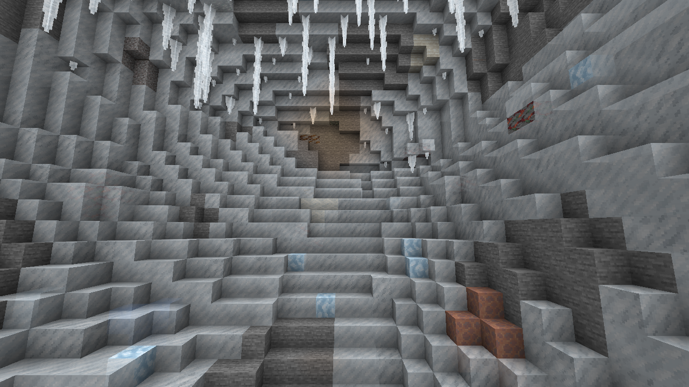
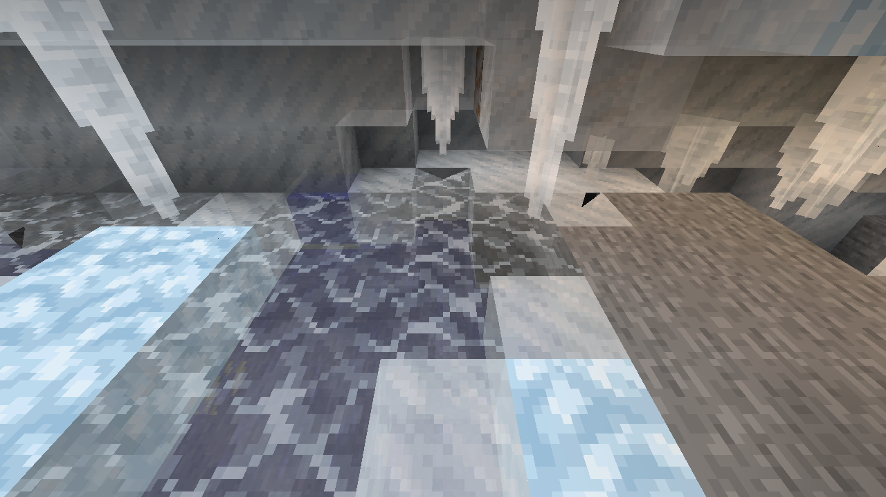
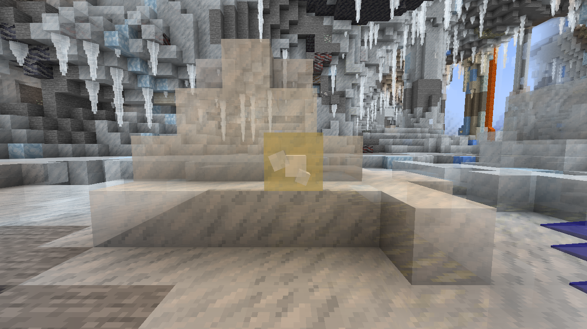

# 冰霜洞穴：第二版当前实现

- Status: `Partial`（第二版源码及当前 TWR 数据已核对；最终 22 项测试及条件矿量采样通过；最终参数正常世界视觉与长期玩法仍待用户验收）
- Last verified: `2026-10-22`
- Scope: `the_winter_rescue:ice_caves` 的覆冰、地下冰湖、大型冰体、薄冰陷阱、晶体、功能冰锥及既有温泉接口
- Code anchors: [`FHFeatures`](../../src/main/java/com/teammoeg/frostedheart/content/world/FHFeatures.java)、`IceCaveSurfaceFeature.place`、`IceCaveIceBlobFeature.place`、`IceCaveLargeIceFeature.place`、`IceCaveSpikeFeature.place`、`IceCaveTrapFeature.tryPlace`、`IceCaveDecorationFeature.place`、`IcicleFeature.placeCaveIcicle`、`IceCaveTerrain`、`IceCaveIceBody`
- Data anchors: TWR [`worldgen/biome/ice_caves.json`](../../../TheWinterRescue/kubejs/data/the_winter_rescue/worldgen/biome/ice_caves.json)、[`worldgen/placed_feature/cave/`](../../../TheWinterRescue/kubejs/data/the_winter_rescue/worldgen/placed_feature/cave/)

本文描述当前工作区的第二版实现，参数为源码默认值或当前 TWR 数据值，不代表最终视觉验收结果。用户目标及尚未验收的比例见[第二版方案](../../plans/2026-10-22_01-04-46_ice-caves-landscape-revision.md)。[首版实现详解与实测对照](ice-caves-implementation-review.md)保留为历史快照，其中的小冰斑、单格水坑、旧生成顺序和旧参数不能作为第二版说明。

## 地形基础、阶段与入口

洞穴主体仍由 TWR 既有噪声地形、含水层、`minecraft:cave` / `minecraft:canyon` 雕刻器和三维群系选择产生。FH feature 装饰已有地形，不替换整套洞穴生成器。仅新生成区块参与，旧区块不会自动重新覆冰。

TWR `ice_caves.json` 的 `features` 按原版 `GenerationStep.Decoration` 执行。相关列表索引从 `0` 起算：

| 索引 / 阶段 | 当前顺序与职责 |
|---|---|
| `4 / UNDERGROUND_STRUCTURES` | `the_winter_rescue:cave/ice_cave_spring`，先放既有温泉 |
| `6 / UNDERGROUND_ORES` | 冰洞专属矿物、普通岩石与原版矿物；全局 biome modifier 还可加入通用矿物 |
| `7 / UNDERGROUND_DECORATION` | `minecraft:ore_infested` |
| `8 / FLUID_SPRINGS` | 原版普通水、熔岩泉 |
| `9 / VEGETAL_DECORATION` | `minecraft:glow_lichen` → `ice_cave_surface` → `ice_cave_ice_blob` → `ice_cave_large_ice` → `ice_cave_spike` → `ice_cave_trap` → `ice_cave_decoration` |

因此先保留温泉和矿体，再处理整体覆冰、宏观冰体、陷阱，最后放晶体及下垂冰锥。下表注册 ID 均以 `frostedheart:` 为前缀，placed feature 以 `the_winter_rescue:cave/` 为前缀，同名 JSON 内嵌 configured feature。大型冰体使用 `LargeDripstoneConfiguration.CODEC`，其余景观 feature 使用 `NoneFeatureConfiguration.CODEC`。

| ID / placed feature 文件 | 每区块配置尝试 | 起点 Y，单位为方块坐标 |
|---|---:|---|
| `ice_cave_surface` / `ice_cave_surface.json` | `placement: []`，整区块扫描一次 | 不以单一起点 Y 决定覆冰范围 |
| `ice_cave_ice_blob` / `ice_cave_ice_blob.json` | `12` | 均匀 `-48..60`，含两端；另有 `in_square`、`biome` |
| `ice_cave_large_ice` / `ice_cave_large_ice.json` | `10` | 同上 |
| `ice_cave_spike` / `ice_cave_spike.json` | `1`，再通过 `chance: 2` 筛选 | 同上；期望 `0.5` 次候选，不等于每两区块生成一根 |
| `ice_cave_trap` / `ice_cave_trap.json` | `12` | 同上；完整坑体预检后仍可能无成功结果 |
| `ice_cave_decoration` / `ice_cave_decoration.json` | `placement: []`，整区块扫描一次 | 同覆冰扫描窗口 |
| `ice_cave_spring` / `ice_cave_spring.json` | `4`，每次通过 `chance: 2` 筛选 | 均匀 `-40..0`；期望 `2` 次候选，保留首版配置 |

`placement: []` 是有意安排：surface / decoration 在被区块群系集合调用后，自行逐格检查三维 `ice_caves`，不会因随机起点群系不匹配而跳过整块深层洞穴。候选型 feature 的成功率仍取决于地形、宿主、实际群系边界、已有装饰及完整体积检查。

## 连续覆冰、高墙与地下湖

[`IceCaveSurfaceFeature`](../../src/main/java/com/teammoeg/frostedheart/content/world/features/IceCaveSurfaceFeature.java) 扫描当前区块完整 `16×16` 列，包括边缘。Y 下限为 `max(IceCaveTerrain.MIN_Y, minBuildHeight+1)`，上限逐列取 `min(IceCaveTerrain.MAX_Y, WORLD_SURFACE_WG-6)`。[`IceCaveTerrain`](../../src/main/java/com/teammoeg/frostedheart/content/world/features/IceCaveTerrain.java) 当前常量为 `MIN_Y=-63`、`MAX_Y=128`，它们是源码边界，不是 TWR 可调字段。

覆盖使用绝对坐标与世界种子的 `SimplexNoise`：`C(x,y,z)=noise(0.075x,0.075y,0.075z)`，种子为 `level.getSeed() ^ 0x1ceca7eL`。`x,y,z` 是方块坐标，噪声值无单位。普通表面当前仅处理 `C<=0.42` 的候选，已由首轮的 `0.35` 调整；这是连续掩码，不是逐格 `80%` 抛硬币，更不是覆盖率已达 `80%` 的证据。验收需分别统计原可见洞底、高墙和洞顶，矿石表面也计入分母。第二层冰壳仍为 `C<-0.35`；湖面材质后来独立校准为下表的 `L<=0.45`。

- `IceCaveTerrain.stone` 接受 `#minecraft:base_stone_overworld`、`#minecraft:stone_ore_replaceables`、`#minecraft:deepslate_ore_replaceables`、方解石、泥土、砂砾和黏土，明确排除 `#forge:ores`。
- 岩格任意六面邻接空气即可直接替换为冰，所以高墙不依赖地面或洞顶高度扫描；普通道路空气不被该分支填满。
- `C<-0.35` 时额外替换相邻自然岩格，形成第二层冰壳；额外层仍限制在本区块、本群系。先收集改动再统一写入，避免本次写入递归改变本次表面判断。第二层在区块边可有厚度差，首层不主动空出边缘。
- 矿石原位保留，在其空气侧包冰。候选反方向必须再有连续 `3` 格空气，即原通道方向至少 `4` 格自由空间；相对两面同时包冰后仍保留 `2` 格。更窄通道允许保留露矿。
- 普通覆冰和包矿避开温泉流体的 `3×3×3` 邻域，保留已有干岸；温泉流体不进入普通水面结冰分支。

表面材质取二维噪声 `M(x,z)=noise(0.065x,0.065z)`，种子为 `level.getSeed() ^ 0x57a1beL`：`0.035<M<0.095` 用浮冰，`-0.095<M<-0.075` 用蓝冰，其余用普通冰。同一 `x,z` 沿高度一致，形成少量偏纵向色带；不保证弯曲、分叉或渐消，也不套用团状冰的 `50%` 材质规则。

地下湖识别“当前格是 `minecraft:water`、正上方为空气”的表面。在扫描窗口和目标群系内，所有这种水面均覆冰，不受 `C` 掩码影响，不修改下层水。湖面噪声 `L(x,z)=noise(0.16x,0.16z)`，种子为 `level.getSeed() ^ 0x1a4e1ceL`：

| `L` 范围 | 水面替换方块 |
|---|---|
| `L<=0.45` | `frostedheart:thin_ice` |
| `0.45<L<=0.62` | `minecraft:ice` |
| `L>0.62` | `minecraft:packed_ice` |

这是连续片区初始参数，目标为约 `80%` 薄冰、`20%` 稳定冰；阈值不是已测比例，也不保证每湖都有完整安全路线。宏观冰体不接受薄冰或流体占位，完整候选碰到它们会放弃；稳定冰可以作支撑或变成另一稳定冰，不能据此挖穿湖面。

## 壁内团状冰、大型冰柱与小型实体冰刺

[`IceCaveIceBody`](../../src/main/java/com/teammoeg/frostedheart/content/world/features/IceCaveIceBody.java) 为三类主体收集完整体积并预检，通过后统一写入。自然石质宿主、方解石、普通冰、浮冰、蓝冰、`frostedheart:firm_ice` 和少量雪块可作基底；结构方块、晶体与流体不作为可覆盖材料。large / blob 允许矿物作为原位夹杂，小冰刺遇根部矿物仍可能被拒。

### 壁内团状冰

[`IceCaveIceBlobFeature`](../../src/main/java/com/teammoeg/frostedheart/content/world/features/IceCaveIceBlobFeature.java) 要求起点为空气，按随机起始方向依次检查四个水平轴，每轴最多 `6` 格寻找岩壁。直径均匀取 `5..10` 格，球心向岩内移 `max(1,diameter/4)` 格。只有部分球体进入原空气、且嵌入格数不少于外露格数时才放置。它不是直接使用原版向下找地面的 `block_blob`，也不是用矿脉近似圆团。

每团统一选材：普通冰 `50%`、浮冰 `25%`、蓝冰 `12.5%`、FH 坚冰 `12.5%`。这是当前实现权重，同团不逐格随机拼色。矿格原地保留并计入嵌入支撑，允许局部矿斑，不为隐藏矿物删除资源。

### 大型冰笋、冰钟乳与部分连接柱

[`IceCaveLargeIceFeature`](../../src/main/java/com/teammoeg/frostedheart/content/world/features/IceCaveLargeIceFeature.java) 保留原版 `LargeDripstoneFeature` 的半径随洞高约束、中心至边缘曲线、逐列 `20%` 高度扰动、向地形内部收根、失败时半径减半及可选风偏。材质改为普通冰，适配干洞宿主、保矿和完整体积预检。不强制补齐上下两端，允许独立冰笋、独立冰钟乳和连接柱。

起点须为空气，沿同列分别找洞底、洞顶。两端间至少 `12` 格净空，洞底附近另需 `5×5` 范围上方连续 `5` 层空气；普通 `IceCaveSpace.isWide` 不能替代此门槛。收根最多检查 `10` 层，完整基底盘检查替代原版少量圆周采样。柱列出岩后遇到对侧自然岩体或矿体即停止，埋入根部的矿格保留。搜索硬上限 `48`，半径硬上限 `6`，当前配置更小。

当前 TWR `ice_cave_large_ice.json` 使用原版 `LargeDripstoneConfiguration` 字段：

| 字段 | 当前数据值 |
|---|---|
| `floor_to_ceiling_search_range` | `40` 格，分别向上、向下 |
| `column_radius` | 整数均匀 `3..5`，含两端 |
| `height_scale` | 浮点均匀 `[0.6,1.1)` |
| `max_column_radius_to_cave_height_ratio` | `0.25` |
| `stalactite_bluntness` / `stalagmite_bluntness` | 各自浮点均匀 `[0.7,1.5)` |
| `wind_speed` | `0.0`，当前无风偏 |
| `min_radius_for_wind` / `min_bluntness_for_wind` | `6` / `0.9` |

`height_scale`、`bluntness`、半径/洞高比均为无单位原版塑形参数，不直接指定柱高。浮点 uniform 格式为 `{ "type":"minecraft:uniform", "value":{ "min_inclusive":..., "max_exclusive":... } }`；整数 uniform 使用 `max_inclusive`。

### 小型完整方块冰刺

[`IceCaveSpikeFeature`](../../src/main/java/com/teammoeg/frostedheart/content/world/features/IceCaveSpikeFeature.java) 保留原版 `IceSpikeFeature` 的向上收尖、截面边缘取舍、局部下部镜像与根形，输出浮冰。地下适配把主体高度缩至 `3..6` 格、半径 `1..2` 格，取消起点抬升和罕见高塔，把 `Y>50` 根须循环换成洞底下 `1..3` 格短根。底部最多点缀四格雪块。

起点上下 `12` 格内找有两格空气且支撑有效的洞底，要求 `IceCaveSpace.isWide`。上部还检查真实空位，避免穿过低顶；根部不接受矿、流体或结构。稀疏程度由当前 `1 × 1/2` 次候选控制，不与顶部功能冰锥密度混用。

## 薄冰陷阱

[`IceCaveTrapFeature`](../../src/main/java/com/teammoeg/frostedheart/content/world/features/IceCaveTrapFeature.java) 在候选起点上下最多 `16` 格找宽厅洞底。`IceCaveSpace.isWide` 要求原点上方连续五格空气，四个水平方向至少三个方向在四格距离内均有两格空气；它描述已存在的空间，不判断洞穴来自噪声还是雕刻器。

`tryPlace` 均匀选深度 `3..12`，等概率选足迹 `dx²+dz²<=2` 或 `<=5`，横向枚举 `[-2,2]`。坑盖位于原洞底表层，深度从盖下第一格算起，坑底下方仍保留支撑。

放置前检查完整坑盖、空腔及外部支撑：每列上方两格为空气；改动体积为自然地基、实体冰或 `forge:ores` 矿格，实际三维群系为 `ice_caves`、当前 worldgen 邻域可写，且避开温泉和干岸；每层水平四侧及下方无流体并有坚固承托面。下层洞穴、水、结构或薄冰会使候选整体放弃，不留半座坑。空腔范围内的矿格随岩体一同挖除，外部侧壁和坑底矿格保留；这与覆冰和大型冰体的保矿路径不同，避免在富矿岩体中几乎无法形成完整陷阱。

仅几何检查成功后抽一次 `random.nextInt(5)==0`：`20%` 概率把整座空腔填普通源水，另 `80%` 填空气，再统一盖 `frostedheart:thin_ice`。不是逐格抽水，也不是仅坑底积水。后续候选不能把已有薄冰/空腔当自然地基挖开。

薄冰继续使用既有机械和热相变行为，没有新破碎机制。断裂、邻水转水及运行时冻融以[气候系统入口](../climate/README.md)和 `ThinIceBlock` 为准；初始干湿比例不保证运行中永远不变。

## 后置晶体与功能冰锥

[`IceCaveDecorationFeature`](../../src/main/java/com/teammoeg/frostedheart/content/world/features/IceCaveDecorationFeature.java) 在冰体和陷阱之后，按与 surface 相同的窗口扫描：

1. **内部口袋**：实体冰格 `1/180` 候选，须六面均为实体冰且避开温泉。相邻冰格换 `frostedheart:glowstone_crystal` 作完整方块支撑，本格留出占位再放 `frostedheart:ice_crystal`；检查 `canSurvive`，失败恢复原冰和支撑。晶簇与完整冰不占同一格。
2. **外露镶嵌**：空气格 `1/120` 候选，须宽敞并避开温泉。相邻支撑格及其后方均为实体冰；支撑换荧石晶体，空气格放朝外晶簇。支撑和晶簇写入限制在本区块、目标群系。它为不透明冰体提供可外露晶体；内部口袋的透视效果仍受冰材质和客户端表现影响。
3. **功能冰锥**：尚为空气且上方为实体冰/自然岩体时，冰下候选概率 `0.42`，岩下 `0.09`。调用 `IcicleFeature.placeCaveIcicle`，向下生成已有 `frostedheart:icicle` 链。

[`IcicleFeature.placeCaveIcicle`](../../src/main/java/com/teammoeg/frostedheart/content/world/features/IcicleFeature.java) 使用世界生成专用间距：只排除四个水平邻格在 `dy=-1..1` 内的已有冰锥，不调用运行时 `IcicleBlock.hasNearbyRoot` 的 `5×5×3` 根部排斥。原 `IcicleFeature.place` 和运行时生长继续用原规则，未修改增长、断裂、伤害等属性。

链长按 `round(2 + Gaussian × 3.75)` 抽取并夹到 `1..IcicleBlock.MAX_NATURAL_LENGTH`；当前上限 `8` 格。遇到非空气、建筑高度边界或实际三维群系边界即停止，使用原根/中段/尾/尖形态，不替换薄冰湖面、坑盖或水。

## 区块、群系及运行开销边界

surface / decoration 的主体写入留在当前区块，逐目标格检查三维 `the_winter_rescue:ice_caves`。表面噪声用绝对坐标和世界种子，不把候选夹到区块中心；覆盖掩码和色带跨边保持同一取样。一次覆冰先读原地形再写，但相邻区块先生成的宏观装饰仍可能影响后续候选成功率。

blob / large / spike 允许正常装饰邻区写入。`IceCaveIceBody.add` 相对原始候选硬限制水平各轴 `±15`、垂直 `±96`，检查 `hasChunk`、建筑高度、`ensureCanWrite` 和每格实际群系。温泉邻岸检查再读一格，因此最大读取边界为水平 `±16`、垂直 `±97`。原位保留的矿格不属写入目标；完整候选遇不可覆盖方块则不写入。

trap 按正常邻区规则跨边，足迹半宽最多 `2` 格、侧壁多读 `1` 格，不夹中心。坑深最多 `12`，坑底支撑再下探 `1`，洞底搜索上下各 `16`；逐改动格检查群系、可写性和完整支撑。

完整 `-63..128` 窗口每个扫描 feature 最多有 `16×16×192=49,152` 个主循环位置，surface / decoration 各一遍，另有表面邻格、晶体和冰锥局部检查。这是循环位置上限，不是方块读取次数或已测耗时。surface 暂存实际改动，三类冰体暂存完整候选并对温泉邻岸读坐标去重；没有无限找洞或主动请求远处区块生成。

大片冰仍进入既有 FH 相变系统；本次未为维持初始比例改变温度或薄冰机制。`biome_temperature/ice_caves.json` 继续是加法 `-5 °C` 修正，不是固定洞温。

## 温泉与矿物状态

温泉逻辑和配置保留首版。[`IceCaveSpringFeature`](../../src/main/java/com/teammoeg/frostedheart/content/world/features/IceCaveSpringFeature.java) 在 `Y<=0` 检查九个附近洞底候选，中心夹在本区块局部坐标 `5..10`；校平一格起伏，凹入生成半径平方 `<=4` 的 `13` 格温泉源并保留干岸。池底期望 `75%` 热液岩、`25%` 方解石，仅为材质；近处和入口的短距离晶体提示保留，不保证长路线。热传输以流体和气候实现为准，温泉不提高整个群系温度。自然频率和回暖效果仍需验收。

**第二版矿物参数与最终条件矿量结果见本文；正常世界露矿观感仍需实际确认。** 下表为 TWR `worldgen/placed_feature/cave/` 的冰洞附加档及软锰矿配对档，`count` 是每区块候选次数，`size` 是原版 `OreConfiguration.size`，不是实际产量或矿脉直径；通用矿物和热液晶洞仍须计入最终对照。

| 文件 / 矿种 | `count × size` | `discard_chance_on_air_exposure` |
|---|---:|---:|
| `ice_pyrite_ore.json` / 黄铁矿 | `10 × 24` | `0.25` |
| `ice_zinc_ore.json` / 锌 | `10 × 18` | `0.25` |
| `ice_lead_ore.json` / 铅 | `14 × 18` | `0.25` |
| `ice_silver_ore.json` / 银 | `10 × 16` | `0.25` |
| `ice_pyrolusite_ore.json` / 冰洞软锰矿 | `13 × 21` | `0` |
| `ice_pyrolusite_ore_generic.json` / 通用档配对软锰矿 | `8 × 6` | `0` |

前四种矿物的暴露丢弃参数用于降低直接露矿的候选，不表示总量恰好减少 `25%`。软锰矿 `size` 从 `30→21`、`8→6` 缩小，原 `13`、`8` 次数未补量；附近宽厅 `1/2`、其他 `1/4` 仍仅是 [`CavePyrolusiteFeature.place`](../../src/main/java/com/teammoeg/frostedheart/content/world/features/CavePyrolusiteFeature.java) 的尝试门控。它不再构成与新黄铁矿预算配对的承诺，也不能推出最终软锰矿恰为黄铁矿 `1/2`、`1/4` 或原总量的 `70%`。方案中的“逐矿种不超过热液两倍”仍须用两侧相同体积、高度范围和种子的最终方块数核验，不能用 `count×size` 宣布通过。

历史统计口径见[矿物生成量对比](../worldgen-mineral-generation-estimate.md)和首版快照。旧 `build/ice-cave-natural-samples-initial.json` / `build/ice-cave-natural-samples-tuned.json` 是首版固定群系条件采样；其资产准备未完整带入 TWR KubeJS 群系标签，也遗漏了部分投影后成员为空但仍应保留的 `replace:true` 标签覆盖。因此旧矿数保留为当时环境的历史结果，不能作为严格忠实于完整整合包的热液对照，更不能证明第二版矿量、覆盖或自然频率达标。

当前 [`ice_cave_sample_assets.py`](../../Scripts/ice_cave_sample_assets.py) 已为新工具补齐这些准备规则：正常预设保留真实群系标签脚本，固定群系采样把脚本中的字面量标签追加投影到选中群系，且保留空 `replace:true` 覆盖语义；同时按实际 pack 引用和配置准备资源。具体采样范围与适配仍应查看当轮生成的清单，工具准备修复不追溯改变旧结果。

## 验证与本地部署边界（2026-10-22）

最终源码运行 `Scripts/ice_cave_sample_validation.init.gradle`，启用 `frostedheart_ice_cave,frostedheart_ice_cave_body,frostedheart_thin_ice,frostedheart_ice_cave_sample`，**22 项 GameTest 全通过**。其中合成地形验证包含覆冰、整湖封顶、3～12 格完整干湿陷阱、开挖矿格而保留外部矿格、冰体与群系/区块边界、晶体支撑，以及既有薄冰行为。日志位于 `build/ice-caves-v2-deployment-final-tests.log`。

验证脚本在 Java 启动前、Gradle 资源处理完成后准备真实整合包资源，避免空 GameTest 群系模板覆盖采样数据。第一次部署复测发生了该覆盖，**该轮自然采样已废弃**；以下仅使用修正后全新世界结果。固定群系环境保留实际矿物宿主 block tags、投影后的 KubeJS 群系标签和空 `replace:true` 覆盖。完成后运行 `python Scripts/ice_cave_sample_assets.py cleanup` 恢复临时资源。

### 最终参数的条件采样

种子 `111 / 222 / 333`，每群系每种子 `16` 个内部区块、额外 `20` 个边界区块；双方统计同体积、同高度并包含全局矿物及热液晶洞。[原始统计](validation/ice-caves-v2-2026-10-22/conditional-final.json)与[逐种子矿量对照](validation/ice-caves-v2-2026-10-22/ore-comparison.json)已保存，不依赖 build 目录。

| 矿物 | 冰洞总块数 | 热液总块数 | 比值 |
|---|---:|---:|---:|
| pyrite | 23811 | 38231 | 0.623 |
| zinc | 14675 | 10786 | 1.361 |
| lead | 15011 | 12191 | 1.231 |
| silver | 8724 | 12319 | 0.708 |

四种有热液对照的矿物在每个种子中均低于两倍；软锰矿没有热液对应物，单独记录为 `6056` 块。这是固定群系条件比较，不代表正常世界的群系出现频率。

按 CARVERS 原可见面加权，最终覆冰比例为：洞底 `77.70%`、岩壁 `80.46%`、高墙 `80.52%`、洞顶 `79.52%`。普通水面 `101` 格，覆盖 `101` 格，其中薄冰 `76` 格。陷阱检测到 `1` 组盖层，完整观察且符合深度、全腔一致条件的干坑 `0` 组、水坑 `1` 组。样本很少时不能据此验收 20% 自然水坑频率；未检出也不等于几何测试通过了自然频率验收。

### 已有正常预设截图

此前真实 TWR normal 预设三个种子的截图与统计已完成，原洞底/岩壁/高墙/洞顶合计覆盖分别为 `82.05% / 79.55% / 79.52% / 78.51%`。图中可见连续高墙覆冰、下垂冰锥与湖面冰盖。[原始记录](validation/ice-caves-v2-2026-10-22/normal-preset-before-final-trap-lake-tuning.json)保留截图坐标。

**这些截图使用最终陷阱与湖比例修正前的参数**：湖噪声阈值仍为 `0.35`，陷阱候选为 `3`，尚未允许挖除坑内矿格；该轮验证环境还缺少随后补齐的部分静态矿物宿主标签。它们证明第二版主体景观已有实际画面，不能冒充本次部署最终参数的完整视觉验收。最终参数的正常世界观感由 Prism 新世界/新生成区块继续确认。本次部署收尾不继续调参。

### 尚待实际体验

Prism 部署用于用户观察第二版，不等于所有景观和玩法均已验收。正常世界最终湖面材质比例、陷阱出现频率与自然干湿比例、大型冰体/小冰刺的观感、长期冻融，以及温泉自然频率和实际回暖仍应分别验证。旧区块不会自动重新铺冰或重新布矿。温泉参数和既有薄冰运行时行为未因本次世界生成修订而调整。
