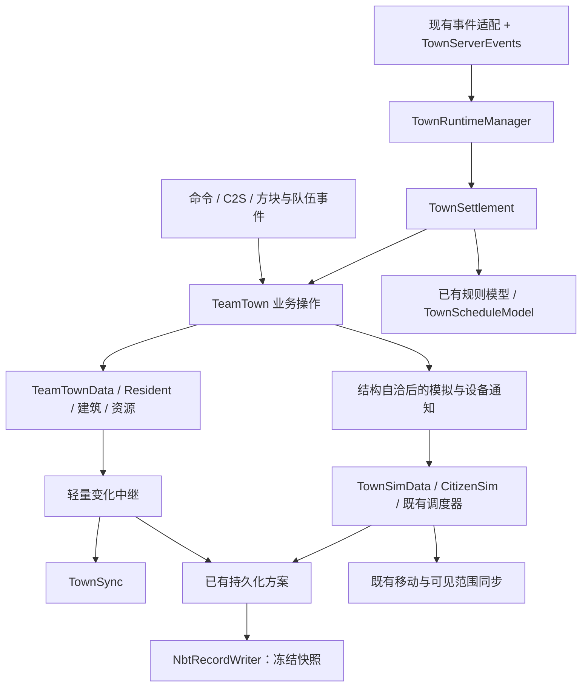

# 队伍与城镇重构：统一实施计划

- Time: `2026-10-19 20:42:32 +08:00`
- Authors: `Codex; OpenAI; primary architecture designer`
- Status: `completed`（基础版实现与本次真实服务端验收完成；实际取舍和未覆盖项见 §17）
- Scope: `Chorda 队伍归属与组件，玩家/AI 城镇的数据、业务、日结算、运行生命周期、居民模拟、网络、持久化及维护合同`
- Related: [当前城镇实现](../docs/town/implementation-reference.md)、[当前居民模拟](../docs/town/hybrid-simulation-architecture.md)、[当前物流](../docs/town/p2p-logistics.md)

## 0. 阅读与实施入口

本文件是唯一有效的实施计划，包含领域、数据、运行、网络、存储、迁移和测试的全部当前规则。旧计划和重复复查文件已合并清理，调查过程保留在 diary。只按 §13 的一份进度表执行；具体存储合同已全部合并到 §16。按照用户最新要求，直接编码，不运行 JUnit；本次新增与仓库原有 174 份 JUnit 源码及对应构建依赖均已删除。代码完成后集中进行构建、真实 Forge 游戏与重启验证，不再启动新的设计或评分轮次。

工程交接与失败路径的修订已并入正文及 §15；实施时需要同时满足正文和工程接线清单，不能只用最初架构摘要。

当前实现先从 [城镇 docs 入口](../docs/town/README.md)核实；目标设计首次阅读先看 §1 的核心决定与 §2.3 的职责表。按 §13 的 M0–M8 实施，单个任务再按下表定位所需合同。新增类名、方法和 NBT 字段是目标合同；实际完成情况以 §13 的状态和源码为准，不能由本文的目标描述推断已实现。

| 本次要做的事 | 从哪里开始 | 对应规则的负责位置 |
|---|---|---|
| 改数值、公式或工作资格 | 对应 model/建筑与实际配置，再读 §4.3、§5 | 原模型/配置拥有公式；§5 只拥有阶段顺序 |
| 改居民属性、建筑字段或玩家计划 | §3、§4、§11.3；首次改造用 §13.1 的岗位目标样例 | 数据所有者、语义操作与变化通知 |
| 改界面或管理同步 | §8，再看 §15.4 的实际入口 | §8 拥有连接基线、信封和重同步规则 |
| 改自动/手动结算时间 | §6 与 §11.2 | §6 拥有时间语义，§11.2 拥有业务完成点 |
| 改创建、换维度、替换或删除 | §7、§15.1 与 §15.4 | §7 拥有生命周期；§15.1 拥有修复调度 |
| 改保存、迁移或关闭 | §9 与本文 §16 的对应章节 | 本文 §16 拥有文件、队列和实际完成合同 |
| 优化某个热点 | §10、对应规则测试与测量记录 | 语义由原业务规则负责，优化不能另定一套规则 |

历史调查过程由 diary 记录，当前有效合同已经并入负责章节。改变规则时先改负责章节，再更新入口/接线引用，不把新含义只追加在另一份报告或文末。

本次范围是这段讨论中的队伍与城镇体系，外加其与世界、气候、研究/知识和原版保存的边界；不重写独立的热求解器、渲染后端、剧情或模组包内容。保持“最小复杂度下的最佳性能实现”：普通 Java 对象、显式方法调用、主线程权威状态、已有纯规则模型、少量有明确生命周期的运行对象。

## 1. 核心决定

1. **一份事实、一个负责修改的入口。** 玩家镇经营事实归 `TeamTownData`，模拟状态归既有 `TownSimData`；两者通过 Resident UUID 关联。runtime、网络和文件不再持有可独立演化的第二套经营状态。
2. **业务状态在服务器主线程修改。** 后台只接收独立输入并返回结果；保存使用共享 I/O 执行器上的单逻辑 drain，导航沿用冻结地形输入。
3. **查询、准备、修改、发布分开。** `get/find/read` 不创建组件、不规范化计划、不更新预留、不标脏。需要修复时显式调用 `reconcile/prepare`，业务改变调用具体动词。
4. **规则与副作用分开。** 规则模型返回结果；业务入口提交状态；模拟/设备监听在相关状态自洽后执行；网络和保存变化分别记录。
5. **保留现有能力与算法基础。** 继续使用队伍组件、居民 SoA、活跃列表、行为分片、AOI、配餐服务、资源 action 和纯规则模型。
6. **时间语义采用本规范 §6 的唯一默认。** 所有玩家镇使用主世界现有逻辑时钟编号，稳定 ID 错峰；只处理新观察到的最新自动机会，不补离线历史；手动命令另行推进经营日。
7. **通过边界和验收维持可读性。** 不引入通用 ECS、Actor、消息总线、事件溯源、依赖注入容器、每个 service 的配套接口或全城事务框架。抽类以独立职责为依据，不以抽象层数为目标。

## 2. 模块、依赖与代码组织

### 2.1 逻辑结构



这是运行数据流图。源码依赖更严格：规则模型不依赖 runtime/网络；数据对象不依赖 manager、世界实例、客户端类或 writer；通过无世界引用的变化回调将结果交给外层。Chorda 仍通过 `TeamRecordExtension` 等既定扩展点接入 FH，不能反向导入 FH 城镇类型。

### 2.2 目标文件布局

```text
com.teammoeg.chorda.dataholders/
  team/                         # 保留身份、组件与扩展点
  persistence/                  # 使用本文 §16 的协调器和 writer

com.teammoeg.frostedheart.content.town/
  TeamTownData.java              # 持久经营数据、Codec、局部变更通知
  TeamTown.java                  # 业务门面、统一增删改与查询
  AutoSettlementState.java       # 小型不可变值对象：自动状态与合法转换；保留原 NBT 字段
  TownAssignments.java           # 包内 helper：名册修复、住房/岗位计划提交
  TownSettlement.java            # 日结算编排；阶段 helper 按业务分组
  TownRuntimeManager.java        # 会话登记、维度分组、attach/replace/detach
  TownRuntime.java               # 包内每镇运行状态与依赖引用；不复制经营事实
  TownSync.java                  # 现有增量缓存、稳定包构造与发送
  model/TownScheduleModel.java   # 纯函数：相位、窗口与日编号；不保留状态
  model/...                     # 保留已有经营模型
  resident/...                  # 保留经营居民与居民规则
  building/...                  # 保留能力、基类和 Codec
  buildings/...                 # 保留具体建筑与既有配餐服务
  resource/...                  # 保留资源类型及 action 执行路径
  transport/TownTransportService.java
                                # 从门面提取端点/P2P操作；复用现有模型与状态
  citizen/...                   # 保留 SoA、行为、移动、导航与同步
  ai_town/...                   # AI 镇持有者；不增加虚假队伍
  network/...                   # 编解码与意图适配；不编排经营
  event/TownServerEvents.java    # 唯一的镇级服务端 tick 收尾入口
  client/TownClientUpdates.java  # 从数据类移出的客户端通知与批次状态
  persistence/TownPersistenceAdapter.java
                                # 使用本文 §16，不另建 repository
```

根包保留几类紧密协作的核心对象，使名册与状态的包内操作不必为了跨层而公开。已有 building、resident、resource 等包不为“整齐”整体搬迁。`TownAssignments` 共享分配不变量；`TownTransportService` 接收明确的状态/依赖，不访问任意全局服务。每镇 Runtime 单独命名为包内 `TownRuntime`，便于直接找到其生命周期字段；结果 enum、小型上下文 record 和变化中继仍优先嵌套，避免只有名字的小文件。

### 2.3 类职责与可持有引用

| 对象 | 负责 | 可以长期持有 | 不承担 |
|---|---|---|---|
| `CTeamDataManager` / `TeamDataHolder` | 内外部队伍身份、组件装卸、记录绑定 | 组件与身份映射 | 住房、结算、导航、界面规则 |
| `TeamTownData` | 当前事实、Codec、局部状态一致性 | 居民/建筑/资源/计划/历史；轻量变更回调 | Level、菜单、设备 watcher、发包、静态客户端监听 |
| `TeamTown` | 业务操作与一致性边界 | 对应 data、需要的具体业务 helper | 全局调度、存储队列、UI 状态 |
| `TownAssignments` | 名册与镜像、住房/岗位应用 | 无跨会话缓存 | 网络、线程、文件 |
| `TownSettlement` | 固定顺序的经营日 | 无全局城镇注册表 | 自动时钟去重、离线追赶、磁盘提交 |
| `TownRuntimeManager` | 当前会话运行对象、按维度分组、生命周期 | 现有数据/模拟引用与少量运行索引 | 另一份持久人口、库存或计划 |
| `TownRuntime` | 一个镇的当前绑定、执行状态和恢复标记 | 该镇 data/sim/facade/helper 引用与运行字段 | 全服调度、Codec、经营算法 |
| `AutoSettlementState` | pending/ready 的合法值与水位转换 | 本规范已有的自动状态值 | 读取世界时钟、执行结算、标脏或发包 |
| `TownSync` | 城镇管理数据的增量和完整输出 | 本会话变化集合与网络基线 | 业务规则、存档版本确认 |
| `TownTransportService` | 端点/P2P操作、拓扑准备和设备通知 | 本镇运行拓扑和已加载 watcher | 自动结算时钟、其他队伍的原始进度 |
| `TownClientUpdates` | 客户端镜像应用后的通知 | 客户端订阅和批次状态 | 服务器权威对象或保存绑定 |

`TownRuntime` 是每个已安装玩家镇的普通对象：引用 holder、data、门面、现有 sim、sync 和 transport helper，另有执行维度、自动窗口观察值、结构脏标记和诊断统计。未能绑定世界时也有 runtime，以便变化追踪和保存不依赖某个 Level 已加载；它不会新建模拟权威副本。AI 通过已有 manager 和能力接口登记，不强制塞入玩家经营 runtime。Runtime 不成为跨包公共业务 API；其他模块取得 TeamTown 或调用 manager 的明确操作，不直接修改运行标志。

Manager 只登记、选择当前对象并按固定顺序调度；分配算法留在 TownAssignments，设备重绑算法留在 transport helper，模拟对账留在既有模拟系统，编码留在 TownSync/存储适配器。遇到职责重叠先把算法放回已有所有者，不再为 manager 新建一套通用 task/processor/service 层。

## 3. 数据架构与不变量

### 3.1 身份

- `holderId`：FH 内部持有者 UUID，玩家镇文件键与稳定调度输入。方法命名为 `findByHolderId`，不使用含义不明的 `get(UUID)` 扩展新调用。
- `externalTeamId`：外部队伍身份，只经 manager 映射；与 owner/player UUID 分开命名。
- `aiTownId`：已有 AI UUID；使用单独索引，避免把玩家与 AI 键的语义混为一谈。
- `residentId`：居民持久 UUID；模拟恢复以此关联。
- `simId`：既有模拟/网络整数身份；数组 `index` 仅在当前访问期间有效，swap-remove 后重新查找。

simId 分配器实际由各维度的 UnmanagedCitizenData 持有，当前调度器保证维度内不冲突；不能据类注释中的 global 字样假定它是新的整服统一 ID。迁维度沿用注销、接管与 ID 修复合同。

沿用这些身份，不为尚未实现的一队多城新增一层玩家 Town UUID。队伍转移保留现有 holder 的语义；替换目标与其运行消费者按本文 §16 交接。

### 3.2 字段归属与变化输出

| 数据 | 唯一所有者 | 持久化 | 修改后失效/同步 |
|---|---|---|---|
| 居民属性、营养、年龄、熟练度 | Resident / TeamTownData | 是 | 居民增量，必要时分配输入变化 |
| 住房/岗位计划、政策 | TeamTownData | 是 | 对应计划/政策包；按既有时点生效 |
| 建筑记录与实际名册 | 建筑 / TeamTownData | 是 | 建筑增量、居民位置镜像、相关拓扑/模拟锚点 |
| 库存及现有占用计数 | TeamTownResourceHolder | 是 | 资源键变化；沿用资源 action 的单位与结果合同 |
| 当日运输服务、日报、历史、townDay | 所属城镇/建筑 | 是 | 对应报告/历史输出；读档不重做生产 |
| P2P关系、端点设置、离线过滤摘要 | 既有 transport 状态 | 是 | 预留、已加载端点和运输视图 |
| 自动结算进度 | TeamTownData 中的 `autoSettlement` 值 | 是，规则见 §6 | 保存版本；调试状态，不进入普通玩家界面 |
| 居民位置/行为等现有保存字段 | TownSimData / CitizenSim | 是 | 既有移动同步与模拟保存版本 |
| 空间格、反向索引、活跃 ID、拓扑快照、watcher | runtime / 既有 sim scheduler | 否 | 按实际失效原因刷新 |
| 发包去重基线、客户端选择/滚动、监听器 | sync / client | 否 | 按会话清理 |

资源字段不能根据 `VirtualResourceType` 这个名字一概认作可丢弃缓存。运输产出与端点推导占用分别处理；派生容量首次读取前由显式 prepare 完成。运行参数读取 `FHConfig`，模型默认值仍由 `TownModelParameters.Defaults` 提供定义来源。不在架构重构中更换数值精度、资源单位或配方含义。

### 3.3 分配权威

建筑名册是当前实际住房/岗位权威；Resident 的 `housePos/workPos` 为反向镜像；玩家计划是分配意图。名册的两种类别分别满足每人至多一项。AI 的显式出生锚点不按玩家住房名册规则处理。

加载/显式修复的顺序固定：先读取旧名册来迁移 `TownStaffingPlan` 的保障目标 → 清除不存在居民引用 → 对重复同类关系按规范化玩家计划顺序、再按 `(x,y,z)` 升序保留一项 → 重建 Resident 镜像 → 恢复模拟。保留合法唯一关系，不在读档时运行新的住房评分、裁剪到当前新配置容量、吃饭或推进经济。容量/工作资格变化在既有业务时点处理。

`TownAssignments` 同时负责正常分配提交与该结构修复，避免各入口复制一套双写逻辑。日结算仍以现有玩家计划、资格和模型输出为准，兼容修复的固定次序不替代正常分配规则。

### 3.4 修改可见性

对外集合返回只读结构视图；不为了每次查询复制整个城镇。只读集合不使里面的 Resident 自动不可变，因此跨模块代码必须使用语义操作；必要的内部 setter 保留，但每个持久字段的真实修改都发出变化通知。初期由存储 `ALWAYS_CAPTURE` 承接尚未接全通知的类型，不能把未接全类型当作干净。

语义操作按不变量范围选择所有者：健康等仅影响单个 Resident 的局部修改可以直接使用该对象的命名方法及已有变化通知，不必再套 TeamTown 转发；住房/岗位、建筑删除等跨对象关系必须经门面/helper 一起维护。资源加减继续使用已有 action 合同。不要把每个标量 setter、每个模拟数组写入都包装成顶层城镇命令。

对象局部 setter、ObservableTownMap 和资源 action 的变化通知只收集 ID/标志和保存版本，不在回调内保存、发包或重入业务。一个逻辑操作可以推进多个版本，网络集合会合并；不要求“一个操作恰好一次版本递增”，也不增加通用嵌套事务计数器。居民出生/退出、设备重绑等外部可观察回调由语义入口在关联状态完成后显式调用。

## 4. 业务调用合同与可读 API

### 4.1 调用边界

```text
命令 / C2S / 方块事件
  → 解析当前 holder 与 runtime
  → TeamTown 的具体业务操作
  → 必要的纯模型 / 小范围候选结果
  → 应用状态与关联索引
  → 模拟 / 设备生命周期通知
  → 返回业务结果；TownSync 按批次输出
```

网络 handler 只解码意图、进入主线程、解析当前归属、调用操作并发送结果。已存在的客户端乐观编辑必须继续得到权威结果：成功向相关成员同步；无变化/被拒也向发起者回送当前值，不能让客户端草稿停在被拒的状态。

查询入口分清 `findPlayerTown(holderId)` 与 `getOrCreatePlayerTown(holder)`。只有建镇/既有 generator 安装等明确业务路径可创建；保存、诊断、UI 查询和索引枚举不得隐式创建。原 `TeamTown.create(data)` 可保留为轻量门面工厂用于兼容/测试/客户端查询，但不承担服务器注册；服务器长期消费者由 runtime 生命周期管理。

建议保持已有公共方法名，以新方法补足语义；以下是应达到的接口含义，不要求用新的命令对象包装每次调用：

```java
Optional<Resident> findResident(UUID residentId);       // 无副作用查询
boolean removeResident(UUID residentId);               // 名册、镜像、sim 一起处理
RecruitResult tryRecruitResident(Resident candidate);  // 正常不足返回明确结果
boolean setStaffingTarget(BlockPos buildingPos, int targetWorkers);
boolean moveHousingEntry(BlockPos buildingPos, Optional<BlockPos> before);
BuildingRemovalResult removeBuilding(ServerLevel level, BlockPos buildingPos);
SettlementResult advanceOneDay(SettlementContext context);
```

布尔返回值仅用于“是否发生变化”已经足够的场合。资源不足、无住房、对象已消失等需要用户反馈的正常结果，用负责业务类内的小 enum/record；不使用消息字符串充当程序分支，也不制造所有操作通用的复杂 Result 框架。

### 4.2 三个必须一致的流程

**招募居民：** 检查 UUID/业务条件 → 计算可用住房或使用既有修复路径 → 安装人口与名册/镜像 → 验证本次已获得有效住房 → 通知模拟出生 → 返回结果。正常不足不留下半个人；保留当前白天只占空位、到晨间才重排全镇的行为。

**移除建筑：** 走现有 `removeTownBlockInternal` 的统一路径 → 移除建筑、其名册与居民精确位置关联 → 更新矿井链接、占地、仓储/拓扑 → 通知已绑定模拟/设备 → 合并网络与保存变化。不存在建筑为幂等无变化；不直接改公开 Map 等待每日修复。

**P2P 配对/改速：** 复用现有候选关系和预留计算 → 检查业务容量 → 一起安装连接与预留 → 失效必要缓存并通知端点。拒绝时保留原绑定/预留。仓库接口使用自己的接纳合同：既有接口被拒时保留原设置，新接口被拒时保存 DISABLED；不能把这条新仓库接口规则推广到新的 P2P 绑定。

### 4.3 配置、世界与研究边界

- 规则模型只接收数值/标识/小集合；Java UUID 等基础值可用，不依赖 Level、注册表查找或静态当前服务器。
- Minecraft 世界读取留在业务适配及既有建筑扫描处，结算只使用本阶段需要的已捕获输入。明确温度来自最近扫描值，不伪装为全天积分。
- 研究/知识经既有 service/API 查询或修改；城镇不复制进度、不修改其原始 NBT。Chorda 管共同所有者，具体系统保留各自业务规则。
- config/定义重载使相关运行参数缓存失效，不在 getter 中重写玩家计划或重新结算当日运输服务。首次版可直接读取现有 FHConfig；真正引入缓存时才加对应失效入口。

## 5. 每日经营流程

自动调度和命令都调用同一个 `TownSettlement.advanceOneDay`。`SettlementContext` 是该类内部的小 record，显式携带 level、holder、town 和需要的当次输入；不传入可查找全模组所有服务的 Context 容器。自动去重在调用者，结算方法只做一日经营。

阶段顺序必须可从入口直接读出：

```text
检查已加载建筑和占地
→ 激活待生效政策，扣每日营养
→ 对账名册与镜像，分配住房与岗位
→ 难民刷新/退出，矿井关联与地形资源准备
→ 重置每日熟练度增长
→ 重置每日服务，重建仓储上限，按顺序生产
→ 运输日报，统一配餐与住宅照护
→ 年龄推进，居民健康/精神/无家与退出处理
→ 资源恢复
→ 记录历史与 townDay
→ 通知模拟刷新最终锚点
```

先原样提取当前顺序、配置开关和通知时点，再做独立行为修正。`TownHousingMealService` 与纯模型直接复用；不复制其实现到新“框架”。阶段是普通方法调用，不用可自由注册/排序的管线插件系统。

最终生产顺序定义为 `getWorkPriority` 降序，再 `(x,y,z)` 升序。岗位/住房依然遵循玩家计划各自的顺序；不要把生产顺序误用于分配排序。

一次经营日在主线程内完成，不跨 tick 暴露半天状态。正常业务不足按既有结果处理。意外程序异常若发生在已修改状态之后，外层记录镇 ID、阶段、自动窗口和异常，重建必要的结构镜像/绑定，保留已发生的事实，不自动从头重跑整天，不伪称已完成日结算。自动尝试标记见 §6，防止下一 tick 重复扣算；其他镇与后续正常操作继续运行。已发生的世界副作用没有通用回滚保证，这个边界不靠后台线程或任意重试掩盖。实现时需用故障注入验证不重复执行与结构修复，不能宣称任意程序缺陷下经济结果都完整。

## 6. 自动时间、手动推进与旧档的最终规则

### 6.1 时钟来源与窗口

自动经营使用**主世界现有 `WorldClimate` 逻辑时钟**，不引入第二个持久化全局时钟。执行结算仍使用城镇实际维度；难民等待与历史标签继续使用现有执行世界日规则。自动编号、世界日历、townDay 和 gameTime 是不同概念。

在服务器 tick END 读取主世界 clock 的秒值和采样位置，计算：

```text
logicalTick = climate.getSec() * 20
            + WorldClockSource.elapsedDayTimeTicks(
                  climate.getClockDayTime(), overworld.getDayTime())
phase(holderId) = 1000 + floorMod(holderId.hashCode(), 20)
window(logicalTick, holderId) = floorDiv(logicalTick - phase(holderId), 24000)
calendarDay(logicalTick) = floorDiv(logicalTick, 24000)
```

`logicalTick` 单位为游戏 tick，`getSec()` 为游戏秒，20 tick/秒与 24000 tick/日是 MC 单位；1000 为现有晨间基准，20 为既有错峰窗口。实现时复用已有单位常量，并将晨间/错峰值命名为常量。`elapsedDayTimeTicks` 补足 clock 已采样值之后的 tick，不修改时钟。两次相同采样得到相同结果。使用 `floorDiv/floorMod`，因为首日黎明前的合法 window 可以为 -1；不能用 -1 代表“没有状态”。hash 碰撞只意味着同一相位，不影响正确性。

若主世界 climate 尚未可用，返回“时钟待绑定”，保留城镇数据，普通可执行操作继续；取得时钟后按下述首次绑定规则初始化。不能使用静态查询的默认 0 冒充一个已就绪时钟。

### 6.2 两种进度、一个小型保存字段

`TeamTownData` 增加可选 NBT 字段 `autoSettlement`，内含：

- `processedThrough: long`：保存中的去重水位，窗口不大于该值时不允许再次自动尝试。只在初始化迁移或实际自动尝试时改变。
- `lastCompleted: optional long`：最后一次成功完成的自动窗口；缺省表示尚无已知成功，不能从 townDay 或历史倒推。

运行对象另有 `observedWindow: long`，记录本会话已经观察/跳过的机会。离线、配置关闭或执行维度不可用时只推进这个临时值，不为了记下跳过的机会而把整个离线镇标脏。保存成功不会修改这两个业务字段；它只确认记录版本。

时钟未就绪时，`observedWindow` 没有值，不能用 0 或 -1 代替。服务器组件安装入口必须先建立可保存的 pending 状态：`autoSettlement.pendingOrigin = NEW | LEGACY`；没有已知水位时省略 processedThrough。替换候选可以同时携带 pendingOrigin 和已知 processedThrough 下界。首次取得时钟时，按来源算基线，再与已有水位/已知 lastCompleted 取最大值，删除 pendingOrigin 并标脏。网络解码的客户端副本不执行这一步。

真正创建的组件写 NEW；从旧档解码且整个 autoSettlement 字段缺失时写 LEGACY；已保存的 pendingOrigin 在再加载时原样保留，不能因为发生了 LOAD 就改为 LEGACY。一个空对象且无可识别来源按旧档修复，不伪装成已初始化水位 0。ready 状态必须有 processedThrough，已知 lastCompleted 不能大于它。状态规范化属于显式安装/迁移步骤，不发生在 Codec getter 中。

替换时旧实例或候选仍有待完成的来源初始化，也必须合并该义务：有 LEGACY 则保留 LEGACY，否则有 NEW 则保留 NEW；已知 processedThrough 继续取最大值。首次得到时钟再消解 pending，不能因候选恰好有一个较旧 ready 水位而丢掉旧实例尚未执行的迁移日抑制规则。

调度初始化只依赖主世界时钟，不等待该镇执行维度可用。runtime 从组件安装起就参加自动窗口观察；维度缺失仅使机会被跳过。即使主世界时钟尚未就绪便保存/停服，pending 来源也能随本记录恢复。

初始化规则不能混用：

| 来源 | 持久字段 | 运行 observedWindow | 效果 |
|---|---|---|---|
| 真正新建的镇 | processedThrough = 当前 window；lastCompleted 为空 | 当前 window | 不补创建前的经营；若在黎明前创建，可以在即将到来的新窗口运行 |
| 旧档缺少 autoSettlement | processedThrough = 当前 calendarDay；lastCompleted 为空；标记迁移变化 | max(processedThrough, 当前 window) | 跳过迁移所在逻辑日，下一日开始自动运行，防止旧序号相位已结算而新相位又执行 |
| 带新字段的正常冷启动加载 | 保留保存值 | max(processedThrough, 当前 window) | 不追赶关服/加载前已经过去的机会；以后遇到新窗口正常运行 |
| 同 holder 的组件替换 | processedThrough 取旧实例与候选的较大值；缺字段候选先应用旧档规则；时钟未就绪保留 pendingOrigin 和已知下界 | 保留旧 observedWindow，并在有时钟后与候选水位和当前窗口取 max | 替换不重开本次机会；lastCompleted 仅采用候选数据确知的成功事实 |
| 原对象跨维度或成员重新上线 | 不重置 | 不重建，保留当前值 | 改维度/登录不会制造新经营日 |

旧档迁移日最多少一次自动结算，这是明确的兼容取舍；手动推进仍可使用。不要把第一行的新建规则用于解码旧文件。运行中被延后到首次取得时钟才初始化的对象，同样携带 NEW/LEGACY/CURRENT 来源，不能猜测。

这些字段在 Java 中由一个小型不可变 `AutoSettlementState` 集中维护，不让安装器、结算器和恢复代码分别直接给三个字段赋值。使用命名工厂/转换，如 `pendingNew`、`pendingLegacy`、`resolveInitialWindow`、`mergeForReplacement`、`afterAttempt`、`afterCompletion`；其含义严格采用上表和现有水位规则，不增加新的状态或默认。窗口计算仍只有 TownScheduleModel 一份；值对象接收算好的窗口/日编号，不查世界、不触发通知。NBT 的 pendingOrigin/processedThrough/lastCompleted 布局保持本规范约定；Codec 仍由 TeamTownData 组合。替换值时由数据所有者比较前后值、记录真实变化。

### 6.3 调度顺序

以下伪代码的顺序是合同，具体类型可使用类内 record/enum：

```text
if runtime.inSettlement:
    return IN_PROGRESS
current = window(tickContext.primaryLogicalTick, holderId)
if current <= runtime.observedWindow:
    return

runtime.observedWindow = current
if !enableTownTickMorning or !hasOnlineTeamMember or !executionLevelReady:
    recordRuntimeSkipReason()
    return

data.replaceAutoSettlement(data.autoSettlement.afterAttempt(current))
                                        # 值替换记录真实变化；在执行前登记尝试
result = settlement.advanceOneDay(context.withAutomaticWindow(current))
recordRuntimeOutcome(result)             # lastCompleted 由业务完成点提交
```

`executionLevelReady` 指存在当前 generator 数据的执行维度并已绑定，不要求塔本身完好/工作；AI 镇不进入此调度。配置与资格在主线程同次调用中读取。一次跳过多个窗口只考虑最新 window，不能循环补 N 天。

TownRuntimeManager 每次 Server END 只采样一份不可变 TickContext，全部镇共用该逻辑时间。各镇处理前核对 runtime 仍是当前实例，单镇异常转换成阶段结果后继续其他镇。窗口比较前先完成 ready/pending 初始化；单镇已有 `inSettlement` 时，重复进入返回 IN_PROGRESS，不再次执行任何阶段。手动命令在普通主线程队列中的两次独立调用仍各执行一次。

`context.withAutomaticWindow` 仅携带本次自动请求的完成标识；结算器不负责决定窗口是否到期。历史、townDay 与 lastCompleted 在同一个无外部回调的业务完成段提交，之后才发布通知。手动 context 无自动窗口，只提交经营日，不修改自动状态。

若逻辑时钟真正回退到已处理窗口，水位不回退，等待进入新的窗口；重复过去的日历不自动再次产出。普通 `/time set` 的 dayTime 回退已经被现有 `elapsedDayTimeTicks` 解释为向下一日绕行，因此不是“裸 dayTime 回退后冻结很多天”。直接修改 climate 日期或其内部回拨修正不会撤销已处理机会；这是本规范选择的无重放行为，不新增 epoch 或恢复日志。

`/town tick` 调用同一个 `advanceOneDay`，遵守现有晨间配置开关，但**不修改自动水位、observedWindow 或全局时间**。成功两次即推进两次 townDay；自动机会稍后到来时仍可推进一次。难民仍由自己的 `lastRefugeeSpawnDay` 限制。

### 6.4 可观察行为表

| 场景 | 目标结果 |
|---|---|
| 集合插入、删除或 HashMap rehash | 相位不变；不重复结算 |
| 同一 tick/窗口重复调度 | 第一次之后无副作用 |
| 在线时从黎明前跳到黎明后 | 最新窗口运行一次 |
| 在线跨越多天的跳时 | 运行一次当前机会，不连算多天 |
| 自动机会到来时全队离线 | 本次跳过；当天稍后上线不补 |
| 配置关闭或维度不可用时越过机会 | 本次跳过；恢复条件后等下一新窗口 |
| 服务器在黎明后才完成冷启动 | 当前窗口视为已观察，不立即追赶 |
| 新镇在黎明前/后建立 | 前者可等到本日黎明；后者等下一次 |
| 旧格式在任意晨间相位迁移 | 迁移日跳过，避免旧相位与新相位双算 |
| 自动流程中途发生意外异常 | 本窗口不再次自动尝试；记录阶段和实际结果，后续正常机会继续 |
| 自动成功后保存重开 | 已保存去重水位与经营状态一起恢复 |

持久水位和经营数据在同一队伍记录捕获。它保证正常运行和实际恢复检查点的去重，不承诺模组文件、原版世界/背包、外部队伍文件之间的掉电原子事务。

## 7. 会话、世界与运行生命周期

### 7.1 只有一个生命周期所有者

Chorda 的服务器生命周期创建/关闭队伍 manager 和 persistence coordinator；FH 通过其适配器为本次服务器会话创建 TownRuntimeManager。静态兼容入口只转发当前实例，不储存另一份对象，不用物理客户端/专用服务器判断数据归属。

加载次序固定：

1. 按本文 §16 读取记录头、替换关系及实际有效持有者。
2. 解码数据与模拟数组；保留未知字段；标记新建/旧档/当前格式来源。
3. 迁移旧计划、修复结构；记录实际修复变化，不执行经济。
4. 安装组件变化绑定、注册 record source、创建 runtime 引用；加载期间已经发生的迁移变化不得因 listener 尚未绑定而丢失。立即建立 autoSettlement 的 ready 或可保存 pending 状态；有主世界时钟即初始化观察值。
5. 等目标 Level 可用后，先校准本维度模拟 ID 分配器，再准备必要拓扑、绑定设备/居民监听、按 UUID 一次对账模拟。初次对账缺失项补建，不重建第二个人口。没有执行 Level 也继续观察主世界自动窗口。
6. 数据安装完成后可生成经营视图；依赖世界的派生部分显式显示既有 UNAVAILABLE 语义。完整网络基线按 §8 建立后才向该连接发送增量；世界绑定完成的容器进入模拟运行集合。

“未绑定世界”只影响需要 Level 的操作，存储与数据查询照常。客户端 holder 默认无服务器持久化/runtime 绑定，客户端应用快照不注册服务器记录。加载阶段对子对象的通知可以汇总，但最后必须把迁移/修复后的记录标为待保存。

### 7.2 替换、转移和删除

组件替换由唯一的 install/replace 入口负责：先解码/准备候选及恢复材料，确认可接管 → 关闭绑定旧对象的菜单 → 解绑旧 watcher/居民监听/调度索引 → 安装新组件与变化绑定 → 接管对应模拟和世界设备 → 确认替换提交 → 发布完整快照。提交前的准备/绑定失败恢复原对象和原绑定；提交后的通知/发包失败只重绑或重同步，不能回滚已经对外发布的新对象。恢复材料包含原自动状态、observedWindow、模拟和运行引用；关闭菜单按原版处理物品，回滚不重复关闭或自动重开菜单。

队伍转移同时更新内部/外部映射和使用者，不更换居民 UUID。原 holder 的时间水位随保留状态走；被退休目标的状态不混入保留镇的经济。跨记录替换先持久化保留者的 superseded 事实、确认后允许退休，被替换文件不依赖目录遍历顺序决定优先级。

显式移除 TOWN_DATA 同时注销其 runtime、设备/模拟监听与 playerSim 运行持有，向成员发布 ABSENT，并使下一次 TEAM 捕获写出缺失 town 组件和显式空 `townSim`。旧全局残留按既有迁移确认流程清理，不能重新补入。移除 generator 组件则保留经营数据和模拟保存事实，只解除执行维度/供热等相关绑定；塔 actualPos 变空但维度仍在，仍不等于删除城镇。整 holder 退休继续走既有删除协议。

城镇存在性不由普通 tick、provider 查询、GUI 或“还有 generator”推断并重建。当前 ClimateCommonEvents 的创建式 getData 调用必须退役；只有明示建镇、新建筑归属建立或能量塔首次归属等业务入口可创建。已有建筑 onLoad/被动设备轮询不是新的建镇动作。保存里确实没有城镇时显示不存在，不能靠读路径填一个空镇掩盖组件移除。

移除居民/最后一名居民后仍处理 pending despawn；容器为空不能提前退出网络收尾。移除或换维度时注销旧空间/网络身份，维度绑定采用已有重建/恢复语义；不把数组下标传给长期消费者。

单镇结算、修复接管和组件安装期间收到的结构生命周期请求，在当前操作退出后的边界执行，不能在旧对象仍在运行其阶段代码时替换它。只使用 manager 内的小型 FIFO 保存 install/remove/transfer/dimension-rebind 请求；每次处理入口时已有的有限数量，不递归排空新产生的请求，不合并有先后语义的转移。这不是普通业务命令总线。请求执行前重核所携带的 holder/runtime 身份；已经失效的请求终结为无变化/被后续操作取代，不能作用于同 ID 的新实例。

### 7.3 事件顺序与最终调度位置

机械提取阶段先从现有事件方法委托，保持顺序。最终布局明确如下，迁移到最终布局是独立的 M4 行为步骤：

| 位置 | 工作 |
|---|---|
| 既有 `ClimateCommonEvents` Level START | 保留气候 clock 更新与供热 begin/end；委托本维度低频经营/拓扑准备；供热发布不受队伍在线门控 |
| 既有居民 Level END 入口 | 继续行为、移动、导航结果安装、空间与既有移动增量处理；空容器仍刷新待删除项 |
| `TownServerEvents` Server END | 一次采样 TickContext、准备稳定候选 → 处理到期的结构/绑定修复 → 自动窗口 → 边界内应用生命周期请求 → 必要派生准备 → 完整同步/增量与提示 → 既有全服务器可见性预算刷新 |

将当前 `CitizenEvents.onServerTick` 的 `SyncEngine.refreshServerVisibility` 收拢到这一个显式 Server END 调用链，并删除旧订阅，避免两个 handler 的相对顺序成为隐含合同。其他命令和 Level tick 入口可继续保留原类中的轻量委托。不移动热求解器，不让每镇循环重入整维度供热刷新。新锚点由下一次 Level tick 使用；发包、空间格与 AOI 仍有既有周期，不能据此保证全部客户端表现仅延迟一个 tick。

候选使用本批固定的 runtime 引用列表，可复用每 tick 填充一次的 scratch 容器；回调不得修改正在迭代的候选列表。每个候选进入业务/准备/输出前确认它仍为 manager 中的当前对象；新增或替换的对象下一批加入，旧候选跳过。生命周期改变只更新权威登记和下一批结构 dirty，不直接改当前工作列表。

每个 runtime 的低频相位也使用 holderId 的稳定 hash 对配置周期取 floorMod，不使用遍历序号。最终结构索引按维度分组；对 generator 维度字段的修改必须接入迁移通知。在相关入口尚未接全前保留现有周期检查，不能先删兜底再追遗漏。

### 7.4 停服

停止时先停止安排新的自动经营/导航任务，权威数据与模拟保留可捕获状态。按本文 §16，在 Level 仍可用时准备停止快照，正常原版保存 RETURN 捕获后续变化并等待真实结果；异常路径只排空已冻结任务并报告实际结果。

旧 runtime 的后台回调只有目标仍为当前活对象/槽位时才能安装。最终完成/终止相关任务后解绑 watcher、模拟、客户端连接状态并清理会话。共享 Util.ioPool 不关闭；导航执行器继续按其现有所有权关闭。保存前不得 reset 玩家/AI 模拟大表；同一 JVM 第二次开世界必须获得全新绑定。

## 8. 网络、查询与客户端

`TownSync` 提取当前 `DataSyncCache` 和发包职责。机械提取阶段保留既有布局；随后 M3 的同步恢复子步骤修改完整快照信封并增加一次重同步请求，内部经营数据仍可使用现有 Codec，增量业务字段保持既有格式。不复制全部页面 DTO。网络协议变更须与客户端/服务器一起交付，不能将修改后的字节布局声称为原格式兼容。

变化收集、编码和发送的顺序为：选取变化 ID/键 → 在主线程读取并冻结输出 → 成功构造后消费对应变化集合 → 发送。编码失败保留待同步项，不在 drain 之后才发现已失去更新。完整包已经在构造时编码的行为保留；居民/建筑增量按相同稳定边界实现，不把活对象交给晚到的编码回调。

当前 `TeamTownDataS2CPacket(TeamTownData)` 会捕获异常并留下 `data=null`，因此不能把“构造函数返回”当作成功。迁移后由 TownSync 的 `tryCaptureFull` 显式返回成功 payload 或构造失败；packet 构造器只接受已冻结的成功内容。真实不存在城镇与编码失败严格区分，失败不得编码成空城镇。

完整同步包增加明确的 PENDING/PRESENT/ABSENT 信封以及可选服务端 holderId：PENDING 是无需经营 Codec 的轻量视图失效消息；PRESENT 必须有 holderId 和完整数据；ABSENT 表示实际没有城镇。基线因归属/组件/客户端世界重建而失效时，先提交 PENDING，再尝试完整构造，避免构造持续失败时客户端仍把旧镇当作当前镇。客户端应用 PENDING 或 ABSENT 时清除旧城镇组件和相关 UI 草稿；PENDING 为尚未就绪，ABSENT 为已确认不存在。二者都不清空研究/知识组件，也不创建默认空城镇。客户端 holder ID 当前是本地随机值，不用它校验服务端 holderId；TownClientUpdates 单独记录该连接的城镇视图归属。

每个连接在 TownSync 中只有一份基线状态：PENDING_FULL 或 READY（可为 ABSENT）。登录、重生、维度/队伍变化、组件创建/移除/替换以及显式重同步请求使其进入 PENDING_FULL；此时不向该连接发送城镇管理增量或基于旧镇的提示。先为当前实际归属构造完整快照，经既有有序通道提交成功后才变成 READY，再发送后续增量。全量构造/提交失败保持 PENDING_FULL；其他成员继续接收自己的更新。

完整单播不推进全队共享增量基线；等待全量的连接无需保留每条历史增量，下一次完整快照覆盖最新事实。用实际连接身份管理状态，登出/会话关闭时移除，避免同一 UUID 重连继承旧 pending 项。旧 runtime 创建的待发送项在归属改变后作废，重试重新解析当前归属。

`CBaseNetwork.sendPlayer` 的返回不证明客户端已应用，READY 在服务端只表示完整包已提交到有序通道。客户端若在对象解码/批次应用时失败，标记镜像未就绪、暂不应用后续增量，合并发送一个新增 `TownSnapshotRequestPacket`；服务端解析该连接当前归属并重新进入 PENDING_FULL。断线由下次登录恢复，不加全量 ACK 协议。完整包成功应用或 ABSENT 应用后清理客户端请求标记。

PRESENT 必须先完整解码到独立候选对象并应用其运输快照，再替换客户端组件；失败不发布半个对象。所有管理增量 handler 在应用前检查客户端视图已就绪且存在，不能通过创建式 getter 绕过未就绪状态。PENDING 后尚未收到完整结果或应用失败的请求按既定退避继续，下一份有效完整快照修复整个镜像。

重试由 TownSync 的 Server END 和客户端 tick 分别驱动，间隔从 20 game ticks 起，连续同类失败最多退避至 200 ticks；一连接一项，不累积快照/请求。新归属/相关状态变化可立即重试。游戏关闭/连接断开清理请求，不等待不存在的未来 tick。当前 TownOperationalStatusRequestPacket 只返回观察状态，不能当作完整重同步请求复用。

管理包从主线程按同一连接/既有有序通道发送；队伍切换或组件替换先发布新完整状态，后续增量才针对新状态产生。维持已有居民模拟的身份/可见性协议，不额外引入一套通用网络版本仲裁。

TownCommonEvents 的登录、维度和 GUI 完整同步入口统一请求 TownSync；补接 PlayerTeamChangedEvent、PlayerRespawnEvent 和组件安装/移除入口。相关计划/政策/历史/名称包与提示也必须经过这个连接基线判断，不能只迁移居民/建筑/资源三种增量。FHNetwork 登记新请求消息时保持已有注册次序、追加新 ID；完整信封变化随实际模组网络版本发布，沿用 CBaseNetwork 现有兼容机制，不静默混用旧布局。

客户端使用自己的镜像和 UI 草稿。收到包后先应用同一批关联字段，再由 `TownClientUpdates` 发一次对应通知；数据 supplier 读取新值，保留滚动、选中和展开状态。客户端通过 `CClientTeamDataManager` 查询，不能因单机里服务器 INSTANCE 存在而访问服务器对象。

只有完整同步的实测编码时间/字节量成为热点后，才按“概览、居民详情、运输详情”提取页面专用快照。详细页可以按需请求，概览仍保持可用；这属于 M7 的条件优化，不是基础架构的先决条件。

## 9. 存储与后台任务合同

存储实施以本文 §16 为准，整体架构依赖以下已定边界：

- 所有服务端 record source 显式注册；TEAM、AI_TOWN、metadata、退休记录均参与保存，不能只遍历在线玩家。
- 成员/嵌套字段变化推进持久化版本；网络 dirty 集合独立消费；尚未接全的类型保持 ALWAYS_CAPTURE。
- 主线程准备业务所需的派生输入后，保存捕获只读状态；Codec/getter 不得触发规范化、创建模拟或修复世界。生成独立 NBT，并复用未变化组件的冻结编码。
- 一个玩家 holder 的经营数据和模拟快照组成既定完整记录；AI 独立记录。基础版 eager 解码，先消除重复模拟构建及平方 UUID 查找。
- 单逻辑后台 drain 在 `Util.ioPool()` 上压缩与替换文件；有限队列按记录合并，保留超大记录的可完成路径。worker 自主连续工作，不等待未来 tick 驱动下一个任务。
- 完成回执携带实际捕获的版本与 CommitFacts；晚回执不能清掉新修改，替换/删除副作用只依据实际写出的事实。
- 强制保存与停服按既有有限阶段处理，成功和终结失败分别报告；停服等待不依赖已经停止的业务 tick。

§6 的 `autoSettlement` 放在 TOWN_DATA 的 Codec 中，与人口/库存/历史共同捕获，不另建调度元数据文件或跨文件事务。迁移首次创建该字段必须推进保存版本；后台不得自行推进它。

导航继续“主线程高度采样 → 后台纯计算 → 主线程核对目标后安装”；不把 ServerLevel、BlockEntity、Resident 或可变 CompoundTag 传给后台。后台安装失败/过期与日结算完成无关，不能撤销经营结果。

后台线程的职责、队列、关闭所有者各自明确。基础版不新增经营线程、每镇线程或统一自建大线程池；测量导航与热计算等已有线程的总竞争后再决定并发上限。

## 10. 性能策略与适用边界

### 10.1 基础版就做

1. 保留 SoA、现有活跃列表、行为分片、AOI、批量同步与移动预测。
2. 用稳定身份分配低频相位；日结算只考虑最新窗口，不积累离线补算队列。
3. 明确修改通知，干净记录不重复编码；模拟恢复采用该批临时 UUID 索引。
4. 结构变化时失效维度分组/注册映射，普通 tick 复用；每个缓存有写入者、失效入口、重建点和释放点。
5. 读档只做结构恢复；不强制加载未加载区块来重建建筑或索引。

### 10.2 测量后才升级

| 热点 | 首选改进 | 等价条件/代价 |
|---|---|---|
| 岗位重复评分 | 一次规划内复用固定参数与评分输入，减少临时数组 | 保持资格/评分的实际配置及平局规则，不假设所有同类建筑评分必相同 |
| 岗位候选扫描 | 按岗位预排候选索引，已分配标记跳过，仍按原队列选择最低占用比例 | canWork/score 在该次规划内稳定；O(W·R) 临时空间，不无条件给所有小镇分配 |
| 住房反复排序 | 按当前住宅比较器评估有限名额选择 | 必须保留照护、原住房和稳定平局语义；不能替换成一次全局排序 |
| 注册表每秒全量扫描 | 生命周期事件或结构 dirty 批量重建 | 创建/删除/换维度/替换/接管路径全部覆盖后再移除兜底 |
| 完整管理同步 | 按界面用途拆只读快照、详情按需请求 | 在保留旧格式阶段先证明热点；不增加第二份经营权威 |
| 导航任务积压 | 限制每次启动与总在途任务，合并相同目标的请求 | 用实际队列/CPU数据确定上限，不仅看处理器数量 |

R 为参与分配的居民数，W 为岗位建筑数。当前余量分配的比较上界可达 O(W·R²)，这是优先测量的候选热点；现有住房排序也要单独计时。不以“代码抽成模型”作为已经优化的证据。

结构索引优化以后，活动范围与可见范围仍随玩家移动刷新，活跃筛选仍可能扫描人口。20 个晨间桶也不保证任意数量的镇都没有尖峰。若单镇结算超预算，先改善其算法；跨 tick 经营提交或后台全城计算不在基础版中。

使用 MC profiler/已有诊断路径区分：普通 tick、低频检查、分配、生产、配餐、恢复、编码、压缩、写盘、网络快照。报告总人口、活跃人口、建筑、队伍、观察者、配置、硬件、原始/压缩大小，再比较均值、p95/p99、最大晨间耗时、分配量与字节量。50 ms 是 20 TPS 的整服 tick 长度，不能把它全部当成本模组预算；本设计不承诺未经测量的毫秒数或承载人口。

## 11. 维护性与可读性的验收约束

### 11.1 从代码中应当直接看得出的内容

- **名称表达行为与单位。** 使用 `advanceOneDay`、`prepareTransportTopology`、`captureSnapshot`、`applyWriteResult`、`targetWorkers`、`intervalTicks`、`elapsedNanos`，避免用 `update/process/handle` 掩盖多种效果。旧接口改名保留短期委托，并在对应迁移步骤结束时清掉内部重复路径。
- **入口展示业务顺序。** 结算入口以命名阶段按顺序排列；复杂数学在模型；IO 在 writer；协议在 packet；不把整个流程压成嵌套 stream 或 lambda。
- **数据字段按业务分组。** 经营对象的身份、居民/建筑/资源、计划/政策、日报/历史、自动进度、Codec 清楚分区；不暴露 public 可变业务字段，不用自动生成全部 setter 绕过变化通知。CitizenSim 是明确的内部计算特例，保留既有数组直接访问和模拟子系统边界，不给每次数组写入增加对象门面。
- **构造与 Codec 无运行副作用。** 不获取当前服务器、不扫描世界、不注册 watcher、不发包。显式绑定是单独一步。
- **注释解释合同和原因。** 写清名册权威、单位、持久/运行属性、正常失败结果、线程归属和兼容取舍；不重复翻译每一行赋值。沿用仓库既有文档风格，但避免两段冗长注释掩盖只有一行的操作。
- **抽象服务于真实边界。** 多种能力用现有接口；单一业务实现使用具体类；测试需要替换的 writer/executor 有窄边界。禁止无实际第二实现的层层 Service/Impl/Factory/Manager 链。
- **局部上下文保持小。** 单次结算参数 record 只装该操作输入；不能演变成全部服务定位器。一个方法只用两个值时不传整套 runtime。

不设置机械的“每个类只能 N 行”限制。入口方法应能一眼读完主要阶段；同一类出现独立的世界生命周期、客户端生命周期和存档生命周期，就必须拆责任。一个纯 Codec 或完整算法较长，允许它保持连续可读，不拆成难以追踪的微型方法链。

### 11.2 业务完成与后续通知的边界

一次业务操作在相关事实与索引提交后即成功。外部观察者不能通过抛异常把已成功的操作变成“可重试的失败”。设备/模拟通知失败时保留事实，标记需要重绑/重同步，并在下一次正常 prepare 修复；诊断包含具体对象与原因。编码/连接失败同样只触发输出恢复。

日结算的完成点是最终历史条目与 townDay 已成功提交：先构造完整历史结果，再提交计数/条目；之后的 `fireMorningDone` 或客户端输出失败不得让同一经营日重跑。`lastCompleted` 在这个业务完成点更新；后续通知失败作为独立诊断。若业务在完成点之前异常，则 §5 的部分完成处理和 §6 的尝试水位适用。

具体分为 `prepareDayCommit(context)`、`commitDay(prepared)` 和 `publishDayEffects(prepared)`。prepared 只含新历史条目、裁剪后的短历史列表、新 townDay、已捕获的信号/提示及可选自动窗口，不复制全镇人口和库存。prepare 不提前增加计数，不清 pendingDailySignals，不发包；commit 只替换已准备的数据、更新自动 lastCompleted、消费已捕获的信号前缀并标记变化，期间没有世界查询、Codec、监听器或网络调用；publish 才通知模拟/设备和输出。

日流程内的资源/居民/建筑变化先进入变化集合，外部设备和表现通知延后到业务完成或失败修复边界，内部阶段继续直接读已提交的权威数据。这避免回调在旧日流程仍运行时重入推进一天或替换对象。普通独立业务操作仍在本操作状态自洽后通知。公开 advanceOneDay 以 try/finally 管理单镇 inSettlement，所有出口释放它；完成后的通知异常返回 COMMITTED 并附带修复状态，不返回可重做的业务失败。

机械提取时先维持现有行为；M3 随后显式建立这个完成点和通知恢复规则，并用异常场景验证。不要仅把现有 `recordDailySnapshot` 内先增计数的代码搬到另一文件，就宣称该合同已满足。

### 11.3 扩展一个功能时应修改哪里

| 新需求 | 首选落点 | 必须补齐 |
|---|---|---|
| 新建筑 | 既有 building 能力、具体建筑、Codec/注册 | 日顺序、资源 action、变化通知、移除与 loaded/unloaded 合同 |
| 新居民属性 | Resident、纯规则/配置、Codec | 业务 setter、同步、旧档默认/迁移与数值单位 |
| 新政策 | 既有 policy 状态和规则模型 | 编辑结果、何时生效、配置输入、旧值兼容 |
| 新运输端点 | 既有端点类型、TownTransportService、拓扑/预留模型 | 配对/拒绝语义、设备加载与移除、视图与保存 |
| 新城镇界面 | client/UI 与 TownSync 的查询输出 | 镜像应用顺序、草稿被拒回正、滚动/选择保留 |
| 新队伍组件 | SpecialData + 其业务 service | server instance 绑定、持久变化策略、替换/解绑与自己的同步合同 |
| 新模拟行为 | 既有 BehaviorSystem 与相关纯计算 | 稳定 simId、活跃范围、可视同步；是否真正改变经营事实须显式定义 |

合理的小改动不应需要同时重写队伍 manager、保存 writer、全部 packet 和模拟调度器。发生这种扩散时，应先检查是否打破了上表边界。

### 11.4 最小诊断能力

复用现有日志、profiler 和 `/town` 命令体系展示：holderId、执行维度/绑定状态、人口/建筑/活跃人数、最近结算结果与阶段耗时、自动 observed/processed/completed、网络待发送数量、保存版本/队列状态、结构重建次数。详细字段供开发诊断，不进入普通玩法 UI。

正常 tick 不为这些字段生成大量字符串；计数器和最近结果可直接保留，显式查询/定期采样才格式化。相同故障保留首次具体堆栈与重复次数，避免每 tick 刷相同堆栈掩盖后续信息。日志不能只写“忽略”，需要指出哪个阶段是否已提交、下一步由谁恢复。

## 12. 回路与验证合同

| 回路 | 发起者 → 完成点 | 异常/恢复 | 实施验收 |
|---|---|---|---|
| 招募/退出 | TeamTown → 人口/名册/镜像自洽 | 正常不足返回结果；通知失败后重绑 | 无重复居民、无悬空分配，接管前后都正确 |
| 建筑变更 | TeamTown → 关联清理与拓扑失效 | 未加载区块保留合法记录；重复移除无变化 | 矿井、容量、居民与端点共同检查 |
| 自动经营 | 新窗口 → 尝试水位 → 业务完成点 | 跳过只更 runtime；业务失败不自动重做 | 20 相位、离线、跳时、重开、迁维度和异常阶段 |
| 手动经营 | 命令 → 同一日流程 | 失败明确反馈，不修改自动编号 | 连续两次推进两日；难民不多刷 |
| 数据恢复 | 有效记录 → 结构修复 → 运行绑定 | 保留事实，延后不可用世界绑定 | 不生产/吃饭/衰老；UUID、名册与当天服务保留 |
| 对象替换 | 唯一安装入口 → 新对象接管 | 业务提交前失败恢复旧对象/绑定；提交后通知失败只修复绑定或重同步 | 菜单、watcher、sim、调度与保存均指向当前对象 |
| 管理同步 | 收集变化 → 稳定 payload → 发送 | 构造失败保留变化；接收者失败补完整同步 | 源对象后改不影响包；单播不丢其他成员增量 |
| 后台工作 | 冻结输入 → 结果 → 有效目标安装/确认 | 过期结果丢弃；写失败按有限协议报告 | 不读活世界；晚回执/旧会话不污染新状态 |
| 停服重启 | 世界活着时捕获 → 实际完成 → 清理 → 恢复 | 无 RETURN 时处理已有冻结检查点 | 不依赖未来 tick；同 JVM 换世界无残留 |

最终只运行真实 Forge 游戏服务器与实际文件/重启场景，不运行或新增 JUnit。下述行为合同通过游戏操作及其真实结果验证；旧的测试类名只作为需求索引，不能据此重新建立单元测试流程：

- `TownScheduleModelTest`：§6 所有规则，包括负窗口有效、冷启动基线、旧档迁移、真正新建、后台保存后的重开、跳过不标脏与重复调用。
- `TownReadPurityTest`：重复查询/Codec 捕获不改变经营内容、组件数量、版本或监听数量。
- `TownAssignmentsConsistencyTest`：正常增删、建筑替换和旧名册修复；旧保障人数迁移在清理前完成。
- `TownSettlementContractTest`：以库存、营养、居民资格、计数和报告结果验证阶段顺序；拒绝只断言方法调用名单。
- `TownPostCommitNotificationTest`：模拟/设备回调异常不重放业务；历史构造失败不提前增加 townDay；业务中途异常不自动重复本窗口。
- `TownSnapshotSyncTest`：晚修改、完整单播与团队增量、被拒草稿回正、输出失败后的恢复。
- 生命周期与真实 GameTest：首次接管、组件替换、队伍转移、跨维度、最后一个居民退出、同 JVM 再开世界。复用本文 §16 的重启/故障测试，不再另造一套文件协议。

算法改进用原模型作语义参照，对不同人口/容量/资格/平局输入做结果对照，再作性能测量。真实环境必须包括空镇、正常经营镇、大人口镇、多人跨维度可见和离线镇；具体规模由基线明确记录，不能拿空镇保存时间当全系统指标。

当前进入编码执行；下列测试随实现准备，在 M8 集中运行。此前有限模型和文档检查不替代 Minecraft、Java 或真实文件验证。

## 13. 唯一执行顺序与进度

用户已要求按需求直接写代码，完成后统一真实测试。下面只有一条执行顺序，技术章节和历史报告不产生独立阶段。开发中同步准备测试，所有实际验证集中在 M8，失败修复后重跑对应检查；不能把未运行的检查标为通过。

| 步骤 | 统一交付范围 | 状态 |
|---|---|---|
| M0 | 核实当前源码、既有修改边界、Java 17 与现有验证入口 | 已核实 |
| M1 | 队伍身份、scenario 同实例别名、转移与唯一组件安装入口 | 已实现；转移及替换经过真实游戏验收 |
| M2 | 数据归属、变更通知、查询纯化、分配与状态值对象 | 已实现；其余组件保留重新捕获并比较缓存的兼容路径 |
| M3 | 结算/运行/同步职责提取，共同提交点，完整同步与恢复 | 已实现；经营、分配、运输和输出已分离，异常回滚经过游戏验收 |
| M4 | 自动窗口、手动推进、迁移初始化与唯一事件顺序 | 已实现；真实登录玩家的自动/手动/离线路径通过 |
| M5 | 快照缓存、组件追踪、后台写入、所有者文件与旧格式迁移 | 已实现；玩家及 AI 的真实文件、迁移与独立进程恢复通过 |
| M6 | 三类模拟容器、加载索引、分配器与结构生命周期接线 | 已实现；保留 20 tick 注册表扫描，取消扫描作为条件优化延期 |
| M7 | 有明确依据的热点优化；其余条件优化明确延期 | 已完成取舍：冻结缓存、直接数组恢复及批次 UUID 索引落地；其余测量后再做 |
| M8 | 统一构建、真实 Forge 游戏/多人/停服重启验证，修复并更新当前行为文档；不运行 JUnit | 本次验收完成：可分发 JAR、11 个真实功能场景、独立进程迁移/重开均通过；图形、多人大规模和长时性能矩阵未验证 |

M5 内的技术顺序为：M5.1 快照缓存 → M5.2 其余组件兼容捕获 → M5.3 单 drain 写入 → M5.4 文件迁移。它们属于同一个步骤，不建立另一张执行表。基础版 eager 解码，延迟解码只在最终测量证明必要时考虑。保留当前工作区其他改动，构建和测试复用当前仓库，不复制源码另建版本。

### 13.1 第一条可读、可验收的业务链

在 M1 的身份/安装基础可用后，先以现有“修改岗位保障人数”验证 M2/M3 的正常修改路径。它是这些阶段内的第一条样例，不是另建一套实施路线，也不替代后续网络恢复、时间和存档迁移。

```text
TownStaffingEditRequestPacket：解析意图、进入主线程
→ TeamTown.setStaffingTarget：应用现有 TownStaffingPlan 规则
→ 数据所有者安装新计划并发出变化
→ TownSync 返回权威计划；保存绑定记录变化
```

保留当前成功向成员同步、无变化/被拒向发起者回送权威值的语义。该样例可先沿用现有包布局和同步保存入口；新信封/重同步仍按 M3 后续子步骤成套交付。先复用 TownStaffingPacketTest 与计划测试，不为相同业务新建第二种目标设置算法。

验收结果应包括：合法目标变更、相同值无业务变化、失效建筑或旧草稿得到当前权威计划、反复读取不修改计划、保存重开保留目标。编辑目标不立即重新分配全镇、不生产或推进一天。读者应能从 packet 找到业务入口、唯一数据所有者、变化出口和相关测试，而无需阅读保存队列内部算法。

第一条链落地后，可由未参与实现的开发者只依据源码和本规范尝试定位：一次目标修改、一个居民局部属性、一条同步失败、一次组件替换的处理位置。验收关注其能否独立说明权威、调用顺序和验证方式；这项人类维护反馈不阻塞已授权的实现与统一测试，尚未实际进行冷读验证时不得宣称可读性已获验证。若样例仍需跳过大量转发层才能理解，先简化命名/边界，再批量迁移其余业务。

## 14. 文档、来源与设计验收

实施后更新 `docs/town/implementation-reference.md` 的权威/生命周期，`hybrid-simulation-architecture.md` 的接管与调度，`town-model.md` 的自动/手动时间和生产次序，`p2p-logistics.md` 的实际服务入口；涉及研究/知识组件绑定时同步其状态文档。新增系统说明遵循 docs 的状态、日期、范围、源码锚点格式；只读 design 不改。历史日记不重写。

关键源码入口：

- [队伍 manager](../src/main/java/com/teammoeg/chorda/dataholders/team/CTeamDataManager.java)、[holder](../src/main/java/com/teammoeg/chorda/dataholders/team/TeamDataHolder.java)：身份、组件和转移。
- [城镇数据](../src/main/java/com/teammoeg/frostedheart/content/town/TeamTownData.java)、[门面](../src/main/java/com/teammoeg/frostedheart/content/town/TeamTown.java)：Codec、名册、结算、拓扑与发包。
- [岗位算法](../src/main/java/com/teammoeg/frostedheart/content/town/model/TownAssignmentModel.java)、[岗位计划](../src/main/java/com/teammoeg/frostedheart/content/town/TownStaffingPlan.java)、[配餐服务](../src/main/java/com/teammoeg/frostedheart/content/town/buildings/house/TownHousingMealService.java)：既有规则及旧名册迁移。
- [气候事件](../src/main/java/com/teammoeg/frostedheart/content/climate/event/ClimateCommonEvents.java)、[世界逻辑时钟](../src/main/java/com/teammoeg/frostedheart/content/climate/gamedata/climate/WorldClockSource.java)、[气候数据](../src/main/java/com/teammoeg/frostedheart/content/climate/gamedata/climate/WorldClimate.java)：当前触发与目标 clock 适配。
- [居民事件](../src/main/java/com/teammoeg/frostedheart/content/town/citizen/CitizenEvents.java)、[调度器](../src/main/java/com/teammoeg/frostedheart/content/town/citizen/sim/CitizenSimScheduler.java)、[模拟容器](../src/main/java/com/teammoeg/frostedheart/content/town/citizen/sim/TownSimData.java)：tick、可见性、接管和停止。
- [完整同步](../src/main/java/com/teammoeg/frostedheart/content/town/network/TeamTownDataS2CPacket.java)、[岗位意图](../src/main/java/com/teammoeg/frostedheart/content/town/network/TownStaffingEditRequestPacket.java)：稳定包和乐观草稿回正。

设计阶段执行了[自动调度有限模型](../build/team-town-schedule-model-20261019.py)，[结果](../build/team-town-schedule-model-20261019.json)为 20 种相位、3399 项检查通过，覆盖窗口去重、离线/关闭/无维度跳过、跳过不标脏、冷启动、新镇/旧档、手动推进、失败不重试、通知失败不重做经营、替换以及 clock 子秒补足。它没有运行 Java、Forge、实际 Codec/文件，也不验证经济数值或性能。它与之前 831 项持久化协议模型是两个限定范围的设计验证，不能相加当成整套系统的运行验收。

后续[工程交接有限模型](../build/team-town-architecture-loop-model-20261019.py)构造了 10 种旧描述允许的反例，并通过 1435 项修正规则检查；[结果](../build/team-town-architecture-loop-model-20261019.json)覆盖 pending 初始化保存重开、共同提交点、完整同步基线、旧实例失效、分配器、查询不创建及组件移除。这也是限定的合同模型，不是生产 Java/Forge/网络测试。

本文已进入执行，进度以 §13 和实际代码、最终验证结果为准。可维护性由这里的依赖、命名、权威、读写边界、阶段交付及测试合同持续约束；不能由一张架构图作永久保证。

Outcome：基础版已按统一顺序实现，并完成可分发制品构建、11 个真实 Forge 功能场景和跨进程旧档迁移/重开验证。用户要求删除的 JUnit 源码、依赖和生成输出已清理，全程未运行 JUnit。§17 记录实际简化和未覆盖的验收范围；当前系统事实由源码和 docs 负责。

## 15. 工程接线与恢复细则（完整回路复查补充）

### 15.1 恢复项有明确消费者

运行时恢复不使用持久操作日志。每个当前 Runtime 只保存合并标记 `ASSIGNMENT_RECONCILE`、`SIM_REBIND`、`TRANSPORT_REBIND`，每个连接的完整重同步由 TownSync 单独管理。标记携带创建它的 runtime 引用、原因、下次允许的 server gameTime 和重复次数；同一类别只保留一项。它们是失败后恢复已有事实的工作，不能触发生产、配餐、年龄推进或整个日结算重跑。

| 恢复项 | 所有者与触发 | 执行与成功条件 | 等待/作废 |
|---|---|---|---|
| ASSIGNMENT_RECONCILE | TownAssignments；结构操作/日流程异常后 | 按 §3.3 重建一致名册/镜像；必要时标记 SIM_REBIND | 只使用当前数据；runtime 被替换时旧项丢弃 |
| SIM_REBIND | runtime；模拟生命周期通知失败或首次接管 | 注销失效注册，按当前 UUID 一次对账、更新锚点/名字/空间索引，重接监听 | 无 Level 等待绑定；受影响容器先退出运行索引并处理 despawn，数据继续保留和保存 |
| TRANSPORT_REBIND | TownTransportService；设备通知/拓扑绑定失败 | 重建当前拓扑/预留推导，reset 并注册当前已加载设备 watcher，实际全完成后清标记 | 未加载设备等 onLoad；不强制加载，不清物理归属；旧对象回调不得写新组件 |
| PENDING_FULL | TownSync；基线缺失/应用失败/归属变化 | 按 §8 重建当前 PRESENT/ABSENT 完整快照 | 连接退出清理；旧 owner 的工作不重发 |

TownRuntimeManager 在每个 Server END 的自动经营前检查到期恢复项，成员离线不阻止结构修复。一般失败从下一 tick 可尝试一次；再次失败按 20→40→80→160→200 game ticks 退避，后续保持 200，不逐 tick 忙循环。Level 重新可用或事实变化可提前唤醒。单镇恢复失败只更新该项及诊断，不能跳过其他镇、同步收尾或保存结果消费。

`SIM_REBIND` 不使整个经营系统停止；仅不让仍含错误引用的模拟容器继续移动。成功后按当前事实重新登记。`TRANSPORT_REBIND` 的设备逐项尝试，一个设备回调抛异常不跳过其他设备；保留需要重试的事实失效标记，避免已经成功的重绑再次建立重复 watcher。设备 unload、组件替换或会话关闭清理相应登记。

所有回调/恢复执行前检查 `manager.current(holderId) == capturedRuntime` 及会话仍存活。仅比较同一个 UUID 不足以识别组件替换；可以用现有对象身份，不新增通用 generation 框架。关键事实和内部索引提交不能依赖一个可能抛异常的外部观察者；变化中继仅记录版本与 dirty，不运行这些观察者。

停止时，已接受但未提交的生命周期请求在世界关闭前终结为已执行、无变化或取消并给出结果；不能留一个等待未来 tick 的承诺。派生恢复标记和网络 pending 在关闭时直接清理，已发生的持久事实由停止快照保存，下次加载重新绑定；保存排空不等待派生修复或客户端确认。旧会话的晚回调统一失效。

### 15.2 必要的准备点与失效入口

`getTransportSummary/getTransportSnapshot/getStaffingPlan/getHousingPlan` 的最终查询路径只读；原本在 getter 中发生的规范化和参数协调移到以下准备点。每个 prepare 对无变化输入无副作用，可以复用结果，不能无条件全镇重建。

| 触发 | 显式动作 | 所有者 |
|---|---|---|
| 服务端组件安装/旧档恢复 | 计划迁移与名册修复、初始化 schedule、绑定变化中继 | 安装入口 + runtime |
| 建筑增删、容量/可工作性/占地变化 | 规范化受影响计划，失效拓扑/占地/必要模拟锚点 | TeamTown + 建筑 setter 的变化中继 |
| generator 安装/移除、dimension/actualPos 变化 | 标记执行维度与拓扑改变，安排注销旧维度/绑定当前维度 | generator 语义修改入口 + runtime |
| 配置重载 | 服务器主线程中使相关参数快照、运输推导和能力判断失效 | 配置事件适配；无服务器时由下次创建初始化 |
| 仓库/P2P准入、改速/配对 | 在计算候选前 prepare 当前拓扑/参数 | TownTransportService |
| 自动/手动日结算 | 各阶段使用前准备其依赖；日后输出前准备最终推导 | TownSettlement / manager |
| 登录、GUI打开、重同步、立即操作响应 | `prepareView` 后 `tryCaptureFull/captureReply`；未绑定世界的部分输出明确不可用状态 | TownSync / 请求入口 |
| 普通保存/强制保存 | 只捕获权威事实；不调用上述世界 prepare，不创建对象 | TownPersistenceAdapter |

持久化不要求为了编码运行设备重绑。派生值若不落盘，可在运行时仍待准备；仍在 Codec 内的规范字段必须在相应业务修改/恢复时更新并标脏。M2 逐字段核实 Codec，禁止把一个仍持久化的字段悄悄归类为“保存时再修”。这是保证强制保存和无 Level 停止路径仍可捕获的前提。

调用图中的读入口也必须替换：`TeamTownProvider.getTown()` 当前使用 `getData(TOWN_DATA)`，三个 TownCommonEvents 全量同步入口通过 packet 构造器也会创建数据，TownManagerScreen 当前同样调用创建式 getter。服务端 provider/查询改为已有 holder/组件的 find/getOptional，客户端通过视图就绪/存在状态读取。组件移除后设备轮询或打开界面不得把它重新创建；明确建镇/建筑归属建立的业务入口才可 getOrCreate。

### 15.3 三类居民容器与模拟 ID

| 容器 | 状态归属/保存者 | 是否每日经济 | 运行登记 |
|---|---|---|---|
| 玩家镇居民 | TEAM 记录中的 TownData + TownSimData；新存储适配器 | 是，按本规范 | player runtime 与所属维度 scheduler |
| AI 镇居民 | 既有 AITownData/TownSimData；AI 记录 | 否 | AI manager 与其维度 scheduler |
| 未托管命令居民 | UnmanagedCitizenData；原版每维度 `fh_citizen_sim` SavedData | 否 | 每维度 scheduler；无玩家镇时仍存在 |

UnmanagedCitizenData 同时持有该维度的 nextId。它继续由原版保存，不能迁入任意玩家/AI 文件，也不能随着旧 `fh_ai_towns` writer 退役而停止保存。统一关闭仍需等待原版对应保存阶段；整体系统不是只有新的模组 writer。

移除 refreshRegistry 周期扫描之前，必须显式接管它目前承担的 `reconcileAllocator` 和重复 ID 修复：在第一次为某维度分配新 simId 之前，读取未托管保存和所有将接管该维度的已恢复玩家/AI模拟，校准 nextId 高于已知 ID；然后处理重复 ID、注册与补建缺失居民。命令 spawn 可能早于首次 20-tick 刷新，因此 allocId/spawn 本身也必须先经过一次 ensureAllocatorReady。

后续追加/替换一个已保存模拟容器时，在注册/补建前再次吸收其最大 ID、检查现有 registry 的冲突；不能只依赖启动时的一个 boolean。这只处理新进入的容器，不恢复每秒全城扫描。更换 ID 同时更新 sim 数组/idToIndex、Resident 绑定、registry/name/空间索引及对应保存 dirty；对曾对客户端可见的旧 ID 发送必要退出。冷启动和跨维度两个保存文件恢复顺序不同的情况都要测试。

重复接管同一容器的同一居民/ID是幂等路径，不当作另一名居民的冲突。真正冲突来自不同居民或容器；替换/修复先注销旧映射，再登记当前对象，避免一轮无变化重绑把所有 ID 都换掉。

### 15.4 明确的改动入口清单

下表只限定接线责任，不授权修改相关热求解器或整合包内容。具体实现前再次核对方法现状。

| 当前入口 | 必须接入的新合同 |
|---|---|
| DataHolderMap.load/getData/getDataRaw/setData、显式 remove | 唯一安装/解绑入口；LOAD/CREATE/REPLACE 来源；pending schedule 可保存；客户端不注册服务器运行 |
| CTeamDataManager.transfer/transferByRid 与 FTBTeamsEvents | 身份修复、边界内生命周期变更、当前成员基线失效、既有持久替换协议 |
| TeamTown.addResident/removeResident/addTownBlock/removeTownBlockInternal | 单份名册提交；通知失败恢复；旧对象不再收到活回调 |
| TeamTownData.recordDailySnapshot/tickMorning | prepare/commit/publish；信号只消费已捕获前缀；手动/自动均有真实结果 |
| TeamTownProvider.getTown、TownManagerScreen.getTownData | 查询不创建；不存在与未就绪状态明确 |
| GeneratorState 中 dimension/actualPos 赋值、GeneratorData 移除/反序列化/替换 | 实际业务赋值通知迁维度；加载由安装流程接管；塔破损与维度消失分开 |
| ClimateCommonEvents 的 TOWN_DATA 获取 | 改为枚举已安装 runtime/只读查找，普通 tick 不重新创建已移除组件 |
| WarehouseInterfaceBlockEntity / WarehouseLevelEmitterBlockEntity / P2PTerminalBlockEntity | onLoad、卸载、移除、重绑、参数变化的完整 watcher/端点生命周期 |
| TownCommonEvents + PlayerTeamChangedEvent + PlayerRespawnEvent | 每连接完整同步基线、显式 ABSENT；GUI 全量也经同一入口 |
| Town*EditRequestPacket 与 TownCommand 手动 tick | 语义入口与权威响应；SKIPPED/IN_PROGRESS/失败不能报告推进成功 |
| TeamTownDataS2CPacket 与所有管理增量/提示包 | 失败不能伪装为 null 成功；稳定 payload、连接基线判断、客户端应用恢复 |
| FHNetwork / TownClientUpdates / 客户端断开入口 | 新重同步请求注册、协议变更、请求合并/退避与会话清理 |
| CitizenEvents / CitizenSimScheduler / TownSimData | 显式 tick 顺序、三类容器登记、allocator 校准、旧/最后一项退出与晚回调失效 |
| TownPersistenceAdapter / Chorda 生命周期 | 保存只读捕获、单一关闭所有者；pending initialization 与最终完成标记共同保存 |

### 15.5 分阶段边界补充

M1/M2 先完成变化绑定和 pending 来源持久化，时钟规则还未启用时也不能丢失新建/旧档信息。M3 先等价提取，再独立交付 prepare/commit/publish 和通知恢复；同步恢复子步骤必须一起交付服务端基线、完整信封、客户端 ABSENT/未就绪处理、新请求及其网络注册，不能只改一侧。

M4 接入新自动触发前，先实现历史/townDay/lastCompleted 的共同完成点，并准备 pending 保存重启、重入和连接基线测试。M6 取消周期注册扫描前，先接全未托管-only、命令先 spawn、晚加入带旧 ID 容器、跨维度和不同文件恢复顺序的生命周期路径，并准备对应测试。测试统一在 M8 执行；未通过前不得宣称这些合同已验证。任何临时双入口都要在相应实现步骤结束时退役。

新增验收：`TownPendingInitializationTest`、`TownSettlementCommitBoundaryTest`、`TownRuntimeBoundaryTest`、`TownRepairLifecycleTest`、`TownFullSyncBaselineTest`、`TownAbsenceQueryTest`、`CitizenAllocatorLifecycleTest`。测试应覆盖实际调用者及失败注入，不仅断言几个 flag。设计模型的验证范围见 §14；生产正确性由 M8 的真实实现验收决定。

## 16. 持久化具体实现与统一测试细则

本章已合并原持久化工程文档的全部有效实现合同。唯一执行顺序是 §13；本章的子编号是技术参考位置，不是另一套计划。测试代码随实现编写，真实构建、测试与游戏验证在代码完成后统一执行。

### 16.1. 复查后收紧的决定

| 复查发现 | 工程决定 |
|---|---|
| `SCENARIO_COOKIES` 与 `COOKIES` 是不同实例，却同为 `scenario`；holder 使用 IdentityHashMap | M1 将 `COOKIES` 改为同一实例的别名，保持存储 ID；禁止新缓存按字符串合并两个仍独立的活对象 |
| FTB 所有权转移把外部 teamId 传给按 holderId 查找的 `get(UUID)`，并使用 from 的名称 | M1 使用 `get(new FTBTeam(event.getTeam()))` 和事件后的实际 owner；内部/外部 ID 在方法名、测试和文件键中明确区分 |
| `TeamCommand` 的两条 set 路径丢弃 `loadData` 返回值 | M2 接入组件替换入口；在此之前不得用该命令的“Modified”提示证明保存正确 |
| `ObservableTownMap` 部分通知早于实际变更；entrySet 与默认修改方法还可绕过通知 | M2 统一为提交集合变化后通知，补齐当前公开 Map 修改面和视图修改，才能用于持久化追踪 |
| holder 锁不保护子对象，Codec 输出可能引用活 NBT | 冻结边界放在主线程；变化组件默认 `Tag.copy()`，缓存子树发布后不再修改 |
| worker 完成若只由下一 tick 消费，停服会互等且小文件吞吐被 tick 限制 | 后台 drain 自主连续取任务；主线程只应用结果，等待时直接取结果队列 |
| 单个快照可能超过队列预算 | 超大记录独占写入通道；不得永远等待一个不可能满足的预算条件 |
| 迁移中删除新文件后，旧全局文件还可能导回原数据 | 删除写小型 `deleted=true` 新格式记录；基础版保留此标记，不自动清理 |
| `ServerLevelDataSaveEvent` 还有 `frostedresearch.handler.FHServerEvents → FHResearch.save()` | 保留原 HEAD 事件且每次只发一次；仅调整 Chorda 保存的普通/强制分支 |
| 强制保存出错若在 HEAD 取消原版方法，会跳过世界保存 | 强制模组保存安排在原版方法 RETURN、关 level 之前；完成后合并返回值 |
| FH 与 Chorda 都清理 `CTeamDataManager.INSTANCE`，事件顺序不能承担排空责任 | 统一由 Chorda 生命周期关闭协调器；FH 删除重复置空，镇存储由适配器关闭后清理 |
| `runGameTestServer` 依赖删除 `run-gametest/world` | 重启读取阶段明确 `-x cleanResearchGameTestWorld`，测试阶段参数必须转发到 JVM |
| AI/元数据虽有 dirty 归属，却缺少统一 checkpoint 注册合同 | §16.3.1 明确三类 source 注册与统一枚举，捕获只读 peek，不隐式创建模拟 |
| 旧成功回执可能晚于退休/替换操作到达 | 快照和回执携带 CommitFacts；副作用只依据实际写出的事实 |
| 两个队伍文件分别写入不能保证替换恢复正确 | 保留记录持久化 supersededHolderIds，成功后才允许目标退休；先读完整头再建立外部映射 |
| 一边捕获一边处理迁移清理可能改变候选或版本 | 捕获内只应用完成状态，CommitEffects 在批次边界处理；强制请求最多三个明确阶段 |
| 原版异常可能跳过 RETURN | 停止时先捕获准备快照，ServerStopped 只处理冻结工作；失败以报告终结，不无限等待 |
| CClientTeamDataManager 也创建 TeamDataHolder；单机中服务端 INSTANCE 同时存在 | 持久化绑定按 holder 实例显式安装，默认 NONE；不能按类名、物理端或全局 INSTANCE 判断服务器所有权 |

以上是实际源码复查结果或其直接实现约束。旧数据中已经被覆盖的字段不会因重构自动恢复。

### 16.2. 文件与职责

| 文件或目录 | 必须完成的改动 |
|---|---|
| 新 `chorda/dataholders/persistence/PersistenceCoordinator.java` | 会话内记录版本、有限待写队列、单 drain、完成结果、批次等待；小 record/enum 作为嵌套类型 |
| 新 `chorda/dataholders/persistence/NbtRecordWriter.java` | 只操作独立 NBT、压缩流与路径；接受可替换 writer/Executor 以验证真实并发时序 |
| 新 `chorda/dataholders/PersistentComponent.java` | 一个可选 `setPersistenceListener(Runnable)` 接口；未实现者仍可保存，但按 ALWAYS_CAPTURE 处理 |
| 新 `chorda/dataholders/team/TeamRecordExtension.java` | 一处明确的附加根字段扩展，避免 Chorda 导入 Frosted Heart 城镇类 |
| [DataHolderMap](../src/main/java/com/teammoeg/chorda/dataholders/DataHolderMap.java) | 为 load/create/setData 统一安装/替换回调，默认空实现；不改变客户端序列化为磁盘快照 |
| [TeamDataHolder](../src/main/java/com/teammoeg/chorda/dataholders/team/TeamDataHolder.java) | 服务端组件缓存、变化绑定、owner/teamId 标记、opaque NBT 保留；普通 serialize 不泄漏缓存 |
| [CTeamDataManager](../src/main/java/com/teammoeg/chorda/dataholders/team/CTeamDataManager.java) | 注册持久记录、读取完整外层、capture/checkpoint、转移与退休记录；删除目录差集清理 |
| [ChordaServerEvents](../src/main/java/com/teammoeg/chorda/listeners/ChordaServerEvents.java) | 创建/加载/结果应用/停止/关闭的唯一责任入口 |
| [MinecraftServerMixin](../src/main/java/com/teammoeg/chorda/mixin/MinecraftServerMixin.java)、[保存事件](../src/main/java/com/teammoeg/chorda/events/ServerLevelDataSaveEvent.java) | §16.8 的 HEAD/RETURN 分支与结果合并，不新增 MixinExtras 依赖 |
| 新 `frostedheart/content/town/persistence/TownPersistenceAdapter.java` | 玩家 townSim 附加字段、AI 记录、旧全局读取、元数据迁移；不成为第二套城镇权威对象 |
| [FHMain](../src/main/java/com/teammoeg/frostedheart/FHMain.java) | common setup 的 enqueueWork 注册适配器工厂，每次服务器会话产生新实例 |
| [TeamTownData](../src/main/java/com/teammoeg/frostedheart/content/town/TeamTownData.java)、[TeamTown](../src/main/java/com/teammoeg/frostedheart/content/town/TeamTown.java) | 早期绑定变更中继、持久字段标记、计划规范化与替换生命周期 |
| [ObservableTownMap](../src/main/java/com/teammoeg/frostedheart/content/town/util/ObservableTownMap.java) | 集合与视图的统一修改语义；回调看到的是修改后的集合 |
| [AITownManager](../src/main/java/com/teammoeg/frostedheart/content/town/ai_town/AITownManager.java)、[AITownData](../src/main/java/com/teammoeg/frostedheart/content/town/ai_town/AITownData.java) | 保留运行时注册表，改为按 AI ID/玩家 holderId 标记；停止注册旧大文件 SavedData 写入者 |
| [TownSimData](../src/main/java/com/teammoeg/frostedheart/content/town/citizen/sim/TownSimData.java)、[CitizenSim](../src/main/java/com/teammoeg/frostedheart/content/town/citizen/sim/CitizenSim.java) | 直接加载最终数组、一次临时身份索引、模拟版本和快照缓存 |
| [CitizenSimScheduler](../src/main/java/com/teammoeg/frostedheart/content/town/citizen/sim/CitizenSimScheduler.java)、[CitizenEvents](../src/main/java/com/teammoeg/frostedheart/content/town/citizen/CitizenEvents.java) | 不覆盖已安装的按镇 dirty 回调；替换/退休时解除运行时引用；停服保留权威模拟直到排空 |
| [FTBTeamsEvents](../src/main/java/com/teammoeg/chorda/compat/ftb/FTBTeamsEvents.java)、[TeamCommand](../src/main/java/com/teammoeg/frostedheart/infrastructure/command/TeamCommand.java) | 修复已确认的身份查询与组件替换入口 |

这里的新增 Java 路径都相对 `src/main/java/com/teammoeg/`。核心仍只有“状态/快照、协调、文件写入”三种职责；接口与两个游戏适配点服务于真实模块边界。

### 16.3. 数据结构与线程归属

建议将以下小类型放在协调器或 holder 中，不拆成大量独立框架类：

```java
record RecordKey(Kind kind, UUID id) {} // TEAM、AI_TOWN、TOWN_METADATA
record FrozenPart(Tag tag, long componentRevision, long retainedBytes) {}
record CommitFacts(int storageVersion, boolean deleted,
                   Set<UUID> supersededHolderIds) {} // 捕获时冻结的事实
record RecordSnapshot(RecordKey key, Path target, long revision,
                      long captureTick, CompoundTag root, long retainedBytes,
                      CommitFacts facts) {}
record WriteResult(RecordKey key, long revision, boolean success,
                   Throwable failure, long writtenBytes, CommitFacts facts) {}
record SaveBatch(Map<RecordKey, Long> targets, Set<RecordKey> captureFailures,
                 Map<RecordKey, Long> deferredRetirements) {}
enum Tracking { NOTIFY, ALWAYS_CAPTURE }
```

`TOWN_METADATA` 使用固定零 UUID，仅为内存 key；其路径固定为 `data/fh_ai_towns.dat`。普通 record 的 UUID 是 holderId 或 AI townId，永远不是 FTB teamId。路径在会话创建时基于存档根固定，worker 不调用全局 currentServer 查路径。

TeamDataHolder 的现有构造器默认没有持久化上下文。只有 CTeamDataManager 创建/加载实际服务器 holder 时，才显式安装本会话 RecordState 绑定；加载时在 deserialize 触发组件安装之前绑定，新建时在业务创建事件之前绑定。CClientTeamDataManager 和 Ponder/客户端回退 holder 一直为 NONE。DataHolderMap 的安装钩子只有发现这个实例绑定才执行持久化与服务器替换生命周期；不得用 `INSTANCE != null` 或 `FMLEnvironment.dist` 代替，因为单机客户端和集成服务器共用 JVM 和类。

持久 teamId 与运行期 AbstractTeam 引用分开保存：加载时先保留文件中的 teamId，成功绑定/转移时再更新。某次 provider 暂时解析不到团队时，不能在下一次保存把原 teamId 丢掉或改成 holderId，也不能据此删除记录。为这一情况增加重新绑定后的往返回归。

`RecordState` 主线程独占：`currentRevision`、`capturedRevision`、`persistedRevision`、`retired`、最近错误。组件槽保存当前修改版本、缓存版本、冻结 Tag、估算字节和 Tracking。已有活对象 Map 仍是唯一权威，槽只持有持久化元数据与编码缓存。

CommitFacts 必须来自这份冻结根的实际内容，不从回执到达时的活 RecordState 重建。v12 普通记录写入期间，活对象可能已成为 v13 删除或队伍替换状态；v12 的成功只证明 v12 的内容。worker 原样传回不可变 facts，不携带整个 NBT。版本递增贯穿整个会话，同一 key 的组件替换/退休继续使用同一个 RecordState，不能重置计数后接收旧任务回执。

队列锁保护：`LinkedHashMap<RecordKey, RecordSnapshot> pending`、`inFlight`、`drainScheduled`、当前 drain 的 `CompletableFuture<Void> drainDone`、保留字节/条目数、是否仍接受提交。drainDone 初始为已完成 Future，不使用 null。`BlockingQueue<WriteResult> completed` 传递结果。worker 不读写 `RecordState`、组件对象或地图注册表。

只有这些操作跨线程：提交冻结快照；worker 移动队列项；结果入队；主线程读取结果。所有代码路径都禁止在队列锁内编码、压缩、写盘、等待结果或调用游戏回调。

`TeamRecordExtension` 只需明确的 prepareLoad、loaded、created、capturePart、retired、reset 钩子和附加根 key（玩家实现为 `townSim`）。由 FH 提供每会话工厂；Chorda 默认空扩展并原样保留未知根字段。prepareLoad 在扫描队伍前读取旧全局/AI；loaded/created 在 holder 注册后、业务加载/创建事件前执行；reset 在协调器排空后执行。

#### 16.3.1 注册、标记、枚举必须接到同一个记录表

协调器提供 `registerRecord(key, target, source)`，返回现有 RecordState 句柄。source 只需要主线程 `prepareCheckpoint()` 与 `capture()` 两个操作：前者刷新 ALWAYS_CAPTURE 的捕获版本，后者只读并生成独立根。业务规范化在安装或修改入口完成，checkpoint 不修改经营事实或访问世界。不要再增加通用存储依赖图。创建/加载时的接法如下：

| 记录 | 谁注册 | 修改通知归属 | 谁参与 checkpoint |
|---|---|---|---|
| TEAM | CTeamDataManager 创建/加载 holder 后、发业务事件前 | holder 组件与 townSim 都通知同一 RecordState | 协调器注册表 |
| AI_TOWN | TownPersistenceAdapter 装载 AI，或 AITownManager 新建 AI 时立即注册 | AI 档案与其 sim 通知该 AI RecordState | 协调器注册表 |
| TOWN_METADATA | prepareLoad 总是注册一份，包括世界没有任何队伍时 | lastAIId、旧来源剩余条目与迁移确认 | 协调器注册表 |
| 退休记录 | 保留原 RecordState，将 source 改成小型删除根生成器 | 退休时递增一次，不再轮询旧业务组件 | 同一注册表；按 §16.7 的确认条件接纳 |

checkpoint 遍历这个统一记录表，不能只遍历 `dataByOwnId`。否则没有玩家队伍的 AI 世界和单独变脏的元数据永远不会保存。正常新建是 `currentRevision > persistedRevision`；读入 legacy 记录也显式标记格式迁移待保存，不能因没有已知组件而一直留在 V0。

新增只读 `AITownManager.peekPlayerSim(holderId)` 供捕获使用；没有模拟时输出显式空 townSim。捕获不得调用会 computeIfAbsent 的 getPlayerSim。业务 getPlayerSim 首次创建时就绑定并标记所属 TEAM 记录，早于 adopt。

组件删除新增明确 `removeData(type)` 路径，负责解绑、去除已知组件缓存/原始槽和增加记录版本；getTypes 返回只读视图。未识别 raw 组件可以保留，但已经明确删除的已知 ID 不能在组合根时从旧输入重新合入。

#### 16.3.2 完成结果与后续清理分阶段应用

`applyCompleted()` 只更新已保存版本/错误，并把成功 facts 放入待应用的确认集合；不在快照循环或 admission 等待内部删记录、注册新 source、修改迁移元数据或重新绑定设备。批量捕获使用稳定的候选 key 列表。

`applyCommitEffects()` 在一个捕获批次之前，或该批 await/报告处理之后运行：依据实际成功 facts 确认替换关系、开放被替换记录的删除、缩小旧来源、标记元数据。效果按 ID 幂等应用；重复回执不得让 metadata 每次都增加版本。普通 tick 可以应用这些内存效果，但只有下一个允许的保存请求才产生后续快照。

这个划分防止预算等待时收到回执，直接改变正在枚举的注册表，或把已经记录为 v12 的元数据根改成 v13 内容后仍按 v12 提交。源捕获保持只读；提交的 revision、root、facts 对应同一内容。

### 16.4. 版本、安装和变化追踪

#### 16.4.1 初始化与替换

1. 读取原始文件，保存不认识的根字段和 `data` 子项。
2. 原有 Codec 解码已知组件。增加 `DataHolderMap.onComponentInstalled(type, previous, next, reason)`，LOAD/CREATE/REPLACE 都走这一处，`getDataRaw` 也不能绕过。
3. 客户端/default holder 的钩子为空；服务端 TeamDataHolder 解绑 previous、绑定 next，并使该槽缓存失效。
4. 为减少解码规范化遗漏，基础版已解码组件在本会话第一次保存时捕获一次，不直接把原始输入认作规范化后的缓存。后续纯净保存才跳过。未识别 raw 子项始终原样复用。
5. 新 holder、元数据改变、已知组件增删/替换、迁移状态改变，都增加记录版本。新记录即使业务为空也需要一次保存。

`PersistentComponent` 是显式接入资格，不是只加一个声明。某组件的所有实际持久修改完成通知并通过测试后，才允许切换为 NOTIFY；其余按 ALWAYS_CAPTURE。每次 checkpoint 先重新编码 ALWAYS_CAPTURE 槽，与其私有冻结缓存作 NBT 内容比较；仅在实际变化时更新缓存并增加记录版本。基础版保留这一兼容路径，以避免为少量组件增加不完整的嵌套通知。它仍有编码成本，不能宣称零编码。未知但未解码的原始数据没有可变活对象，可以按不变 raw 处理。

新接口的 `setPersistenceListener(null)` 明确定义为解绑并改用空操作，适用于构造、客户端和退休对象。不得把 null 继续传给当前要求 non-null 的 ObservableTownMap.setOnChange；其解绑使用显式空回调。

组件替换不能只换 Map 指针：town 替换需解绑旧居民监听和仓库设备监听、让调度器解除旧 town 关联并重新接管模拟、重建所需派生状态及同步；研究替换需结束旧监听并按现有加载语义重建解锁投影；generator 替换需撤销旧的运行投影绑定。使用正常保存/重载已有的恢复方法，避免复制另一套初始化规则。命令修改只有该生命周期走完后才能报告成功。

具体替换顺序：先在隔离输入中解码/规范化候选并准备旧状态恢复材料；关闭仍直接绑定旧组件的相关服务器菜单，使游标物品先按原版关闭路径处理；解绑旧订阅，发布并绑定新组件；在同一主线程操作中完成模拟和已加载设备的重新绑定；最后发完整客户端同步并报告成功。这是罕见的管理操作，可以使用现有 NBT 快照保存一次旧组件/模拟供失败恢复，不加通用事务框架。若发布后的绑定失败，恢复旧组件和必要模拟快照、重建旧绑定并报告该次操作失败；版本继续向前推进，不能回退计数。

“发布后的绑定失败”中的发布指内存组件指针安装，并非已经向客户端发布成功状态。绑定和相关索引全部安装后就是业务替换提交点；之后网络/观察者失败只进入本文的重绑或 PENDING_FULL 路径，不恢复旧组件。自动调度的 pendingOrigin、已知水位与 observedWindow 也属于替换恢复材料；它们按 §6 合并，不能因失败/重试降低去重进度。

显式移除 TOWN_DATA 还需经适配器注销 playerSim、失效其扩展快照缓存；下次 TEAM 捕获的 data 无 town，townSim 为显式空 compound。没有经营组件时不从旧全局残留重新挂模拟，不在保存或普通 tick 里创建默认镇。只移除 generator 则保留 TownData/模拟事实，解除世界运行绑定。未初始化的自动状态在组件内保存 pendingOrigin，因此时钟/Level 不可用不妨碍只读捕获。

源码中的 GeneratorContainer 用 lambda 和 slot 持有具体 GeneratorData，替换后不能继续让旧菜单修改脱离 holder 的对象。WarehouseLevelEmitterBlockEntity 在 watcher 非空时不重新创建订阅，因此 town 替换必须显式 reset 旧 watcher、注销旧 topology listener、向新 town 注册并重新订阅；不能等待另一次 onLoad。为当前 WarehouseTopologyListener 添加可选的运行时重新绑定回调，实际设备覆盖实现；使用 TeamTownData 已有 loadedWarehouseAutomationDevices 的快照通知。保留物理 townProvider，不能误用会清除归属的 clearBinding。模拟重新接管须在下一次 movement 之前完成，不能等固定 20 tick 刷新。

#### 16.4.2 当前组件清单

| ID / 对象 | 实际修改入口与注意点 | 接入要求 |
|---|---|---|
| `town` / TeamTownData | §16.4.3；名称、日龄、历史、政策等不能只靠居民/资源网络包判断 | 基础版必须 NOTIFY |
| 玩家/AI `townSim` | 创建、移动/行为批次、增删、维度、更换锚点/目标、恢复修正 | 基础版必须按镇 NOTIFY，持久数组变化才使模拟缓存失效 |
| AI 镇档案 | AITownData.addResident/removeResident 及 Resident 内部 setter | 档案和模拟分别有缓存；一个小记录版本合并二者 |
| `generator` / GeneratorData | GeneratorState、GeneratorContainer 的直接赋值；inventory onContentsChanged；燃料、开关、actualPos、dimension | 可先 ALWAYS_CAPTURE；完整通知作为有测量依据的后续优化；不标记 transient gameplayFieldKey |
| `research` / TeamResearchData | ResearchData/ClueData 内部变化、visitedArea、current/insight、variants、EffectStats 直接 put、reset/reconcile | 当前先用兼容捕获比较覆盖可变嵌套 NBT；完整子对象通知按实际编码热点再接入 |
| `frostedresearch:knowledge` | KnowledgeState 的 revision++ 路径、replaceState、merge、初始化和定义修正 | 保留现有知识 revision 合同；当前用兼容捕获比较，避免扩张独立知识系统的改动范围 |
| `labour` / MachineLevelManager | MachineData/ProviderData 的持久列表、register/release、desired/actual、provider 变化 | 根据 CODEC 捕获真实持久状态并比较缓存，不把 pools/索引作为新持久事实 |
| `scenario` / ClientStoredFlags | getData 暴露的 CompoundTag、S2C cookies；当前主要为客户端使用 | 先修同 ID 别名；不得改动客户端保存所有权。仅当实际附着服务端 holder 时参与本管线 |
| `seed` / DimensionalSeed | setSeed、generateSeed、tryInit | 当前注册不代表每队伍拥有；不得为了追踪而创建本不存在的组件 |

这张表以当前 7 个不同 SpecialData ID 为基准。实施者还需用 `rg 'new SpecialDataType' src/main/java` 核对是否新增。已完成核心 town/模拟追踪时可以保留明确登记的 ALWAYS_CAPTURE 类型交付中间阶段，但最终不得宣称含这些类型的队伍能做到零变化零写出。

#### 16.4.3 town 必须覆盖的面

| 持久内容 | 代码位置 / 行为 | 容易遗漏的路径 |
|---|---|---|
| 名称、townDay、history、难民日期 | TeamTown.setName；TeamTownData.tickMorning、历史裁剪与难民结算 | 没有居民也会改变的状态 |
| 居民档案 | Resident.CODEC 对应全部字段、ResidentNutrition 与 snapshot | gainDailyWorkProficiency、老化、名称、嵌套 Map；simId 是 transient 不单独落盘 |
| 建筑 | ITownBuilding.CODEC 当前 6 类型：house/huntingBase/mine/mineBase/warehouse/transportStation | 房屋床位/膳食报告、矿场关联、岗位名单、运输日报及有效性变化；逐类型核对 Codec |
| 资源 | TeamTownResourceHolder.addSigned、容量、服务重建、removeZeros | 客户端 applySyncEntry 不应回流到服务端保存；实际服务器清零和容量变化应标记 |
| 地形资源 | `terrainresource/TerrainResourceData` 及其嵌套 ChunkResourceTracker | extractedResources、恢复/消耗/替换；activeChunks 等 transient 索引不落盘 |
| 岗位/住房/政策 | setStaffingTarget、moveStaffingEntry、setHousingGuarantee、moveHousingEntry、requestCareLaw、日结算激活 | 当前 getter 会 normalize；移到加载/建筑和计划修改之后，getter/Codec 只读 |
| 运输与 P2P | TownTransportState、绑定、过滤摘要、记录删除、日报 | 派生 capacity 重算不应被误当新权威字段；保存已有实际持久字段 |

在 TeamTownData 安装一处变更中继，分别转发持久化标记和现有 DataSyncCache。网络集合 drain 不改变持久化版本。服务端 holder 安装组件时就绑定中继，不能等第一次 tick。客户端副本只使用原客户端通知。

ObservableTownMap 的 put/putAll/remove/clear、条件 remove/replace、compute/merge/replaceAll，以及 entry/key/value 视图删除和 Entry.setValue 必须走相同的 attach/detach/change 规则。先完成集合修改，再通知；putAll 可逐项使用已正确实现的 put。iterator.remove 必须先执行真实 remove，再通知；视图 clear/removeAll 等不能直接委托原集合绕过回调。对相同值替换可保守多标记，但不能漏标记真实改变。

不要在回调里保存文件、运行 Codec 或全量发送网络包。日结算批次可以合并一次持久化通知；若不做合并，简单版本递增也可先接受，不能为了省几个加法引入额外事务框架。

#### 16.4.4 快照生成与失败处理

```text
checkpoint(context):
  主线程应用已到达的 WriteResult
  在批次开始前应用待处理的 CommitFacts
  对统一记录表的候选刷新 ALWAYS_CAPTURE 状态（不创建业务组件）
  将尚无替换成功依据的退休记录放入 deferredRetirements
  对其余候选记录本批所需的 key → currentRevision
  对尚未保存、也没有相同或更新版本在队列/写入中的记录：
    只编码失效组件；变化组件的 Tag.copy 后进入冻结缓存
    获取同一所有者的模拟冻结片段（其保存数组已经独立复制）
    新建 root，放入元数据、原始未知字段、冻结组件、townSim
    admission 后提交完整 RecordSnapshot
  返回 targets、捕获失败清单与延后退休目标
```

缓存必须只通过保存私有方法读取，不能将冻结 Tag 交给 TeamCommand、网络解码、业务 setter 或 getVariants。普通 `serialize(false)`/`SpecialDataType.saveData` 仍可作为调试导出的独立结果，既不清 dirty，也不推进 persistedRevision。

当前 CitizenSim.save 已对持久数组 Arrays.copyOf，TownSimData.toNbt 新建容器和维度字符串；这一路可直接封装其独立结果，避免再 Tag.copy 一遍大数组。其他组件只有证明整个输出不含活引用并通过快照变更回归后，才能采用相同优化；不能以“调用了 Codec”为证明。

编码某个组件失败时，不提交缺字段的整个记录，保留旧文件和记录脏状态，继续处理其他记录。已成功生成的独立组件缓存可保留供重试，但整记录没有成功写入就不能确认已保存。不要用空默认值替代失败的已存在城镇数据。

只在 WriteResult.success 后主线程执行 `persistedRevision = max(persistedRevision, result.revision)`。v12 写完时 current 为 v13，仍待保存；捕获版本、排队版本、已保存版本不能混用。普通 checkpoint 可复用同版本的进行中任务，强制等待也必须把它纳入 targets。

确认后的清理只能使用 result.facts：普通 V1 成功可确认对应迁移来源；deleted 成功可确认该记录的删除；supersededHolderIds 只能确认该次实际写出的替换关系。不得根据当前 retired 布尔值，把旧的普通成功回执解释成删除成功。

### 16.5. 后台队列的具体算法

初始内部参数建议：并发度 1、GZIP level 1、压缩缓冲 64 KiB、最多 64 个在途快照、在途 NBT 估算预算 32 MiB。计数包含 inFlight 与 pending，同一 key 的这两个版本按两份计。它们是首轮对照值，不是认证容量；不需要为第一版增加一排玩家配置项。

同一个 key：最多一个 inFlight、一个 pending。pending 用 LinkedHashMap；更新已有 key 保留原队列位置。可以合并未开始的完整旧快照；inFlight 永不被取消或覆盖。批次用目标版本判断完成，不依赖被合并请求自己的 Future。

```text
enqueue(snapshot):
  循环：
    lock:
      按当前 pending/inFlight 计算替换差值和超大记录独占条件
      若可接纳：
        pending.put(key, snapshot)，计入实际新旧差值
        若 !drainScheduled：设为 true，新建 drainDone，记下需提交 drain
        接纳成功
    unlock
    若接纳成功：退出循环
    否则：锁外消费/等待一个完成结果，再重查预算
  若需要：executor.execute(drain)

drain():
  循环：
    lock:
      若 pending 为空：drainScheduled=false，记下本轮 drainDone
    若已空：unlock，完成本轮 drainDone，返回
    否则在锁内：
      取最早条目，设置 inFlight（预算从 pending 转移，暂不释放）
    unlock
    在锁外调用 writer.write(snapshot)
    lock:
      completed.offer(WriteResult)（不在这里执行任何游戏回调）
      清 inFlight，释放该条目预算
    unlock
    立即继续取下一条，不等待主线程 tick
```

只有“空队列检查 + drainScheduled=false”在同一个锁内完成，才能避免工作刚入队却无人启动的窗口。完成 drainDone 必须使用取出时保存的本轮 Future，不能在锁外再次读取可能属于下一轮的字段。executor.execute 若拒绝提交，恢复 drainScheduled，将所有未执行项转成失败结果并释放预算，再完成该轮 Future；不能留下永远等待的批次。此情况不关闭共享池，状态仍可在后续请求重试。

容量检查与 pending 替换也必须在同一锁内：旧 pending 可能在主线程编码期间被 worker 取成 inFlight，不能按过期的“可释放旧 pending 大小”接纳新快照。编码始终在锁外，重新检查只读已完成快照的大小。

实际 Java 实现须保证每个已取走任务在 finally 中释放 inFlight 和预算，并产生成功或失败结果。完成结果先发布，再宣布无 inFlight；最后一个结果发布后才能完成 drainDone。writer 内部错误不得让后续健康记录无人执行；drain 非正常结束也要使其 Future 得到结果，不能遗留挂起的等待者。结果结构不保留整份快照，处理完的旧根引用及时释放。

提供一个明确的 `abortDrain(cause, drainToken)` 出口，供 executor 拒绝或 drain 自身意外退出使用：锁内将尚未产生结果的 inFlight/pending 全部摘下，逐项发布带原捕获 facts 的失败结果，清预算与 scheduled；锁外完成该轮 drainDone。已经发布结果的条目不再重复失败。只能操作传入的当前轮 token，不能清掉下一轮工作。单条普通写失败仍按原循环继续其他项；不能只异常完成 Future 却把 pending 和预算留在无人执行的状态。

后台结果的作用仅是通知主线程。禁止在 `thenRunAsync` 中直接改 holder，也禁止完成 Future 还依赖 `server.execute` 才发生。主线程普通 tick 的 END 可调用 `applyCompleted()`；停服/手动保存改用下面的同步等待。

#### 16.5.1 预算与超大快照

在途预算包含 pending 和 inFlight，替换 pending 以新旧差值计费。变化片段冻结时计算估算大小并缓存，复用片段不每次重新遍历。原版 `Tag.sizeInBytes()` 返回 int，外层累加使用 long；不能把溢出的负值当作便宜快照。需要处理超过其可表达大小的条目时按“超大记录”计费并单独写入，而不是拒绝整个存档。

快照构建是不可分工作：第一版允许主线程暂时持有一份尚未入队的待提交快照。如果它加上队列超过预算，主线程消费/等待最早完成结果，直到能提交。若单个快照自身超过 32 MiB，则先排空其他任务，再允许这一份独占提交；下一份等待它结束。

因此这里限制的是排队保留量，不是整个 JVM 堆的硬上限。真实内存还包含活对象、每组件最新编码缓存、一份正在构建的快照、worker 缓冲；共享子树可保守重复计费。不得宣称固定 32 MiB 就容纳任意大城镇。

#### 16.5.2 等待与有限失败

```text
awaitBatch(batch):
  在锁内读取协调器当前 drainDone（已经完成也可）
  在不持队列锁的情况下等待这份 Future
  主线程应用全部已到达的 completed
  对照 batch.targets 与各记录 persistedRevision
  返回每个 key 的已保存版本或明确失败
```

这个简化成立于本文的明确约束：提交只由主线程进行，强制等待期间主线程不再推进玩法，worker 不自行产生新快照；因此等待当前 drain 结束就能覆盖所有已接受的目标，不需要每记录 Future 继承链。若 admission 已排空早先 drain，最后一个 drainDone 覆盖剩余任务，早先结果也会被应用。

本次 checkpoint 没有新提交时也按同一规则等待当前 drainDone：所需版本可能早已在途，不能把“本次入队数为零”当作“已经保存完成”。完全空闲时初始/上一轮已完成的 Future 立即返回。

即使 drainDone 异常完成，也必须在主线程消费已发布结果并构造失败报告；不能让 join 的异常直接越过 saveAllChunks 的结果合并。失败原因保留原始 cause。

对于目标 v12，成功保存 v13 也满足要求。v12 失败而 v13 已经排队时，drain 会处理完 v13 后才结束；若没有更高成功版本则返回失败，不能一直等未来 tick。捕获失败同样计入报告，但不阻止其他记录完成。等待容量时可以直接取一个 completed 来释放/应用进度；最终排空等待 drainDone，避免“最后一条结果已消费，但 worker 尚未宣布空闲，继续 take 导致永远无下一条结果”的竞态。整个 await 不能调用会执行任意游戏任务的 managedBlock 来推进保存，否则同一次捕获可能夹入玩法修改。

writer 对临时文件/替换的 IOException 可直接进行最多 3 次尝试，间隔建议 50/200 ms；这只发生在错误路径，强制等待无需另一个 tick。用完后返回失败，保留正式旧文件与待保存版本，后续正常保存重新尝试。禁止无限重试、吞掉错误、提交后先清 dirty。若线程被中断，记住中断并按既定关闭路径收尾，不让已接受的写入悄悄遗留到下一个世界。

### 16.6. 文件写入与固定格式

每条任务：确保目标目录存在 → 同目录创建临时文件 → GZIP level 1 写完整 NBT 并关闭 → 尝试 ATOMIC_MOVE + REPLACE_EXISTING → 不支持原子替换时使用普通同目录 REPLACE_EXISTING → 返回成功。针对 AtomicMoveNotSupportedException，以及 provider 因原子操作不支持替换已有目标而抛出的 FileAlreadyExistsException，走普通替换；其他 I/O 原因保留并按有限重试处理。不要先删除正式文件。未完成临时文件由本会话清理或下次启动只按已知临时后缀处理，不能扫描后删除所有“不在内存里的 .nbt”。

保存完成在本文指输出流成功关闭和正式文件替换成功，不承诺存储设备断电下跨文件持久性；`/save-all flush` 等待本管线完成，与原版区块 flush 一起返回。若以后需要额外 fsync，应单独测量与定义语义，不能悄悄加在每次小文件写入中。

V1 玩家记录沿用原路径，根字段精确定义：

```text
chorda_data/<holderId>.nbt
  storageVersion: int = 1
  uuid: UUID（现有格式）
  teamId: UUID（外部队伍，沿用现有字段）
  owner: string（可选）
  deleted: byte/bool（缺失视为 false）
  captureTick: long（服务器 tick，仅诊断，不用于版本比较）
  supersededHolderIds: UUID list（可选，持久确认由该记录替换的旧 holder）
  data: CompoundTag（原组件 ID 和原组件 Codec）
  townSim: CompoundTag（TownSimData.toNbt 结果，显式存在，空 compound 表示无模拟）
```

V1 AI 记录 `data/fh_ai_towns/<aiTownId>.nbt`：根包含 `storageVersion=1`、`id`（UUID）、`deleted`、`captureTick`；`data` 为现有 `AITownData.save()` 结果，保留其内部 residents/sim 布局。AI 文件名与根 id 一致，业务 payload 的字符串 id 延续既有 Codec。

元数据 `data/fh_ai_towns.dat` 保留原 SavedData 外壳 `DataVersion + data`，在**根**增加 `storageVersion=1`。`data` 内有 lastAIId，以及迁移尚未清除的旧 `towns`、`playerSims` 条目；这些不是新的运行权威，只是兼容来源。无剩余条目时这两个 compound 为空。

`currentRevision` 不落盘，它是本会话顺序号。`captureTick` 不决定读取优先级。读取优先级只认完整的新格式记录与明确删除标记，不能根据文件时间、注册顺序或压缩字节大小猜测。

### 16.7. 迁移、删除与所有者转移

#### 16.7.1 启动加载顺序

1. 创建每会话协调器与 FH 适配器。prepareLoad 直接 `NbtIo.readCompressed` 读旧全局/新元数据，按原外壳取 data；**不再 computeIfAbsent 注册旧 AITownSaveData 写入者**。
2. 扫描 AI 独立文件并读取新格式记录/删除标记，再读取队伍文件。玩家以根 uuid 建 holder，外部映射以 teamId 建立。
3. 先读完成功解析的规范 V1 文件头，包括 deleted 记录，收集删除 ID 与 supersededHolderIds；再建立活 holder 和外部 teamId 映射。被这些持久事实排除的 ID 不从旧队伍文件或全局模拟重新导入。只有 legacy 玩家记录才从旧 playerSims 补模拟；新 townSim 为空时绝不回退旧模拟。不能边扫描边按外部 ID 最后覆盖，目录遍历顺序不决定替换胜者。
4. 旧文件可能以外部 ID 命名。记录 sourcePath；同一个 holderId 同时有新规范文件与旧别名时只加载新文件，旧别名在成功确认后单独清理，不再依靠目录差集。
5. 安装玩家/AI 模拟的按所有者 dirty 回调，早于任何 adopt。调度器不再用全局 `AITownManager::markDirty` 覆盖它。正常业务事件初始化在适配器 loaded/created 之后执行。
6. 未匹配到 holder 的旧 playerSims 保留为迁移剩余条目；不创建虚假的队伍、不因未激活而丢弃。

AITownManager 可保留 playerSims/byId 作为当前运行对象注册表，由适配器装入和读取。保存路径只由协调器执行，原 SavedData 的大对象序列化和自动写出全部退出。原版 UnmanagedCitizenData 与 ID 分配器先保持原路径与恢复合同。

#### 16.7.2 只有成功回执才允许缩小旧来源

新记录保存入队时，不得删除旧全局对应条目。主线程收到 V1 文件成功结果后，才能把该 ID 标为已迁移，并使元数据变脏。

普通自动保存中，删除和元数据清理可以留到下一次原版保存；旧来源多保留一轮没有问题，新文件的替换事实仍优先。强制保存/停服使用 §16.7.4 的有限阶段：业务记录、获得确认的退休记录、元数据，各自等待并应用结果。不要循环重捕获整个世界。

如果某数据记录失败，旧来源仍保留；其他记录正常迁移。若元数据清理失败，重启以已写成功的新记录优先，剩余旧条目以后继续清理。不要仅凭单线程队列中的先后顺序就删除旧来源，因为前一个写任务可能失败。

#### 16.7.3 删除标记与转移

业务确认删除/替换掉一个 holder 或 AI 镇时：先增加其记录版本，保留一个待退休 RecordState，然后解除业务引用并提交（在正常保存入口）小型 V1 deleted 记录。记录可移出活业务 Map，但其待保存/进行中版本仍由协调器持有。

deleted 快照和普通快照使用同一 key、同一有序队列。若旧普通快照已经在写，先写完它，再写删除标记；若旧快照只在 pending，可直接替换为较新 deleted 快照。基础版保留删除标记文件，因此混合迁移期间没有“文件不存在 → 从旧全局恢复”的窗口。禁止在删除时直接 Files.delete 后继续保留旧迁移来源。

收到删除标记的成功回执、完成相关迁移来源清理确认后，可释放退休记录的业务对象与编码缓存；无需为了小型磁盘标记永久保留一整个旧城镇的内存。加载删除标记只保留读取优先级所需身份信息，不解码或创建已删除的业务组件。

转移保留原 holderId 和原模拟身份，更新外部 teamId/owner；只移除仍指向该 holder 的旧外部映射，建立新的唯一外部映射。orig 与 target 映射同一个 holderId 时不能删除自身。若按现有规则替换另一个 holder，按以下规则协调两个文件，不能将它们视为无关写任务。

保留记录 A 替换 B 时，A 的持久 supersededHolderIds 加入 B 以及 B 已携带的替换集合；不加入 A 自身。B 先进入内存退休状态，但其删除写入只有在某份成功回执或启动已读 V1 文件中确实包含“替换 B”后才被允许。A 写失败时不得先擦掉 B。A 成功而 B 删除尚未写完时，重启根据 A 的字段选择 A，B 的残留文件不会抢占外部 teamId。

连续替换时传播这个集合，例如 C 替换已经替换 B 的 A，C 保存 `{A,B}`。随后明确删除 C 的标记也保留该集合。基础版保留这些小型关系字段与删除标记，不增加清理日志或通用事务系统；它们仅描述最终替换关系，不记录操作历史。future 结果按原 key/revision/facts 应用，不查当前玩家所在队伍来决定归属。

#### 16.7.4 强制请求的三个有限阶段

1. 捕获并等待正常业务记录、元数据的当前内容及无需前提的直接删除。需要替换确认的退休目标单独保留，不作为已提交失败，也不能被遗漏。
2. 应用阶段 1 的成功 facts；对得到实际确认的退休目标捕获小型删除记录并等待。前提写失败的目标保持原文件，最终报告关联失败原因。由于连续替换在最终保留记录中传播完整集合，此阶段不需要遍历一个任意深度的任务依赖图。
3. 应用删除/迁移确认，若元数据内容实际变化，单独捕获元数据并等待。最后汇总初始所需版本、延后退休目标和必要元数据的结果，任一必需项未成功则整个请求不报成功。

收尾阶段不再刷新所有 ALWAYS_CAPTURE 组件，不循环重新递增业务版本。无任何变化的阶段直接结束；幂等确认不会反复标记 metadata。普通自动保存仅执行其本批可提交部分，后续允许的保存点继续推进收尾。每会话保留少量退休 RecordState 元数据直到请求结果处理完毕，业务大对象/缓存可以在实际删除确认后释放，避免目标检查因句柄提前移除而失去依据。

FTB 所有权转移入口使用 AbstractTeam 包装后的 get 方法，owner 从事件后的 `team.getOwner()` 解析；离线名称无法取得时保留既有可用名称或现有空值语义，不为了保存阻塞等待外部服务。

### 16.8. 保存钩子与停服：固定接法

保留 `MinecraftServerMixin` 的 HEAD 注入和原有 overworld 为 null 时的早期返回。HEAD 仍发布一次 `ServerLevelDataSaveEvent`，为事件增加 server/flush/forced/stopping 上下文；研究目录保存监听保持现有执行时机。

Chorda 监听器只在“允许保存且不是需要等待的请求”时执行普通 checkpoint。需要等待的请求在 `saveAllChunks` RETURN 新增的注入中，由 Chorda 直接 checkpointAndAwait；这样原版世界保存已经执行，不会因为模组文件错误而被提前取消，而且无需保存跨 HEAD/RETURN 的批次字段或引入包装方法依赖。

```text
allowed = forced || stopping || !server.overworld().noSave
mustAwait = forced || flush || stopping

HEAD:
  保留 overworld-null 处理
  post 原保存事件（携带上下文，仍只一次）
  Chorda listener: allowed && !mustAwait → checkpoint(AUTO)
  研究 listener: 保留 FHResearch.save()

RETURN:
  如果 overworld 存在且 allowed && mustAwait:
    report = checkpointAndAwait(context)
    若 report 失败：返回值改 false；原版保存逻辑已经执行
    若 report 成功：保留原版原返回值，不能把原版失败改 true
```

普通与强制模式都在同一个服务器调用的稳定主线程边界捕获，强制模式具体在 RETURN；不承诺两者发生在原版所有保存回调的同一位置。捕获本批所有者时不推进玩法 tick。同一次调用不能在 HEAD 和 RETURN 各捕获一次。

`/save-all` 使用 forced=true；正常 stopServer 使用 flush=true、forced=false。手动命令在 saveEverything 返回后才报告结果，RETURN 合并 false 会沿用原版错误反馈，详细原因在模组报告中；不另造“入队成功即保存成功”的提示。

保留 `CTeamDataManager.save()` 无参入口作为同步显式保存兼容入口，内部转到 checkpointAndAwait。事件使用带 context 的新入口；更新原 `OnlineTeamSaveMixin` 等测试计时，旧 team_save 时间不能直接等同后台总耗时。

生命周期顺序：

1. ServerAboutToStart：Chorda 创建带 server 根路径的协调器和适配器实例。
2. ServerStarting：prepareLoad → load → 绑定；保留研究/知识初始化的既有事件先后。
3. 正常 tick END：应用 completed；drain 自主运行不依赖该 tick。
4. ServerStopping：Citizen 先 markAllDirty，随后可停止寻路和清理调度索引，不能清空 playerSims/byId。Chorda 的停止处理使用 LOWEST 优先级，进入 STOPPING，并在世界仍可用时捕获/提交一份停止准备快照；先不阻止原版继续停服。此准备快照为原版保存异常退出、无法到 RETURN 的分支保留一个可完成的检查点。
5. 原版 stopServer 保存到 RETURN：捕获停止准备之后实际又变化的状态，按三个有限阶段完成最终排空。追踪完整的未变组件/进行中同版本任务复用；不要为了第二次入口再全量处理干净内容。
6. ServerStopped：Chorda 作为唯一关闭入口排空已有冻结任务、应用结果及无须访问 Level 的已准备收尾资料，不在 level 关闭后重新运行普通业务捕获。然后确认无 inFlight/pending，再调用适配器 reset、置空 manager。FHServerEvents 删除重复置空，CitizenEvents 的存储 reset 改由此入口调用。

正常状态为 RUNNING → STOPPING → CLOSED。STOPPING 不是拒绝最终保存的状态。共享 Util.ioPool 不关闭；异常退出也只能在实际任务终止或完成后释放会话引用。有限尝试后仍写失败时，终态报告明确列出未保存 key、目标/已保存版本和原因，保留旧正式文件；任务已经失败终结不等于数据保存成功，也不能无限等待未来 tick 或永久故障恢复。原版异常导致 RETURN 未运行时，报告停止准备检查点的实际完成情况，不能声称它包含随后所有退出回调的变化。

### 16.9. 居民加载与对账实现

给 CitizenSim 增加实例 `loadFrom(CompoundTag)` 或等价内部填充方法，将现有 static load 的解析逻辑集中到这一处。static load 创建结果后调用它，TownSimData 则直接填充 final sim。沿用当前 declared size/数组长度处理、方向旧字段兼容、完整 UUID 判定、重复身份/ID 处理，不复制一份不同的解码算法。

加载前 clear，按有效容量预留，随后每条记录通过现有 add 建立 idToIndex。只在未接管的加载阶段调用；不能在活跃调度器持有该数组时直接清空。如果需要替换活模拟，先走明确解绑/重新接管生命周期。

`syncTownResidents` 开始时用 `Map<UUID, Integer>` 建立 UUID→simId 临时索引，放进该批对账上下文。该批所有查找，包括 `onResidentAdded` 的幂等查重，都使用同一索引，避免只改主循环却让补建路径仍然平方。删除/新增更新临时索引，通过 idToIndex 取当前槽，finally 清理上下文。

日常已绑定 Resident 可以先用 simId 查找并核对 UUID；旧绑定无效时再走现有恢复路径。保持空间注册、客户端 despawn、床位分组与名字缓存的既有生命周期顺序，不把数组复制优化与行为改动混为一次迁移。

身份匹配的目标是期望 O(R+S)。床位排序和出口定位单独记录成本；不添加永久第二份 UUID 索引来声称整个恢复零成本。

这一优化不替代模拟整数 ID 的分配器恢复。UnmanagedCitizenData 继续由原版每维度 fh_citizen_sim SavedData 保存，并持有该维度 nextId。第一次分配前以及晚加入已保存容器时的校准、冲突处理和空容器退出，遵循本文模拟 ID 章节；不能随旧全局玩家/AI writer 退役而移除它。

### 16.10. 测试合同与执行命令

以下 Java/Forge 测试类为拟新增，实施者需要创建。确定性队列测试使用可控 Executor/Writer 和 CountDownLatch 验证真实状态交错；不要通过随意 sleep 或降低生产负载制造性能结论。[闭环模型](../build/team-town-persistence-loop-model-20261019.py)是设计审查辅助，不能代替这些实现测试。

#### A. 修改通知与生命周期

- `ComponentPersistenceTrackingTest`：LOAD/CREATE/REPLACE/getDataRaw 都绑定；替换后旧对象不再标记新槽；无变化 setter 不改版本；ALWAYS_CAPTURE 所属记录不能提前跳过。
- `ObservableTownMapTest`：普通/批量/compute/merge/条件修改、iterator.remove、Entry.setValue 和三个视图；回调观测到修改后的状态，attach/detach 各一次。
- `TownPersistenceMutationTest`：按 §16.4.3 逐类字段设置，使用独立全量 Codec 前后语义比较作为测试 oracle；只要持久内容改变，相关版本必须变。只测试数个 UI 按钮不算完成。
- `TeamIdentityPersistenceTest`：不同 FTB ID 与 holderId、同 ID 转移、替换目标、实际新 owner、无 FTB 的 SinglePlayerTeam；scenario 两个常量严格同实例。
- `TeamComponentReplacementGameTests`：命令 set 的整组件和路径两种形式实际改变 holder；town 替换后的模拟/建筑监听指向新实例，研究投影不重复发奖励。

#### B. 快照与编码

- `FrozenTeamSnapshotTest`：捕获后修改 variants、clue payload、flags、模拟数组，旧快照保持原值；不能只比较不可变标量。
- 同步全量编码与缓存捕获结果忽略诊断外层字段后语义相等；未知组件/root 字段仍在；删除已知组件不能被旧 opaque 数据复活。
- 冷净状态连续两次 checkpoint 无重复编码/写出（包含首次规范化完成后的基线）；只有 generator 变时 town 编码计数不增加；移动时经营组件计数不增加。
- 某 Codec 失败时整个该记录不替换、其他记录继续、版本不假确认；修正输入后下次保存正常。

#### C. 队列与等待

- `PersistenceCoordinatorTest`：v12 inFlight 时修改并提交 v13，v12 成功后仍脏，最后文件为 v13。
- pending v12 被 v13 合并时，等待 v12 的批次在 v13 成功后完成；v12 失败且 v13 已排队时不提前认定最终失败。
- worker 检查空队列与主线程提交交错，任务没有丢唤醒；无需任何 tick 就能连续写完多条。
- 任务数/字节预算，pending 替换差值，失败后释放，单快照超过总预算时独占完成而非互等。
- writer 抛 IOException 或 executor 拒绝提交时，所有受影响目标都收到结果；其他健康记录继续；旧文件保持，后续重试可完成。
- 普通写入 inFlight 后退休同一记录，最终为 deleted 标记，旧回执不能取消退休状态。

#### D. 原版入口与重启

- `TeamTownPersistenceGameTests`：真实自动保存、/save-all、flush、直接 saveAllChunks、save-off/on；HEAD 的研究保存仍执行一次；强制保存没有重复捕获。
- 在测试 writer 中制造一次失败：原版世界保存仍执行，最终命令不报告全部成功；错误解除后正常保存可恢复。错误注入仅用于功能测试，不计性能数据。
- 正常 stopServer 的 flush=true/forced=false 路径排空；不再产生 tick 时仍完成；随后打开另一个世界无旧任务、旧路径或旧回调。
- 保存过程中进行实际物资转移，检查两端同批模组快照；不声称同时验证了整个 Minecraft 跨文件断电原子性。

#### E. 格式迁移

- `TownPersistenceMigrationTest`：旧 playerSims、旧 AI、旧空模拟、旧扁平 sim、V1 完整记录、V1 空 townSim、混合文件、旧命名别名、未知字段。
- 新记录成功而元数据未清理时重启；一个新记录失败而其他成功时重启；旧全局仍存在时删除新 AI/玩家记录后重启，居民不能复活。
- 元数据只删除收到成功回执的来源；没有 holder 的条目仍保留；读取新格式后旧 SavedData 不再被注册为另一个 writer。
- 维度和居民 UUID 连续，位置/行为/目标按当前持久合同恢复；经营档案、资源、研究、知识与政策也需核对，不能只看居民数量。

#### F. 本次闭环复查新增的必需回归

- 世界没有 TEAM 记录、只有 AI 镇及 dirty metadata：统一 checkpoint 仍保存全部所需记录；getPlayerSim 的创建路径立即通知 TEAM，捕获使用 peek 不改变注册表。
- 集成服务器存在时，客户端 TeamDataHolder 接收全量/增量同步仍为 NONE，不注册磁盘记录、不增加服务器保存版本、不执行服务器菜单/设备替换；实际服务器 holder 正常标记。无服务器的回退 holder 同样不落盘。
- v12 捕获时没有 superseded ID，v13 才发生替换/退休；v12 回执不授权删除、不把 v13 的事实当作已保存。
- 替换 A→B 的保留记录写失败：B 原正式文件保留，延后退休目标明确失败；不能因其他元数据成功而把整个请求报成功。
- A 文件成功、B 删除未完成或失败即重启：改变扫描顺序仍选择 A。继续 C 替换 A 并包含旧 B 时，分别覆盖 A 已落盘与尚未落盘两种前置状态，所有中断点仍保持正确排除关系。
- 在预算等待期间到达的成功结果只更新完成状态；注册表、迁移元数据和清理动作在批次边界应用，不发生枚举修改或内容与版本错配。
- drain 驱动本身意外退出、executor 拒绝：所有未结束项有失败结果，预算归零，Future 终结，下一次正常保存可重新启动；不能残留无人执行的 pending。
- 组件替换时已有能量塔菜单和仓库 watcher：旧菜单关闭、新订阅连接新资源对象、物理 owner/filter/threshold 保留。重新绑定失败时恢复旧组件/模拟，不报告成功，不回退版本。
- 原版保存异常跳过 RETURN：停止准备快照仍能完成，ServerStopped 不访问已关闭 Level；持续 I/O 失败按有限结果报告结束，不声称最终状态已保存。
- 强制请求阶段 2/3 中途失败：整体报告失败，业务记录不被反复 ALWAYS_CAPTURE 增加版本；下次保存能从已确认阶段继续。

当前仓库 Java toolchain 为 17；用户已明确禁止运行 JUnit，仓库原有 JUnit 源码及依赖已经删除。下列旧的单元测试名称仅描述行为合同，不是待执行任务。实际游戏场景见 `TeamTownPersistenceGameTests` 和 `TeamTownPersistenceRestartGameTests`。GameTest namespace 通过 `-PgameTestNamespaces` 选择，并用 `-PgameTestDirectory=build/team-town-gametest` 隔离运行目录。建议命令在根目录执行：

```powershell
.\gradlew.bat compileJava compileGameTestJava
.\gradlew.bat -PgameTestNamespaces=frostedresearch_knowledge_login,frostedheart_persistence runGameTestServer
```

新增 GameTest 类使用 `frostedheart_persistence` namespace；不把这些命令视为当前已经存在或执行过的测试。修改前确认 Gradle 工作区是否有并行任务，不启动竞争写同一测试世界的进程。

独立 JVM 重启验证使用 `teamTownPersistencePhase` Gradle 属性并转发成 GameTest JVM 的 `frostedheart.persistenceTestPhase` 系统属性。实际分支为 seed/migrate/read：seed 由真实游戏数据生成旧格式夹具，migrate 必须从旧文件启动，read 读取再次停服后的 V1 数据。两个读取分支不能先重新造预期数据。

在 `gameTestServer` 配置块中增加：

```groovy
property 'frostedheart.persistenceTestPhase',
        providers.gradleProperty('teamTownPersistencePhase').getOrElse('read')
```

独立重启类 `TeamTownPersistenceRestartGameTests` 使用专门的 `frostedheart_persistence_restart` namespace，避免普通功能测试同时修改要跨 JVM 读取的记录。seed 分支完成真实保存后正常停服，再装入旧格式文件外壳；经营与模拟 payload 来自实际游戏数据。预期值对应最终实际保存状态，不能假设测试 succeed 之后服务器绝不再产生 tick。

```powershell
.\gradlew.bat -PgameTestDirectory=build/team-town-gametest -PgameTestNamespaces=frostedheart_persistence_restart -PteamTownPersistencePhase=seed runGameTestServer
.\gradlew.bat -PgameTestDirectory=build/team-town-gametest -PgameTestNamespaces=frostedheart_persistence_restart -PteamTownPersistencePhase=migrate runGameTestServer -x cleanResearchGameTestWorld
.\gradlew.bat -PgameTestDirectory=build/team-town-gametest -PgameTestNamespaces=frostedheart_persistence_restart -PteamTownPersistencePhase=read runGameTestServer -x cleanResearchGameTestWorld
```

第二条必须跳过当前 build.gradle 中删除 world 的任务；否则“重启测试”实际只是新建世界。仅使用专用测试世界，不能借用玩家存档做写入验证。完整相关检查通过后，再运行仓库所需 build/diff 检查；没有新失败依据时不无限扩展相同测试。

### 16.11. 性能验收、停止线与文档

计时至少拆为：组件编码、冻结复制、模拟数组捕获、主线程 admission 等待、后台 NBT 写出/压缩、文件替换、请求到完成、读盘解压、对象解码、身份匹配、床位/出口恢复。分开测量需要在同一真实线程与真实任务中布置观察点；不得把写调用耗时全解释成纯磁盘，或把所有 saveEverything 时间归给队伍。

记录每组件编码次数、写入记录数与字节、合并数、实际并发度、队列最老年龄和峰值、缓存估算、失败/重试、GC 与完整 tick。正常数据无变化时，已追踪记录重复保存必须为零；一个活跃镇不能使其他干净镇文件重写。平均吞吐达标但手动保存/停服明显长等，也不能直接接受。

性能输入包括：单镇分别 100/1000/10000 名居民；10 镇共 10000 人，分别只有 1 镇活动和全部活动；100 个历史队伍中少量镇活动；零变化连续保存；含真实建筑、库存和研究状态的每日结算后保存。规模是测试输入，不是已认证容量，每种场景至少覆盖多个自动保存周期。记录完整 tick 的 p95/p99/最大值、保存阶段耗时、累计 CPU、分配与 GC、实际写入字节、缓存和队列峰值、完成延迟及加载恢复耗时。先测并发度 1，只有压缩 CPU 和队列数据支持时再比较 2，不先开放多级线程池。主线程捕获仍重时先定位具体组件，不重写整个模型。

M8 完成后更新 `docs/town/implementation-reference.md`、`hybrid-simulation-architecture.md`，按需要新增 town persistence 文档并链接系统 README；同步研究/知识的文件所有权和初始化合同。保留历史日记，追加完成记录，更新本计划每阶段实际状态。

## 17. 实际交付与验收边界（2026-10-20）

本次交付基础架构，不把所有设计时列出的候选优化和场景都声明为已实施或已验证。当前行为详见 [保存与运行边界](../docs/town/persistence-and-runtime.md)，完成记录见 [开发日记](../diary/2026-10-20_11-14-00_team-town-runtime-persistence-delivery.md)。

- 核心职责已分为 `TownAssignments`、`TownSettlement`、`TownRuntimeManager/TownRuntime`、`TownSync`、`TownClientUpdates`、`TownTransportService`、`PersistenceCoordinator/NbtRecordWriter`；既有门面保留公共调用入口。运输 helper 实际放在城镇核心包，使用包内数据访问，避免为了移动文件而新增公开 setter。
- 结构修复采用当前 runtime 的一个合并修复标志、待重绑设备集合和有限退避；网络 pending 仍按连接单独拥有。没有为三种结构修复各建一个任务框架。
- town、玩家模拟、AI 档案采用变化通知；其余组件每次保存重新编码并比较私有冻结值。该路径保证未知嵌套修改不会漏保存，仍有编码成本，不宣称全组件零编码。
- 保留每 20 tick 的模拟注册表检查，并增加显式接管、首次分配前校准、活跃列表/空间索引同步恢复；没有在生命周期尚缺充分实测时删除兜底。未引入惰性磁盘解码、后台经营或跨 tick 日提交。
- 构建使用 Java 17，`assemble` 通过。`frostedheart_persistence` 与 `frostedresearch_knowledge_login` 合计 11 个真实 Forge GameTest 全部通过；独立 seed/migrate/read 验证玩家和 AI 的真实旧文件迁移与二次恢复，最终代码另做一次 read 通过。
- 未运行 JUnit；原有 174 份 JUnit 源码、构建依赖和生成测试输出已删除。测试只在实现后集中执行，发现问题后修复并重跑相应游戏场景。
- 图形客户端的完整 PENDING/ABSENT/恢复流程、多客户端同时换队、多维度可见性、同 JVM 连续开不同世界及 100/1000/10000 人长时性能矩阵尚未逐项实测。专用游戏服务器通过不等于这些范围已经通过；不据本次结果声明人数容量或性能提升倍数。
