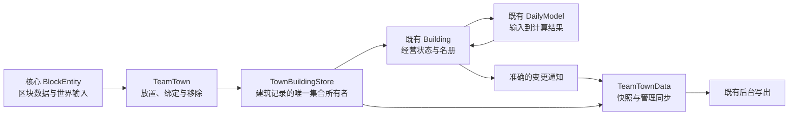

# 城镇建筑数据系统：统一设计与工程审查

- Time: `2026-10-23 00:18:00 +08:00`
- Authors: `Codex; OpenAI GPT-6; architecture design and source review`
- Status: `completed` — 本批建筑数据改造、代码闭合复查、28 项真实 Forge 功能复验、独立进程最终 read 与制品构建已完成；实际结果及验证边界见第 13.6 节。
- Revision: `2` — `2026-10-23` 再次对照调用链复查，修正分配语义、恢复重试、错误粒度、维度接线与隐式区块加载；简化字段合并和扫描调度。
- Scope: 玩家城镇逻辑建筑、建筑存档与旧档恢复、建筑修改通知、核心方块实体绑定、住房/岗位关联、结构与环境刷新、管理同步。
- Related: [当前实现入口](../docs/town/README.md)、[保存与运行边界](../docs/town/persistence-and-runtime.md)、[实现参考](../docs/town/implementation-reference.md)、[已交付城镇基础架构](2026-10-19_20-42-32_team-town-modern-architecture-specification.md)、[交付日记](../diary/2026-10-20_11-14-00_team-town-runtime-persistence-delivery.md)、只读 [创作原则](../design/creative-principles.md)。

本文保留统一设计、实施过程与最终结果。第 1—12 节中的“拟”及实施前代码描述属于设计基线，第 13 节记录实际工程进展与验收；当前系统行为以源码和 `docs/` 为准，不能把未执行的验收范围当成通过。

## 1. 目标与边界

沿用一队一份完整存档、服务器主线程拥有业务对象、现有后台快照写出的基础架构。在建筑这一层完成四件事：局部无法解码时保留数据；每次真实修改都能准确保存和同步；重开与区块加载能够重新连接原对象；稳定建筑避免反复扫描和编码。

继续使用 `HouseBuilding`、`HuntingBaseBuilding`、`MineBuilding`、`MineBaseBuilding`、`WarehouseBuilding`、`TransportStationBuilding` 及现有 DailyModel。建筑按功能组织源码；数值公式、每日阶段顺序、资源动作语义保持现有合同。

本版采用启动读取/解码。仍由 Minecraft 区块系统保存物理方块和设备缓冲。压缩与落盘继续使用既有 `PersistenceCoordinator` / `NbtRecordWriter`，不新增后台经营、数据库、每栋建筑文件、事件溯源或通用属性框架。任意字段网络差量、多线程结构扫描和跨文件事务不进入本版。

## 2. 实施前核对到的问题

| 实施前代码事实 | 后果 | 本版处理 |
|---|---|---|
| `TeamTownData.MAP_CODEC` 对整个 `blocks` 使用 `catchingCodec` + 默认空 Map | 单项错误或重复位置造成集合解码失败时，可能整表回空并在后来写回 | 建筑专用逐项读取；保留失败条目原文 |
| `TeamDataHolder` 的缓存粒度为组件 | 一栋建筑修改使整个 town 组件重新编码 | 组件内复用每栋建筑的冻结编码；仍承认整镇组装/复制成本 |
| 工作/住宅名册 getter 和矿场链接暴露可修改集合 | 绕过通知，可能复用旧 town 缓存 | 只读查询 + 明确批量替换入口 |
| 狩猎、矿业部分 setter 没有相等判断 | 未变化的扫描结果也使编码缓存与同步失效 | 源头值比较；批量应用后统一通知 |
| `DataSyncCache.onBuildingChange` 无条件使仓库拓扑失效 | 温度、日报等不相关变化也触发拓扑准备 | 在已有建筑通知中注明所影响的工作 |
| 方块实体 `getBuilding()` 可以补注册 | 读取、恢复、创建时机混在一起 | 纯查询与显式绑定/修复分开 |
| `TownHousingPlan.normalize` / `TownStaffingPlan.normalize` 只认识已解码建筑 | 原文虽保留，计划仍可能被加载整理删除 | 引入“暂不可解析”查询语义，计划保留为待恢复项 |
| `OccupiedZoneInfo.equals` 只比较几何集合 | 有效性与错误信息变化可能被忽略 | 几何比较和扫描状态比较分别命名 |
| `SchedulerQueue` 是静态按维度的轮询列表 | 生命周期与跨世界清理不明确，结构/环境同频刷新 | 会话清理、注册去重、结构与环境分开刷新 |
| `MineBuilding.BIOME_RESOURCES` 以空 Map 判断是否加载 | 空结果重复加载，重载/跨世界可能保留旧结果 | 配方重载后重建；显式已加载状态与会话释放 |

核心锚点：`TeamTownData`、`TownAssignments`、`TeamTown.addTownBlock/removeTownBlockInternal`、`AbstractTownBuildingBlockEntity`、`AbstractTownBuilding`、`OccupiedZoneInfo`、`DefaultValueCodec.fieldOf`、`CodecUtil.mapCodec/buildByNameWithLegacyInt`、`TeamDataHolder.captureRecord`、`TownSync`。

## 3. 数据所有权与最小结构



### 3.1 拟新增的三个主要类型

| 类型与拟放置位置 | 单一职责 |
|---|---|
| `content/town/building/TownBuildingStore.java` | 拥有记录、已解析对象、未解析原文、位置索引和建筑编码缓存；提供只读查询 |
| `content/town/building/BuildingRecordsCodec.java` | 建筑集合格式、逐项解码、原文保留与迁移；不读取世界 |
| `content/town/building/TownBuildingTypes.java` | 六类建筑的稳定 ID、当前版本、旧整数映射和类型 Codec；顶层字段键从 MapCodec 派生 |

条目元数据、读取结果和问题原因使用以上文件的嵌套类型。每类建筑扫描应用所需的小 record 放入对应现有类，避免为了目录层次增加一套公开服务接口。

`TeamTownData` 持有一个 `TownBuildingStore`。其已解析建筑 Map 是 store 的只读投影，与存储条目指向同一对象，不复制一套经营事实。原 `data.buildings.put/remove` 内部调用全部收口；外部仍通过 `TeamTown` 完成实际业务操作。

store 内部使用一份按坐标索引的有效/待恢复记录表，以及一份只保留原文的存档列表；已解析 Map 是其只读投影。单条记录只能是有效或 pending，archive 不竞争运行位置。位置查询 O(1)，异常原文不得在建立 Map 时覆盖丢失。删除/快照组装允许 O(B)，B 为建筑记录数。

六个建筑类对外暴露 `MAP_CODEC` 与其 `.codec()`，由 `MAP_CODEC.keys(NbtOps.INSTANCE)` 一次取得拥有的顶层键；不另外手写一棵重复字段结构的描述树。类型表保存延迟 Codec supplier，沿用现有 `typeLazy` 思路，防止父类 CODEC 与子类静态初始化循环。全局 Codec 工具保持原样。

### 3.2 一栋建筑有哪些数据

| 数据 | 所有者与恢复规则 |
|---|---|
| 居民名册、生产小数余量、日报等经营事实 | 原 Building；按存档恢复；扫描不得重置 |
| 面积、布局、温度、容量、结构有效性等已知输入 | 原 Building 的最后已知快照；加载恢复后按世界绑定安排复核 |
| 重叠关系、仓库拓扑等派生结果 | 由城镇重建；旧存档数值只作缓存，不作为独立事实 |
| Level/BlockEntity 引用、加载状态、待刷新标记、订阅、任务位置 | 当前服务器会话；不序列化 |
| 未知字段、无法解析条目 | store 的原文保留区；不伪造可经营建筑 |
| 设备实物缓冲、过滤设置、供热端点本地数据 | 原 BlockEntity 的区块 NBT；不迁入逻辑建筑 |

同一玩家镇继续只绑定一个建筑维度。拟在城镇存档增加可选 `buildingDimension`，记录已有建筑所属维度，避免 generator 临时缺失或换维度后用另一世界的同坐标清理旧建筑。身份由 holder、建筑维度和核心坐标共同确定，不给每栋建筑再增加永久 UUID。

旧档缺少该字段时，在完整 holder 加载后从既有 generator 维度取得；无法取得时保留待确定，不默认套用主世界。只有记录维度尚未知的新城镇才可由首次合法核心注册确定实际维度；旧记录维度未明时，不以任意加载的同坐标核心猜测并清理旧记录。已有非空建筑集合的维度不自动改写；tower 维度不匹配时保存所有事实、标明执行连接未就绪，匹配恢复后自动重绑。跨维度搬迁属于另外的玩法操作。

“新城镇”不能用已解析 Map 为空判断：还须没有待恢复记录、原容器 archive 和旧的计划/恢复意图。否则整表无法解析的旧镇会被误当新镇绑定到另一个世界。

### 3.3 维度必须统一接线

`TownRuntimeManager` 提供同一个纯查询上下文（可用嵌套 record），区分持久 `buildingDimension` 与当前可用的 `executionLevel`。generator 缺失、维度不匹配或 Level 不存在时，后者为空；保持现有卸塔暂停执行、保留事实的语义。`resolveTownDimension` 返回持久归属；世界执行使用上下文中的 executionLevel。

以下路径必须在同一改动中接通，不能只增加存档字段：

| 路径 | 使用规则 |
|---|---|
| `TownRuntimeManager.executionLevel/tickEnd/tickLevel` | 同一个 executionLevel；不可用机会跳过，恢复不补历史 |
| `CitizenSimScheduler.isTownInLevel/refreshRegistry` | 以 executionLevel 所属世界门控玩家模拟，防止旧每 20 tick 扫描把容器接进 generator 的另一维度 |
| `TownSync.tryFull`、`TeamTownData.prepareView` | 使用统一服务准备入口；管理页全量导出不能把暂停的运输拓扑重新激活 |
| `TownWarehouseDeviceAccess`、P2P 端点 | 用 buildingDimension 检查归属，用 executionLevel 判断服务可用；设置与缓冲继续保留 |
| 核心绑定、`checkBlocks`、扫描与实际移除 | 只读取对应 buildingDimension 的已加载区块；其他世界同坐标不能作为删除依据 |
| `TownOperationalStatusProvider`、难民/气候位置、手动经营入口 | 区分建筑世界与实际塔所在世界，处理空 Level；不得把塔坐标套入另一 Level |

已知 buildingDimension 时可绑定核心记录并展示数据；执行暂停不等于删除记录。无塔/维度错配的服务状态由同一上下文导出，不能由不同 getter 各自“修好”一部分。

## 4. 存档格式与逐项加载

### 4.1 格式采用增量扩展

队伍路径仍是 `chorda_data/<holderId>.nbt`。`data.town.blocks` 继续使用现有的条目列表形状，新增条目版本；减少格式切换范围：

```text
data.town
  buildingDimension: "minecraft:overworld"       # 可选，城镇建筑维度
  blocks: [
    {
      pos: [x, y, z],                           # 位置权威
      version: 1,                              # 该建筑类型的 payload 版本
      building: {
        type: "house",                         # 沿用现有稳定名称
        pos: [x, y, z],                        # 为复用现有 Codec 保留的相同镜像
        initialized: true,
        ...现有住宅字段...
      },
      ...未知的条目级字段...
    }
  ]
  retainedBuildingData: [
    { mode: "pending", kind: "entry", pos: [...], raw: <可定位的待恢复记录> },
    { mode: "archive", kind: "entry", pos: [...], raw: <冲突记录> },
    { mode: "archive", kind: "container", raw: <无法解释的原 blocks> },
    { mode: "archive", kind: "field", pos: [...], name: "...", raw: <被修复的字段原值> }
  ]
```

`version` 缺失表示旧版本 0。当前六类迁移到版本 1；名称沿用 `house/huntingBase/mine/mineBase/warehouse/transportStation`。旧整数映射固定为 `0..5` 对应上述顺序，使用独立只读表，不能由今后的注册顺序临时生成。

保留区中的 `raw` 支持任意 Tag；每个外层元素仍是 CompoundTag，满足 NBT 列表同类型要求。mode/kind 是固定格式值，问题说明只作诊断。已保留项不得每次重开再包一层；同一位置/字段/原文相等的项不重复追加。

`BuildingRecordsCodec` 是 owning `blocks/retainedBuildingData/buildingDimension` 的 MapCodec，在 `TeamTownData.MAP_CODEC` 中替换原 `blocks` 字段包装。不能同时保留原默认空 Map 路径；不能修改全局 `DefaultValueCodec` 来影响其他游戏系统。

### 4.2 加载顺序

1. 读取容器与原文，在本地候选 store 中逐条处理；本阶段不注册世界、不通知客户端、不结算。
2. 读取外层坐标、类型、版本。旧项迁移在副本上进行；坐标只有原 Tag 存在且 BlockPos.CODEC 成功时才算合法，不能把旧默认 ZERO 当恢复证据。外层合法位置覆盖送入旧 Codec 的内部位置镜像；有冲突时原内部值按字段 archive。外层不合法但内部位置合法时可恢复位置并标记待写迁移；两者都不合法则 archive 原条目，不能自动放到原点。
3. 对当前支持版本先按第 4.3 节修复可重建/展示字段，再完整解码该栋；未知类型、较新版本、关键经营字段错误保留整条原文。不能用带不明缺项的 partial result 冒充成功。
4. 同坐标冲突时，按输入顺序选第一条完整可解析记录；其余作为 archive 保留。没有可解析记录时，只选第一条可定位记录作 pending，其余 archive。选择与文件枚举顺序无关；后续写回有效记录保持稳定坐标顺序，冲突原文不能抢占位置。
5. 整个 `blocks` 不是可解释列表时，原容器进入 archive，继续恢复城镇其他数据。已有保留区同时读取；无法定位项、无法解释的保留区字段/维度原值也进入 archive。真正缺失/明确空列表才表示没有输入条目，不能覆盖已经读到的 pending。
6. 完整构造 store 后连接本地监听，随后处理计划与居民关联。得到完整 holder 后确定维度、安装 runtime，再连接已加载核心。
7. 只对 pending 在启动、相关资源/类型代际变化后尝试；一次代际内失败只记录，不在周期绑定修复/getter 中重复解码。archive 永远不由普通注册或重试自动提升成运行记录；它保留恢复证据，不是第二份候选建筑表。健康核心的正常绑定/缺项修复仍继续。

store 至少向内部调用区分：`resolvedAt(pos)`、`unresolvedAt(pos)`、`retainedIssues()`。单纯 `resolvedAt == empty` 不能证明建筑被拆除。

真实移除/明确新放置替换时，同一操作清除该位置的有效记录、pending、可定位冲突 archive、恢复意图和原计划。无位置 archive 留作原文，不参与自动注册，因此不会在下一次启动把已删除建筑重新带回。原文保留、pending 提升、迁移、维度确认和修复都必须调用 store 的元数据变更入口，使 town/TEAM dirty，即使没有可用 Building 也不能漏保存。

### 4.3 错误按数据用途恢复

现有 `optionalFieldOf` 等默认值路径必须核对；缺失可用版本默认值，存在但错误不能悄悄当缺失。范围限于建筑字段，Codec helper 不改变全局行为。

| 错误类别 | 恢复动作 |
|---|---|
| 身份/类型/版本、居民名册、生产余量等关键经营数据无法解释 | 整栋 pending，原文保留，不猜测经营事实 |
| 面积、结构几何、床位/入口、温度、容量等可重建输入错误 | 该字段原文存为 archive；相关快照标为待复核，使用明确初值，核心加载后重新扫描；不重置合法名册/余量 |
| 最近日报、物品展示条目等非执行数据错误 | 字段原文 archive，使用 EMPTY 日报；其余建筑继续运行，不因一份坏日报让住宅停止提供服务 |
| 明确版本迁移允许的缺项或数值规范化 | 在副本执行规则，记录变更并等待正常保存 |

这种恢复在严格业务解码前针对固定字段执行；不依赖 DataResult 的不完整 partial 值。即使恢复后的可重建输入仍无法形成完整对象，也退为整条 pending；原输入继续保留。

### 4.4 版本与字段覆盖的简化规则

已解析条目只在顶层保留未知字段：条目外层、`building` payload 顶层。先从原文移除 MapCodec 声明的全部已知顶层键，再加入完整新编码；可选已知字段即使本次省略也会被清掉。类型与位置由记录层写入，不允许原文覆盖。

日报、布局、列表等已知嵌套值按整个字段拥有。今后修改任何嵌套格式（包括增加字段）必须提升该建筑条目版本；旧版本读取较新条目时保留整条 pending。当前版本不承诺合并在同一版本内任意手改的嵌套扩展。这是明确的格式兼容范围，替代上一稿的通用递归字段合并，避免维护两套可漂移的字段树。

因此 `entrancePosition` 删除不会复活，较新日报格式也不会被旧写入器拆成一份混合结构。文档与测试只能声明以上范围，不能再声称任意深度未知字段都会合并保留。

解码和迁移始终在副本上操作。新文件成功替换前，磁盘仍保留原正式文件。已解析对象编码失败时本次队伍捕获失败并保留 dirty，使用已有重试机制；不能跳过该栋、用旧缓存假报最新版本已保存，也不能因此把失败对象转为“空建筑”。

## 5. 无法解析建筑与居民关联

这是恢复闭环的一部分，必须与新 Codec 同批实现。

`TownHousingPlan` / `TownStaffingPlan` 增加 store 上下文：已解析且类型匹配的项照常使用；暂不可解析位置的顺序、保障人数和目标保留为待恢复项，不参与当前分配或产出。移除计划项必须有明确拆除/同位置类型替换依据，不能因为已解析 Map 中暂时查不到就删。`TeamTownData` 构造器必须先安装完整候选 store，再做这种有上下文的规范化；不得先用临时空 Map 修剪计划。

`Resident.housePos/workPos` 继续只表示有效名册镜像。不能把待恢复坐标留在这些字段：现有 `TownSettlement.tickResidentsMorning` 用 `housePos != null` 判断有住房，`TownSimData`、统计和 UI 也直接使用这两个字段，继续复用会导致免除无家惩罚、生成错误模拟锚点等问题。

拟在 `Resident` 中增加一个可选 `pendingAssignments` 字段，值为嵌套 `PendingAssignments(housePos?, workPos?)`，缺失默认 EMPTY。这只保存恢复意图，不与实际分配竞争权威。原 Codec 当前有 15 个 group 字段，合并为一个新字段后为 16 个；不能分别新增两个顶层 group 字段而超过 RecordCodecBuilder 常用上限。同步覆盖 `Resident.CODEC`、手写 NBT 构造/保存及兼容构造重载；AI 居民默认 EMPTY，不改变其无建筑的坐标锚点语义。

服务器加载对账时，未知建筑关联从有效位置移入 pendingAssignments，清空相应 housePos/workPos；已有有效名册优先。计划保留为待恢复项。有效建筑继续正常分配，成功后清理相应恢复意图。没有替代分配时，意图继续保存，但居民按现有无家/无业、营养衰减和衰老规则执行，不会得到虚构服务。

重新解析成功时，已有有效名册优先，恢复建筑的旧名册其次，pending 镜像最后。去掉不存在居民和重复引用后共同安装；恢复的旧名册不能把已经安排到其他有效建筑的人抢回。仅恢复结构/关联，不补过去经营日。

整个建筑容器无法解析、无法知道位置时，原容器 archive；把输入中的分配位置转为 pendingAssignments，保留计划，并对已加载坐标做有限世界核对。实际核心可以修复缺少的逻辑记录，不能从无法解释的原容器虚构原经营数值。没有单独的分配账本；恢复意图是 Resident 内的两个可选坐标。

对账必须在一次批次中先计算最终名册与实际/待恢复位置，再共同提交。居民死亡/离镇清除其恢复意图；建筑实际移除清除指向该位置的意图。恢复时必须过滤已不存在的居民，旧原文不能重新创建已离镇的人。

`TownAssignments` 应先构造最终住房/工作名册，再用 `replaceResidents` 一次应用。不能只把 getter 包成只读，然后留下原有 `clear/removeIf` 调用。

## 6. 变更通知与建筑编码缓存

### 6.1 修改入口

`getResidentsID/getLinkedMines` 等只返回只读结构。新增内部 `replaceResidents(Set<UUID>)`、`replaceLinkedMines(Set<BlockPos>)`；保留明确 add/remove 业务入口。所有入口先比较最终值，真变化后通知；居民位置镜像与名册在同一个主线程操作边界更新。

已有 `TownBuildingChangeEvent` 使用明确命名的 `ChangeKind`：`DATA`、`STRUCTURE`、`AVAILABILITY`、`REGISTRATION`。普通 `fireChange()` 表示 DATA，批量应用用 EnumSet 收集实际变化种类；保存与同步统一消费真实变化，空间和仓库派生更新通过命名方法判断。按用户对可读性的要求，不使用数字位掩码或按位组合表达业务语义。

| 修改 | 要做的工作 |
|---|---|
| 日报、余量、名册、温度真实变化 | 失效该建筑编码，失效 town 组件缓存，收集建筑同步 |
| 占用几何或扫描状态变化 | 上述工作，另收集空间关系复核；仓库可用性依赖变化同时使仓库拓扑失效 |
| 仓库容量、初始化、有效性、重叠状态变化 | 使仓库拓扑失效；仍保存当前兼容快照字段 |
| 狩猎站日报变化 | 不使仓库拓扑失效 |
| 建筑添加、移除、类型替换 | 更新索引、监听、空间关系、相关计划/名册及仓库拓扑 |

一次扫描、名册替换或生命周期操作先在局部算好结果，再用不会调用外部观察者的短提交安装完整数据，最后汇总通知。持久化失效和同步脏键是内部必达步骤，UI/设备等观察者在其后执行。提交前计算失败不安装候选，提交后观察者失败安排 runtime 修复，不回滚已经发布的事实或重放生产。

对仍保留的多字段修改批次，使用一个轻量修改作用域合并影响标志；嵌套时仅最外层发送，finally 必须发出已经发生的真实变更。旧 Building 脱离 store 时清掉监听，回调同时核对当前位置的 Building 实例，防止旧菜单/旧对象使新记录变脏。

### 6.2 缓存边界

每条已解析记录只保留一组本地 `revision/encodedRevision/frozenNbt`，缓存按首次实际捕获懒生成。真修改增加 revision；捕获时只调用变化建筑的 Codec，完整编码成功后才更新 encodedRevision，失败继续保持 dirty。未变化项复用其私有冻结编码。pending/archive 只保留一份原文，不另缓存一份等价业务树；已解析记录只留下顶层未知字段，释放重复的完整输入副本。

store 元数据（添加/删除、pending/archive、维度、迁移、片段修复）另有一个本地 revision，并统一向 `TeamTownData.persistentChanged()` 报告。加载期间尚未挂载 listener 的修复记录为 `needsInitialSave`，在服务端安装好持久化监听后报告一次；不能等下一次业务修改碰巧带出。编码、管理导出和 getter 本身不得推进业务版本。

这些版本只用于缓存，不是独立落盘版本。整个 TEAM 的持久化成功仍由既有 coordinator 的记录回执确认；建筑编码完成不意味着建筑已落盘。

冻结树由存储层私有拥有；公共 getter、设备、客户端和游戏代码不能取得并修改它。后续修改建立新树，不修改已交给快照的旧树。`TeamDataHolder.encodeComponent` 既有独立复制边界继续保留。

因此成本仍包括 O(B) 的条目组装、整个 town 的必要冻结复制、整个队伍文件的压缩和写入。本版只减少无关建筑的 Codec 执行，不承诺 O(1) 保存或局部文件写入。常驻缓存内存另行记录，不能把 32 MiB 在途队列预算说成包含全部缓存。

## 7. 世界绑定、区块卸载与删除

`AbstractTownBuildingBlockEntity.getBuilding()` 改为纯查询。服务端显式入口由 `TeamTown` 协调：`onCorePlaced`、`ensureCoreBound`、`onCoreRemoved`；同类既有方法可改名或委托，但只能保留一条业务安装/清理路径。

| 情况 | 确定的处理 |
|---|---|
| 玩家实际放置新核心 | 用玩家所属 holder 与实际 Level 确定归属，写 provider 并 `setChanged()`，再创建新记录；重复回调不重复新建 |
| 区块加载，同位置有兼容已解析记录 | 连接原对象，保留名册/余量/日报；安排结构和环境复核 |
| 核心先加载而队伍 runtime 尚未可用 | 合并为待绑定请求，runtime 安装后重试；不创建临时队伍 |
| 区块加载，仅有未解析记录 | 保留原文，不用默认同类对象覆盖；仅在相关代际变化后重试业务解码，其余绑定等待并展示状态 |
| 区块加载，确实没有记录且存在合法核心/provider | 显式修复入口创建默认逻辑建筑，并从现有 pending 引用整理可恢复关联 |
| 区块卸载 | 释放当前会话订阅/任务，不删逻辑建筑、名册和存储记录 |
| 已解析建筑对应的核心确实不存在或类型被替换 | 在该维度区块已加载且当前对象身份确认后，经原统一清理路径移除/替换 |
| 未解析建筑的核心暂时找不到 | 不据此销毁原文；等待能解释记录或明确的实际移除操作 |
| `TOWN_DATA` 已明确移除 | provider 查询不创建城镇，待绑定任务取消；任何核心 getter 都不能使城镇复活 |
| 旧任务晚于同位置替换返回 | 用当前 store、当前 Building/BlockEntity 实例核对，丢弃旧结果 |

新放置与读取旧区块是不同入口：新放置允许先完成正常旧建筑清理，再建立新实例；读取旧区块只做绑定/对账，不能调用无条件覆盖式 `addTownBlock`。

只有 pending 可以重试业务解码，同一类型/资源代际中的重复绑定只等待上次结果。archive 不阻止健康核心的缺项修复，也不自动变成建筑。明确新放置/拆除需要清理该坐标的旧 pending 和可定位 archive，不能只移除有效 Map。

操作在服务器主线程完成。结算遍历、分配提交或建筑提交正在进行时，核心放置/拆除必须进入 `TownRuntimeManager` 现有生命周期入口，到当前操作边界应用；否则生产中破坏核心可修改正在遍历的建筑 Map。请求按 holder/维度/位置合并，并保留是否真实新放置的信息；最终核对 holder 的当前 TOWN_DATA、store、世界与实例，不能用晚到的旧拆除回调删除新核心。区块卸载只释放会话，不合并成实际拆除。

对外通知放在完整安装后。创建提交前失败恢复未发布的 provider/记录连接；提交后失败只安排重绑。删除一次处理名册镜像、恢复意图、原计划、矿场链接、仓库容量、空间关系和 listener；从 store Map 直接 remove 不是业务 API。旧菜单在操作前核对其绑定的 BlockEntity/Building 仍是当前实例，不能经同坐标查询取得并修改新对象。

单队伍文件与区块文件仍没有共同事务。中断后按已加载世界事实和保存记录对账，不承诺任意断电点恢复到完全相同的联合时间点。本版不引入永久删除日志或建筑实例 UUID 来假装解决跨文件提交。

## 8. 结构、环境与派生值

首次实现继续使用现有主线程调度预算 `ChordaConfig.SERVER.taskPerTick`。每个实际 ServerLevel 会话只持有一个按位置的 LinkedHashMap 轮询队列，完成 O(1) 注册/移除/去重，不再保留“列表 + 集合 + 全表清理”三份机制。任务被取出执行后仅在原实例仍有效且未取消时放回队尾，不能覆盖执行过程中注册的同位置新任务。只有 `level instanceof ServerLevel` 才能注册；客户端不能把同坐标任务放进集成服务器队列。`onLoad/onUnloaded/onRemoved` 对齐句柄注册/释放，世界卸载/停服清理，兼容同一 BE 实例重新 onLoad。

仓库仍使用 Java 17：取队首用 entrySet 迭代器并 remove，再 put 到队尾，不能使用 Java 21 的 SequencedMap/getFirst 等 API。取消句柄在任务临时移出 Map 时仍有效，执行中卸载也不能把已取消任务放回。

首版使用两个内部间隔常量，环境目标为 20 game ticks、结构复核为 200 game ticks；它们是设计初值，不是已测出的最佳值。核心初次绑定、显式刷新和相关配置/标签重载可提前 dirty。实际服务间隔还受轮询长度和 taskPerTick 限制，必须记录最大等待；未达标时调整预算或定位热点，不能将目标间隔当硬实时保证。普通 tick 只更新轻量供热/粒子等既有逻辑，不反复注册扫描任务。

结构扫描与环境刷新分开：结构扫描产出完整 `RoomData` 和该建筑的设施结果，先在本地算好容量/布局，再通过建筑专用 `applyScanResult` 一次应用；环境路径使用最后已知几何更新温度/供热输入，不重新搜索房间。

环境更新同时重新计算依赖温度的评分，不保留第二份未失效的 rating。供热端点的消耗频率沿用原 tick 逻辑；其 modifier 真变化时可立即更新已绑定逻辑建筑，不等待结构复核。所有刷新期限使用当前世界 gameTime，不能用可被 `/time set` 回退的 dayTime。

队列一次机会可完成该建筑已到期的环境/结构工作；完整结构扫描已经取得温度时不再重复采样。轮询等待约随 `B/q` 增长（B 为已加载队列长度，q 为平均每 tick 机会数）；默认 q=1、B=500 时单轮约 500 ticks，不能宣称每栋都每 20 ticks 更新。验收比较实际最大等待和原实现同负载表现，不能通过牺牲明显的服务更新延迟来换取低 CPU。

本版依靠有限周期复核覆盖墙、门、床、活塞、命令和其他模组的世界修改。暂不构建全世界方块事件拦截或“方块到建筑”的反向索引；以后只有实际交互延迟需求支持时才增加局部提前失效钩子。这样避免为了减少扫描而增加持续的全局监听与索引维护。

扫描不能直接沿用现有 `CachedLevel.getCachedLevelReader` 的加载行为：其内部调用 `level.getChunk(cx,cz)`，会同步加载 AABB 覆盖的区块。建筑扫描改用主线程的只读、非加载 world adapter，对实际触及的区块使用 getChunkNow/等价非加载查询并做本次调用内缓存；缺少数据时标记整个候选 INCOMPLETE，不把缺块当空气或结构错误。高度查询也必须走已取得的区块，不能间接回到会加载的 Level 方法。范围裁剪到维度 min/max build height，避免顶底边界 section 越界；温度采样数为零或结果非有限值时保留旧输入并安排复核。

完整扫描成功后只留下占用几何、设施位置/数量及所需评分输入，释放 RoomData 内的完整方块索引、邻接集合和临时 PalettedContainer 引用。环境刷新使用不可变占用几何即可，不能为省扫描长期保留整个扫描世界缓存。继续复用既有温度查询入口，不另造一套温度权威。

`OccupiedZoneInfo` 改成不可变值，包含的集合也不可由外部修改；移除直接修改内部 valid/overlapped 的公开 setter，使用返回新值的 `withValid/withOverlapped`，并由 Building 的应用入口发布通知。扫描状态包括几何、valid、error；分别提供几何比较与完整扫描比较。重叠结果由城镇在整个几何批次完成后重算，避免新扫描暂时清掉旧 overlapped 后又设回造成空转通知。旧 `initialized` 表示有已知扫描快照，不用来表示区块当前加载。

结构输出中的床位、门和报告条目使用稳定顺序；住宅入口按固定坐标次序选择，不能依赖 HashSet 的首项。多个采矿基地竞争矿场按固定核心坐标顺序处理并一次替换最终链接；半径和产量规则沿用现有配置。经营顺序不得依赖 store 的存档条目顺序。

加载保留最后已知环境，安排首次复核；首次复核前沿用已保存输入，保持现有未加载建筑经营语义。结构 invalid 与“区块未加载/本次无法完成扫描”必须分开，后者保留旧快照并重试。配置/标签变化使相关评分或结构输入失效，配方重载重建矿业配方索引。不会为了 freshness 清空居民、历史或生产余量。

单次大扫描若实测仍造成停顿，再考虑按访问节点分片；这属于有条件的后续优化，不是本版尚未实现却必需的承诺。

## 9. 同步、客户端与设备边界

继续使用 `TownSync` 的连接基线、PENDING/PRESENT/ABSENT 和重同步机制。正常建筑增量仍发送“变化建筑的完整经营对象”，本版不引入字段级网络差量。

完整城镇视图通过下述专用 `MANAGEMENT_CODEC` 恢复可用对象和待恢复摘要；客户端只安装候选视图，不注册世界、不驱动磁盘缓存、不生成随机熟练度。管理界面将待恢复项显示为“建筑数据待恢复”，提供位置/已知类型/原因；无法取得位置则显示条目数，原始 NBT 留在服务端存储与诊断中。

管理视图只需要恢复摘要，完整 raw 不进入日常界面数据。`BuildingRecordsCodec` 的磁盘捕获与管理视图导出必须是显式不同入口，不能根据 `NbtOps` 或 `DataOps` 猜测用途。拟提供 `TeamTownData.captureManagementView()`：导出已解析建筑与简短恢复状态，省略 raw 保留区。客户端相同 store 使用只读摘要条目。全量包改用此入口，增量包仍构造时编码。待恢复集合或维度状态变化时使完整视图失效并通过现有路径重发，避免增加独立消息系统。

具体组合方式为 `TeamTownData.createMapCodec(buildingFieldsCodec)`：其余城镇字段只定义一次，持久化 `CODEC` 传磁盘建筑字段 Codec，`MANAGEMENT_CODEC` 传管理字段 Codec。管理字段包含可用建筑及 `buildingLoadIssues` 摘要列表（可选位置、可选类型、固定原因枚举）；接收端构造只读摘要，不把摘要当原文再解析。`TeamTownDataS2CPacket` 编解码双方都改为 `MANAGEMENT_CODEC`，不能只替换发送端。此设计避免复制一份可变城镇，也避免先编码完整 raw 再删字段。

同时核对本链路使用的 `Resident` 解码构造器和 `getWorkProficiency`：熟练度缺项填充移到服务端的新建与旧档修复入口，纯解码与查询不生成随机值；值域规范化可作为确定性的解码规则。必须覆盖 `TeamTown` 招募/调试、`WanderingRefugee`、Citizen 命令/交互、`AITownData.fromNbt` 及管理视图读取，不能只改一处构造器。AI 原有直接坐标锚点继续有效，只有玩家镇的未知建筑关联转成恢复意图。不能靠 DynamicOps 类型或静态全局标志猜测补数据时机。

`TeamTownData` 解码构造器只装配字段与本地监听，不能自动分配/补随机数据。有 store 上下文的业务修复放到服务端完整安装阶段；管理视图候选直接使用服务端给出的实际分配与摘要。`TownSync.tryFull` 中现有 `prepareAssignments` 等需要迁到该准备边界或改为只整理派生视图，不能为发送数据触发一次实际住房/工作分配。

类型/格式协议更新 FH 通道版本，拟追加 `:building-data-1`；沿用既有消息注册顺序。本版客户端和服务端一起更新；存档兼容和网络版本兼容分别处理。

仓库接口/库存信号器仍把设备设置、实物缓冲保存于区块。速率与运输预约继续由城镇 transport state 拥有；重开重建 watcher、拓扑订阅和传输预算，不把预算缓存写成第二份事实。逻辑建筑拆除不删除城镇公共库存。

## 10. 统一实现顺序

以下是同一份工作中的依赖顺序，不创建多份子计划。2026-10-23 已完成本批源码接线，新增 15 个建筑 GameTest 并扩展独立进程验收；运行结果在统一验收后记录。

1. 建立延迟类型表和固定旧映射、MapCodec、逐项恢复 Codec 与 store；区分 pending/archive，替换默认空表路径，接元数据 dirty。旧 Map 构造方法只作明确迁移入口；去掉绕过 store 的直接写入。
2. 同批接 `Resident.pendingAssignments` 的 Codec/NBT/构造重载、计划规范化、服务器安装修复和 `TownAssignments` 最终名册提交。检查实际分配 getter 的现有消费者行为，补齐 setter 值比较、精确影响标志和单份懒编码缓存。
3. 拆分核心查询/绑定/放置，接当前操作边界和完整删除；补 provider setChanged。按第 3.3 节同步修改所有维度消费者，包括旧的模拟周期扫描和设备 helper，不能留下第二套门控规则。
4. 实施非加载扫描适配器、完整结果提交、轻量轮询、环境独立刷新、重叠批量重算和配方缓存重载；接管理视图双方 Codec、恢复摘要与协议版本。移除旧默认路径/重复通知/静态残留，而非长期并存两套实现。
5. 先完成生产与 GameTest 编译，再集中执行下节真实场景；失败后针对实际问题修正并复验。完成后更新当前文档、追加日记，将本计划改为已完成并记录实际范围。

## 11. 真实游戏验收合同

不新增、不运行 JUnit。不用纯数值模型的通过代替游戏行为。复用当前源码与构建产物，使用专用 GameTest 世界；跨进程读取阶段不得清理或重新生成预期存档。以下全部是待实施场景，不是已通过结果。

| 场景 | 必须观察到的结果 |
|---|---|
| 六种逻辑建筑 + 实际核心/设施，真实保存后独立进程重开 | 字段、名册、余量、日报、布局恢复，原核心接回原经营数据 |
| 50 条记录中混入未知 type、未来 version、坏字段，另放重复位置 | 健康记录继续使用，失败原文保留，冲突不覆盖，保存后第二次重开仍可恢复 |
| `blocks` 整体类型不正确，其他 town 数据正常 | 原容器保留，其他数据不清空；原计划与居民引用不因空投影被批量删除 |
| 顶层未知字段与可选入口删除；较新版本包含扩展日报 | 顶层未知字段仍在、旧入口不复活；扩展格式整条 pending，旧程序不混合写回 |
| 日报损坏、结构缓存损坏、关键名册损坏分别输入 | 日报原文 archive 后住宅仍可用；结构缓存可扫描重建；关键经营数据 pending，不因展示错误使全屋失效 |
| 暂不可解析住宅/岗位 + 有效替代建筑，再使原记录可解析 | 待恢复计划保留，有效分配照常发生；恢复旧名册不抢人、不重复、不补经营日 |
| 只有 pendingAssignments、没有有效住房/岗位，完成经营和模拟对账 | 按现有无家规则结算，不产生待恢复坐标的虚假模拟锚点；UI 统计实际状态并显示恢复意图 |
| 删除/新放置前有 pending 和重复 archive，保存后再重开/资源重载 | 已删旧条目不能自动提升复活；同位置新核心只连接新记录，无位置原文仅留存档 |
| 只改一栋建筑、其他同镇建筑不变，再保存 | 仅该栋业务 Codec 重新执行；文件可重开，仍报告完整捕获成本 |
| 只有迁移、pending 提升、原文字段修复或维度确认发生，业务值不变 | 仍有一次正确 dirty 与实际保存；之后干净保存不重写，保留区多次重开不递归增长 |
| 无变化刷新、无变化名册重算、连续原版保存 | 不增加对应建筑 revision，不因空转发包/重算仓库拓扑；无其他变化时队伍文件不重写 |
| 房屋边界/床/门/装饰改变；温度独立改变 | 结构结果最终更新，单独温度刷新不搜索房间；valid/error 变化可见且保存 |
| 核心靠近未加载区块、维度顶/底边界，触发结构与温度查询 | 扫描不加载/生成额外区块，不将缺块当空气提交，不越界或写入 NaN；数据到齐后正常复核 |
| 区块卸载重载、先核心后队伍、同位置替换、旧任务晚到 | 保留经营事实、最终连接正确对象，无重复注册或旧结果覆盖 |
| 生产遍历中触发核心移除/替换、观察者异常或同步请求 | 生命周期在边界应用，无枚举修改异常、半安装视图或整天重放；旧对象不再使新记录变脏 |
| 拆核心、删 town 组件、卸能量塔再重装 | 清理范围正确；删组件不复活，卸塔保留数据并能重新连接 |
| 建筑存档在维度 A，tower 暂在 B，运行超过模拟周期并打开设备/管理页 | 核心不误删、模拟不迁到 B，管理读取不重新激活服务；恢复匹配后自动重绑且不补历史 |
| `/reload`、空矿业配方、同 JVM 关闭世界 A 再打开 B | 空结果不反复查询，缓存/任务无跨世界遗留 |
| 注入建筑编码失败、真实写出失败、重试与停服 | 不输出缺项新记录、不把旧缓存标成最新成功；原版保存仍执行，下一次保存可恢复 |
| 两客户端管理页、换队/重生、完整视图恢复 | 显示可用与待恢复状态，客户端不修改服务端事实，无持续全量重试循环 |

性能输入先使用实际可建的 10/100/500 栋建筑，分别测稳定、少量变化、集中改建和加载；数量是工作负载，不是容量承诺。记录 Codec 次数、主线程捕获/复制、扫描/环境读取耗时、最大刷新等待、常驻缓存与临时峰值、同步字节、完整 tick、后台积压和重开耗时。同一运行环境、相同真实工作负载比较当前基线和最终实现，不复制源码另造构建版本、不做路径敏感哈希。

本版验收必须满足：核心/名册/原文恢复正确；健康记录无空转版本与文件重写；稳定建筑重扫减少，温度刷新不重做房间搜索；无隐式区块加载和跨世界残留。Codec 次数减少若伴随明显更高的捕获停顿、内存或刷新延迟，不能直接认定优化成功；先定位单份缓存与复制成本，再决定是否保留具体缓存，不能再叠一层缓存掩盖问题。未知数据归档规模以输入和实际修改为依据，重复保存不得无故增长。

## 12. 工程自审结果与人类审查重点

| 审查问题 | 本稿结果 |
|---|---|
| 是否把好建筑和坏条目一起清空？ | 已在设计中消除：逐项解码、完整候选、原文保留；不改全局容错 Codec |
| 原文保留后计划/居民仍会被删吗？ | 已补：独立 pendingAssignments、保留计划、有效名册优先；见第 5 节 |
| 待恢复坐标会被旧逻辑当成有效住房吗？ | 已修正：housePos/workPos 仅存实际分配，恢复意图占一个新 Codec 字段；包含 16 字段构建边界 |
| 未知字段合并会复活已删除字段吗？ | 简化为已知顶层键整体替换与嵌套版本升级，不做通用递归合并 |
| 保留原文会在删除后重试复活吗？ | 已补：pending/archive 分开，实际移除清理同坐标原文，archive 不自动注册 |
| 一份坏日报会使住宅失效吗？ | 已补：展示字段 EMPTY + archive；关键事实和可重建输入采用不同恢复动作 |
| 名册只读后旧调用会抛异常吗？ | 同批替换所有直接写入，包含 `TownAssignments`，不只改 getter |
| 建筑缓存是否等于落盘成功？ | 已区分：本地编码版本与 TEAM 成功回执；保留整个队伍写入边界 |
| 重载核心会把旧名册/余量重置吗？ | 绑定与新放置分开，读取只接管原对象；见第 7 节 |
| 结构比较是否忽略 valid/error，或导致重叠来回变化？ | 已补：完整结果比较与批次重算，先安装后通知 |
| 世界暂时不可用是否会误删记录？ | 已补：持久建筑维度、未加载不判拆除、失败扫描保留旧输入 |
| 新维度字段会被旧模拟/设备路径绕过吗？ | 第 3.3 节列明所有消费者，服务可用与存储归属统一导出 |
| 扫描检查了核心已加载，就不会加载周围区块吗？ | 已修正：替换会调用 getChunk 的缓存读取路径，补高度/温度与数据不完整规则 |
| 恢复元数据没有 Building 事件时会漏保存吗？ | 已补：store 元数据 revision 与服务端安装后 needsInitialSave |
| 结算期间直接破坏核心会改遍历集合吗？ | 已补：复用 runtime 操作边界，按坐标合并并核对当前实例 |
| 未知建筑会导致客户端一直失败重同步吗？ | 已补：显式管理导出只发可解码对象和摘要，不发送未知 raw 让客户端硬解 |
| 是否为性能增加另一套游戏线程或存储事务？ | 沿用主线程和已有写出；如实保留整镇复制、文件重写和跨文件中断边界 |
| 是否承诺事件捕获所有方块变化？ | 保留有限周期复核；分片/后台扫描未纳入交付承诺 |
| 是否已经验证可运行与性能？ | 设计阶段未执行；本批最终功能、重启及成本采样结果见第 13.6 节，未覆盖项单独列明 |

人类审查可集中看五项已选定取舍：一队一文件与单份懒编码缓存；恢复意图与实际分配分离；pending 可恢复而 archive 不自动注册；嵌套格式变更必须升级版本；保存最后已知环境并通过非加载轮询复核。它们分别控制代码量、恢复语义、删除正确性、兼容维护成本和扫描成本。

### 12.1 第二次审查发现与修订依据

| 上一稿的工程缺口 | 源码/推演依据 | Revision 2 的确定修订 |
|---|---|---|
| 复用 housePos/workPos 保存 pending | `TownSettlement.tickResidentsMorning` 的非空判断、`TownSimData` 的直接锚点、管理统计 | 增加一个 PendingAssignments 字段，旧有效字段语义不变 |
| 所有保留原文都可重试 | 删除主记录后，重复条目或容器碎片可能再次成为候选 | pending/archive 分离，限定自动恢复资格并闭合删除 |
| 所有字段严格失败整栋 pending | 日报并不驱动实际生产，错误扩大为住宅停服 | 按关键事实/重建输入/展示数据分级恢复 |
| 增加维度字段但未列全调用点 | 模拟周期扫描、设备 helper、全量同步仍直接使用 generator 维度 | 统一上下文与明确调用点清单 |
| 只检查核心是否已加载 | `CachedLevel.getCachedLevel` 对周围 AABB 调用 level.getChunk | 非加载扫描 adapter、INCOMPLETE、世界高度边界和非有限温度处理 |
| 通用递归字段所有权与合并 | 每类 Codec 外还维护第二棵结构，增加漂移和合并歧义 | 从 MapCodec 派生顶层键，嵌套变更走版本 |
| 记录恢复/迁移未必触发对象事件 | tracked town 会复用旧缓存，元数据可能不随模拟写出 | 明确 store 元数据 dirty 与安装后的初始保存 |
| 仅主线程不足以保证枚举安全 | 生产/观察者回调可能同步触发核心增删 | 先计算再提交，生命周期复用现有操作边界 |

静态审查结论：上述已发现矛盾已在本稿正文修订。这里的“已修订”只说明设计规则，不表示相应游戏场景已通过。最小复杂度是当前选型原则，最佳性能仍需第 11 节的同负载真实比较确认；不能仅凭再次阅读承诺绝对无错。

## 13. 实施进度、文档影响与结果

Status: `implementation connected; runtime qualification pending`。

2026-10-23 01:57:11 +08:00 收束本批 Java 源码，随后串行让出共享构建给温度侧真实游戏验证。共享编译 `build/thermal-hotspots-20261023-compile-r3.log` 于 01:58:56 完成 `compileJava` / `compileGameTestJava`，结果成功；不把温度侧场景结果当作建筑功能已通过。

本批实际接线包括：三类建筑存储职责；命名 `ChangeKind` 与批量变更；只读名册及最终分配提交；pendingAssignments；逐项恢复与单栋编码缓存；核心查询/放置/绑定/移除；维度统一门控；非加载结构和温度查询；主线程会话轮询；管理摘要与协议版本。按用户可读性要求，数字位掩码已移除。清理五个无调用的旧扫描类，保留知识实验依赖的 `AbstractBlockScanner` / `ConfinedSpaceScanner`。

`TownBuildingGameTests` 新增 15 个真实服务端场景，使用实际核心、原版保存和真实队伍文件，包含 10/100/500 个物理核心的捕获/保存采样。`TeamTownPersistenceRestartGameTests` 扩展为真实六类核心、旧整数类型迁移、余量/名册、未知字段、pending 与 duplicate archive 的 seed/migrate/read 验收。测试源码已编译；本批建筑场景与跨进程重开尚未执行。

当前行为已更新至 [建筑数据文档](../docs/town/building-data.md)、[保存与运行边界](../docs/town/persistence-and-runtime.md)、[实现参考](../docs/town/implementation-reference.md)、[城镇模型](../docs/town/town-model.md) 及城镇 README。文档明确区分已实现源码与尚待运行确认的结果。没有编辑创作目录或整合包。本批之后未再修改热力源码。

实际范围与验证结果待下一个阶段补齐：统一建筑/基础存储游戏测试；保留专用测试世界的三个独立进程；运行通过后生成最终构建、记录采样、追加交付日记并将本计划标记完成。双图形客户端、长期 tick/内存分布及原架构同负载性能比较不能由单次捕获采样推断通过。

设计 Revision 2 的复查与取舍记录保留于 [第二次工程复查日记](../diary/2026-10-23_00-45-28_town-building-data-plan-second-review.md)。

### 13.1 源码稳定期间的只读复查记录

以下为源码冻结期间发现的三项局部问题；已于 2026-10-23 07:59:40 +08:00 落盘修正并扩展现有场景，等待新的统一编译和真实验收：

- `BuildingRecordsCodec.readEntry` 应在 building payload 非 CompoundTag 时仍先提取合法外层 pos，使条目进入可定位 pending；现已先读取外层位置，再将错误 payload 保留为可定位 pending。50 条混合场景加入这一情况：46 条健康建筑继续使用，四个 pending 坐标的计划保留，七份原文/字段/重复条目不增长。
- `DataSyncCache.onBuildingChange` 的空间脏集合应只在服务端 tracking 时累计；客户端应用只需更新视图，不能让已删除坐标在运行缓存中长期积累。

- `WorldTemperature.dimension(LevelReader)` 对非 Level 的适配器使用主世界默认基准。建筑非加载环境采样应保留实际服务器维度的基准，继续调用现有温度模型及被动查询 API；不能直接把适配器当成原 Level 使用。扩展同一个非加载场景，对照实际维度温度。

三处对应 `BuildingRecordsCodec`、`DataSyncCache.onBuildingChange` 和 `BlockScanner.sampleTemperature`；测试仍为原有 15 个建筑 GameTest，增加客户端增量和真实下界对照断言。差异格式检查通过，源码再次稳定，未执行共享编译或 Forge。热系统源码保持不动；继续等待协调侧完成统一编译与剩余组后接管构建。

### 13.2 统一验收与闭合复查进度

- `compileJava` / `compileGameTestJava` 在城镇修正后成功；`town-building-functional-r2.log` 记录 27 个 required 场景全部通过（15 个建筑、10 个基础持久化、2 个知识登录）。首轮替代住宅夹具没有面积/体积/温度输入，实际不满足入住条件；已换成真实住宅核心、补齐有效输入并检查可工作性，生产分配规则未为测试改变。
- `town-building-restart-seed.log`、`town-building-restart-migrate.log` 各记录一个独立进程场景通过。read 阶段触发共享编译时，被 08:10:28 热力清理移除的 `QueryPublication.MutableSample.sampleTick()` getter 挡住，8 个调用无法编译；没有启动第三个服务器。阻塞日志另存 `town-building-restart-read-blocked-compile.log`，原世界和 V1 文件保留，禁止重新 seed 或清理。
- 08:14 将共享构建交回温度协调侧；getter 已由该侧恢复，并承诺统一编译后补城镇 read。城镇没有改写热力源码。
- 08:20:06 完成一处封装复查修正：`AbstractTownBuilding.updateDepth` / `pendingChanges` 加 `@Getter(AccessLevel.NONE)`，避免 Lombok 暴露内部可变集合。
- 08:26:14 测试源码再次稳定。按原验收合同新增 `resourceReloadRetainsPendingDataAndProductionCarry`，验证实际服务器资源重载、代际失效、pending 原文和生产余量；建筑专项共 16 个，新增项待运行。生产逻辑未因新增场景改变。
- 通过功能复验的单次捕获采样（10/100/500 个实际核心）为：冷捕获 0.3800/2.1925/7.9647 ms，缓存捕获 0.1648/0.3534/1.7315 ms，改一栋捕获 0.1749/0.3588/0.9047 ms。包含 town NBT 组装与复制；不是旧架构基准或 tick 百分位。原版强制保存覆盖整个世界，不能当成单镇独占保存时长。

当前剩余：新资源重载项验收、独立进程 read、可用窗口中的最终构建、交付日记与完成状态；所有已通过和受阻结果分开保留。

### 13.3 缺项修复的闭合修正

08:35:31 +08:00 再次完成源码落盘。实际核心缺少可解析记录时，原 `ensureCoreBound` 复用了 `onCorePlaced`，会执行新放置的计划/恢复意图清理；整容器归档后尤其可能丢失已保留引用。现改为 `TownBuildingStore.installMissing`：只补缺项，保留可定位 archive 与原计划；已有不兼容记录仍走正常替换。新候选也在移除旧记录前创建。

`preservesReference` 只用于真正未解析的位置；已知类型不兼容的计划与 pendingAssignments 在规范化时清理。坏容器验收在原场景中增加真实核心、住房保障目标 2 和修复后恢复意图检查，不增加另一份计划或持久状态。16 个建筑场景数量不变，等待共享编译与完整复验。热力源码没有由城镇会话修改。

### 13.4 当前验证结果与最后的维度入口核对

08:41:09 `town-building-restart-read-thermal-handoff.log` 记录第三个独立进程 read 通过，45s、退出 0。统一编译在 `thermal-physical-20261023-compile-r1.log` 成功。原 manifest 修改时间仍为 08:09:03，沿用 seed/migrate 的世界，没有重建预期数据。

温度侧随后独占 16 组矩阵，城镇继续冻结 Java。只读核对发现第 3.3 节尚有一处实际入口遗漏：`TownCommand.spawn_refugees` 仍把命令来源 Level 直接传入；`TownSettlement.advanceOneDay` 的公共边界也依赖调用者事先选择正确世界。待窗口交回后，以统一 executionLevel 和当前 town 实例核对补齐两条入口；补原手动夹具的真实 generator 上下文，并在现有替换/维度场景中验证旧实例和错误世界不推进经营。不得在当前 Forge 运行期间改动共享源码。

随后统一复验 28 个功能场景（含 /reload 与加强的缺项修复），必要时重复 read 验证最新编译的恢复路径，再完成最终构建、文档结果与交付日记。

### 13.5 最终代码闭合修正

09:29:44 +08:00 在共用温度矩阵 16 组全部结束且无运行中 Gradle/Forge 进程后，一次应用城镇补丁；生产源码随后保持稳定直至本轮功能、独立进程读取和制品构建全部结束。

- `TeamTownData.executionLevel` 排除已退休/不再注册的 holder；`isCurrentExecutionContext` 核对当前 town 组件与实际世界。`TownSettlement.advanceOneDay` 和调试难民入口在读取世界前使用它；重入保持 `IN_PROGRESS`。`/town spawn_refugees` 同 `/town tick` 一样选择统一执行世界。
- 狩猎站在没有可用几何或得到非有限评分时使用 0，正常公式不变。真实房间场景先完成住宅门床扫描，再改成封闭无门的狩猎站，确认无效扫描确实完成、环境刷新不会保存 NaN、余量不会重置。
- 冲突 pending 在加载时规范为 archive 后也标记迁移待保存。混合 50 条记录场景加入这一冲突，验证 46 栋健康建筑、4 个待恢复位置、字段修复及冲突证据在实际文件中稳定保留。
- 矿业缓存读取、是否存在配方及失效三个入口同步访问，避免单人客户端与服务端清空/构建同一静态表。完整构建后才记录已加载身份；实际 `/reload` 场景使用已加载矿场核对重建后的权重。
- 清理修改方法中的异常空行、误放的年龄说明及已经过时的“同位置替换不清理旧对象”注释。修改通知保留 `ChangeKind.DATA/STRUCTURE/AVAILABILITY/REGISTRATION`，不再使用数字位掩码。

### 13.6 最终结果与验证边界

- [功能复验 r3](../build/town-building-functional-r3.log)：2026-10-23 09:32:07，28 个 required GameTest 全部通过；16 个建筑专项、10 个基础存储、2 个知识登录。Gradle 退出 0，1m49s，服务器正常保存并停止。
- 独立进程 [seed](../build/town-building-restart-seed.log)、[migrate](../build/town-building-restart-migrate.log) 与 read 已闭合；[最终 read](../build/town-building-final-restart-read.log) 额外使用本轮全部补丁，09:33:18 通过，退出 0，45s。沿原测试世界运行，manifest 仍为 08:09:03，未清理世界或重建预期对象。
- [最终构建](../build/town-building-final-build.log)：`assemble reobfJar` 成功，退出 0，22s；运行制品为 `build/libs/frostedheart-1.20.1-0.7.7.jar`。没有运行 JUnit，`src/test/java` 无 Java 源文件。
- 实际 10/100/500 核心的单次采样分别为：冷捕获 0.3552/2.2818/6.6326 ms，稳定缓存捕获 0.0879/0.2662/0.9681 ms，改一栋后的捕获 0.1434/0.5769/1.0730 ms。缓存稳定时不重做建筑 Codec，改一栋只重做该栋；完整 town NBT 组装、复制和完整队伍文件写出仍然存在。
- 这组采样不是旧架构对照，也不是完整 tick 的百分位。图形客户端与多客户端操作、长时扫描延迟分布、缓存内存峰值及完整 tick 性能矩阵未被本次通过结论覆盖。队伍文件与原版区块文件之间仍无联合事务。
- 五个无调用的旧建筑扫描器已删除；仍被知识实验使用的 `AbstractBlockScanner`、`ConfinedSpaceScanner` 保留。本轮没有恢复旧热力代码，也没有改动只读 `design/` 或整合包数据。
- 当前行为已写入 [building-data.md](../docs/town/building-data.md)，同步维护 town 入口、保存运行说明与实现参考；详细命令及结果见 [交付日记](../diary/2026-10-23_09-35-31_town-building-data-delivery.md)。
