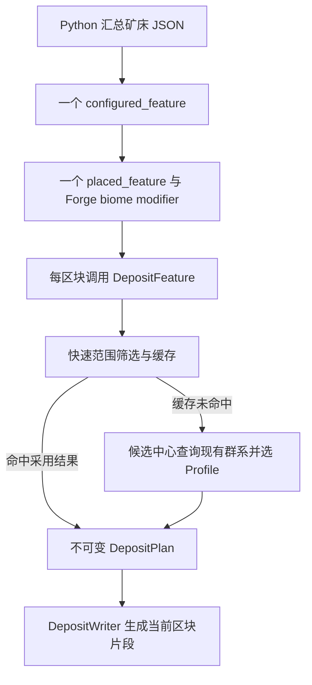

# 无新增 Mixin 的共享矿床生成架构

- Time: `2026-10-24 03:16:48 +08:00`
- Authors: `OpenAI Codex / GPT-6，架构设计与源码核对`
- Status: `completed`。实现与限定范围的真实 Forge 验收完成；完整整合包/客户端限制见实施结果。
- Scope: Frosted Heart 中一个普通 Feature 类型及四个主要 Java 职责；TheWinterRescue 中共享入口、矿床配置和导出工具。
- Related: [已撤销的旧方案](2026-10-24_02-15-15_hydrothermal-deposits-v1-design.md)、[撤销记录](../diary/2026-10-24_02-45-22_hydrothermal-mixin-removal.md)、[仓库规则](../AGENTS.md)。

## 1. 已确定的边界

新增一种 `frostedheart:deposit` Feature。它以数据包配置生成有种子随机性的池盆、裂隙、洞厅和矿化围岩；同一类地质形态的多种矿床复用它。

新增 Mixin 为零，不注册 BiomeSource 或 ChunkGenerator，不改变 normal.json 的气候表。实际群系继续由现有 multi_noise 决定，地质体可以延伸到相邻群系。已有群系颜色、温度、群系采矿配方仍按实际群系生效。不会因为生成了地质体而重划这些规则的范围。

用户明确拒绝凭空供热。本架构不改变水温、体温、热系统或热源注册；水与沉淀柱属于世界生成的普通方块。第一版不新增喷口粒子方块，先以水体、矿化与静态地貌建立辨识度。局部动态表现如后续需要，单独说明其成本，不能混入本次代码预算。

生产代码目标约 400–600 行，拆为四个主要文件，测试、数据和资源另计。这是规模预算，不是为了压缩代码而必须满足的行数指标。必需的规则写清楚，文件按职责划分；不建立通用地质模拟、插件继承体系或后台地区管理器。

## 2. 游戏中的第一版结果

热液配置保留已有洞穴环境，同时生成一处有方向的矿床主体：两处相连洞厅、一条主裂隙、零至两条短支裂隙、主池和二至三级小台地，以及沿裂隙分布的矿物。一个可选侧厅增加地点变化。

热液初始配置的主体长 160–224 格、宽 64–96 格、垂直包络高 40–56 格；主池目标深 6–10 格。具体池底、顶部和沉淀层均在本次抽取的垂直包络内。至少有一条连接主要空间的干燥岸台，净宽和净高目标均不小于三格。后续测试统计有效尺寸，不把配置上限当作每处必然达到的结果。

主池、通路、封闭层、必有台地和主要矿化均来自同一份布局。原版浅池/柱体组合可用于外围补充，不承担上述必有结构。这样不会把“核心是否生成成功”交给多次独立随机放置。

本架构保证的是采用地点的地质体形状与跨块连续性，不保证每一片很小的气候群系都命中一处大矿床。小片群系保留少量背景矿和沉淀痕迹，资源密度与选址概率通过统计调校。

## 3. 四个 Java 文件及接口

拟放在 `com.teammoeg.frostedheart.content.world.features.deposit`。

| 文件 | 责任与主要接口 | 不承担的内容 |
|---|---|---|
| `DepositConfig` | `FeatureConfiguration`、Codec、参数范围、群系 ID 到 Profile 的直接查找、少量材料权重的预计算；持有本配置的派生缓存 | 世界扫描、几何计算、方块写入 |
| `DepositFeature` | `place(context)`；检查维度与候选范围，取得现有种子/RandomState，查缓存，构造或拒绝布局，调用 Writer | 逐方块选址、群系来源替换 |
| `DepositPlan` | 根据种子与 Profile 构造不可变几何；`intersects(chunk)`、`sampleColumn(x,z,out)`；私有路径、池体和矿化参数 | 读写区块、保留世界引用 |
| `DepositWriter` | `write(level, chunkPos, plan, profile)`；按柱形成空腔、通路、封闭层、静态沉淀和矿化；仅写当前区块 | 决定地点是否存在、生成邻块、服务端 tick |

Range、Placement、Profile、Materials、OreEntry、CacheEntry、Column 等小记录作为所属文件的内部类型；不为每种矿床新增继承类、工厂或管理器。Column 是调用者复用的输出对象，每次采样必须完整赋值。

Feature 注册复用现有 `FHFeatures.FEATURES`。如需共用防替换围岩，在现有 FHBlocks 中注册一个普通 Block，复用凝灰岩贴图；它没有专用方块类、BE 或随机 tick。

旧草稿中的 Plan/Generator 可作为几何与写入的起点，但必须重构：删除 containsBiome、固定矿石 ID 表、sampler 接线、未接入喷口块等旧职责。Regions 不再作为世界上下文管理类保留。



## 4. 数据包入口：每区块一次，不能只挂热液群系

计划新增一个 configured_feature：`the_winter_rescue:deposits/main`，类型为 `frostedheart:deposit`。一个同名 placed_feature 引用它，`placement` 为空。

共享入口用 `forge:add_features` 挂到 `#the_winter_rescue:deposit_generation`，阶段选择 `top_layer_modification`。标签覆盖所有可能参与主世界地形的群系，初始合并 `#minecraft:is_overworld` 与现有 `#the_winter_rescue:all_twr`。

不加 count、in_square、height_range 或 `minecraft:biome` 放置过滤器。这里仍使用 Forge biome modifier 添加共享入口，两者是不同机制。随机位置、频率和允许矿床类型由共用入口处理。保留当前原点即可定位正在装饰的区块；不能由放置修饰器把入口挪到另一区块。

原因：一处矿床可能跨十余个区块，外围区块的实际群系可能已经不是热液。如果只给热液群系挂入口或按当前原点群系再次过滤，外围会漏生成。统一挂载只提供一次回调，未选中的区块快速返回，不为每种矿床增加一套全局回调。

原版会从附近 3×3 区块的各高度段收集群系，汇总并去重 placed_feature 后调用。因此验收要从实际加载后的 biome source 检查全部 possibleBiomes 是否都能获得共享入口，同时统计每个目标区块调用次数。标签不完整是数据错误，不能用向远处写方块弥补。

选择后段装饰阶段，是为了在当前区块的普通洞穴、矿石、泉水及地下结构之后形成主体，减少其立即改写新池体的机会。它不保证排在所有第三方同阶段 feature 之后；邻块后续装饰仍要靠材料约束和真实测试核对。

拟输出：

```json
{
  "type": "forge:add_features",
  "biomes": "#the_winter_rescue:deposit_generation",
  "features": "the_winter_rescue:deposits/main",
  "step": "top_layer_modification"
}
```

## 5. 共用候选与 Profile 选择

默认候选单元为 512×512 格，每格最多一处主体；中心相对单元中心在 X/Z 各扰动最多 80 格。所有雕刻、围岩、矿化、细节的水平外接半径统一上限 160 格。

按以下顺序执行：

1. 检查配置的目标维度；使用 `floorDiv` 算出当前区块所属候选单元，兼容负坐标。
2. 用世界种子、全局 salt、单元坐标派生中心 X/Z、参考 Y 和概率值。使用纯坐标哈希，不新建每区块 RNG。
3. 概率未命中或当前区块不与半径 160 的可能范围相交，立即返回；尚不访问群系、地形高度或缓存。
4. 对剩余区块查该配置的候选缓存。
5. 缓存未命中时，通过 `generator.getBiomeSource().getNoiseBiome` 在候选中心、参考 Y 查询一次现有群系，直接用其注册 ID 找 Profile。无 Profile 或 Profile 概率未命中，缓存拒绝结果。
6. 构造少量几何参数，用生成器的基础高度查询做最多五个顶盖探针；明显露头或垂直空间不够时拒绝整处候选。成功后缓存不可变 Plan。
7. 对采用地点进行更精确的写入范围相交判断，只处理实际相交的区块。

参考 Y 在一份共享范围内由种子选出，初始热液范围为 -24..0。Profile 不再次把中心搬到其他高度，避免选中的群系与最终中心不一致。新增深层矿床时在数据中评估共享 Y 范围与命中率；仍是一处单元一个主体，不增加按矿床类型逐一采样的循环。

Profile 使用 `Map<ResourceLocation, Profile>`，键即允许作为候选中心的群系 ID。选中类型是一次 Map 查找，不遍历所有矿床。添加另一份 Profile 不改变其他地点的随机流或排序。

顶盖探针只排除明显不合适的地点，不证明全部位置都有天然顶盖。天然洞穴与干燥侧壁相通可以保留，池底与池壁由 Writer 构造。候选群系查询使用生成器和现有 sampler，基础高度来自生成器；不调用远处 `level.getBiome/getHeight/getChunk`，不强制加载远处区块，也不以已装饰地面作为规划输入。

运行入口使用已有 API：`context.level().getSeed()`、`context.chunkGenerator()` 与 `context.level().getLevel().getChunkSource().randomState()`。由后者取得 sampler，使用 QuartPos.fromBlock 转换 X/Y/Z 后，在所选中心查询源群系；这一定义不额外追踪 BiomeManager 的方块级抖动边界。高度查询使用同一 generator、RandomState 和高度范围。规划完成后不把这些运行时引用存进 Plan。测试若构造不同于当前世界的 generator，须显式使用相配的 RandomState，不能让生产路径猜测一个替代种子。

## 6. 包络不重叠与跨块连续性

默认参数下，中心离单元边界至少 176 格，扣掉外接半径 160 后还有 16 格余量。相邻单元中心最小间距为 352，两处最大包络之间至少相隔 32 格。因此当前位置只查自己的单元即可，不需要邻近九格搜索或候选冲突图。

允许修改 cell_size / jitter 时，导出工具检查：cell_size 为 16 的倍数，且 `cell_size/2 - jitter >= 160 + 16`。有效形状还必须满足：

```text
sqrt((length.max/2)^2 + (width.max/2)^2)
 + transition + 3(两格水平封闭层的对角余量)
 + ceil(sqrt(2) * roughness) + detail_reach
 <= 160
```

热液建议值 length.max=224、width.max=96、transition=16、roughness=2、detail_reach≤6，总水平占用界小于 150 格。所有实际写入还必须满足最终包络；必有空间位于内部，不能依赖最后硬裁切修补越界参数。

每个区块用同一世界种子、单元与 Profile 得到同一 Plan，只写自己 16×16 的 X/Z 范围。相邻块所需的两格几何 halo 由 Plan 采样，不读取邻块的实际方块。矿化和沉淀也按全局坐标计算，不能在每个区块重新随机选择另一条矿脉。

## 7. 缓存所有权：配置快照内的有限 memo

一个解码后的 DepositConfig final class 持有一个 64 槽 `AtomicReferenceArray<CacheEntry>`，正结果和拒绝结果共用容量。Profile 映射、材料权重是只读派生数据；缓存字段不参与 Codec 序列化。方块标签沿用 Minecraft 的当前绑定，不在 Codec 解码时复制尚未绑定的成员表。

CacheEntry 的匹配条件包括世界种子、单元坐标、当前 generator 和 RandomState 的对象身份；如规划使用高度上下限，也纳入相应整数。配置身份由所属缓存隐含确定。

generator 与 RandomState 身份使用弱引用，Plan 仅保存几何数值和本配置材料引用。缓存不保留 ServerLevel、WorldGenRegion、ChunkAccess、闭包式地形查询器或玩家。配置重新加载得到新快照与新缓存；旧缓存可随旧配置回收，不需要新增世界卸载监听、静态世界目录或 NBT。

这里的重新加载指确实解码了新的 worldgen 配置快照，不能承诺 1.20.1 的一次 `/reload` 就替换既有世界生成注册表。初版导出后以重启/新测试世界确认加载。缓存只保存选址与几何，绝不保存“该地点已生成”的完成标志；每个相交区块都仍须生成自己的部分。

未命中时允许多个工作线程重复计算同一份纯规划，再以不可变条目覆盖槽位。覆盖、冲突和淘汰只影响重复工作，不改变结果；不以等待某线程或访问顺序决定几何。槽位采用明确的坐标哈希，不建立 LRU 链表或全局锁。

目标保留量≤256 KiB/配置，实施后测量实际对象大小；此处未包含 Minecraft 已有的 RandomState/注册表内存，因为缓存不会强引用它们。

## 8. 自然随机形状与按柱计算

Plan 在采用地点时生成主路径四段、干燥岸台路径四段、可选短支路至多两段，以及两处必有洞厅和一处可选侧厅。干燥岸台使用连续路径和固定小高度差，避免逐块随机台阶破坏通行。

每段的宽度、底部和顶部参数沿路径插值；洞厅中心、长宽比例与高度由种子变化。两处必有洞厅与主路径重叠连接，侧厅与支路有明确交点。不会仅靠旋转两个固定椭圆制造差异。

小尺度水平扰动使用两份有界的二维相关场，初始空间尺度约 24 格、每轴振幅最多两格。先用控制点形成主要地貌，相关场只破除过直的岸线和墙面。第一版不叠多层三维噪声，也不建立任意 SDF 节点图。

每个 X/Z 柱采样一次：至多十条路径段、三个洞厅截面和少量台地，得到 floor、roof、waterLevel、walkway、alteration、mineralBand 等输出。第一版每柱只表示一个主要开放区间，可形成台地与局部柱体，不支持同一 X/Z 下多层完全独立的洞厅。

Writer 先采 20×20 几何 halo，使用固定大小的 primitive 数组；两格邻域膨胀确定封闭层，逐 Y 写入时只检查预计算区间与材料。几何暂存目标≤16 KiB/任务，不保存整个地区或整个区块的三维距离数组。垂直候选范围上限为主体 56 格加上下各 8 格，即最多约 18,432 个候选方块位置/完整 16×16 覆盖区块，实际先剔除空柱和无相交区间。

外围以内部/外部包络间的 smoothstep 权重降低蚀变和细脉密度，不使用实际群系边界硬切地形。水盆的封闭层保持确定厚度，渐变只用于周围表现。

## 9. Writer 的材料与水体规则

处理顺序明确为：保护判断 → 主体空腔/水/岸台 → 封闭层 → 内侧沉淀皮层/柱体 → 围岩与矿化。所有垂直区间用半开区间 `[minY, maxYExclusive)`，Column 的 roof 为上界外一格，避免预算与实际循环相差一层。只写变化的状态，复用 MutableBlockPos。使用世界生成的正常 `level.setBlock` 接口，保留高度图、状态变化和必要后处理通知；第一版不直接替换 Section palette 或绕过该接口。

雕刻用 carvable 标签，矿化用 host 标签，两者分开。前者需要包含可移除的天然岩石、原矿和自然碎屑，避免挖洞后矿石悬空；后者限制矿化能替换的自然基底。空气与允许的现有水体单独判断。床岩、带 BE 的状态和受保护标签优先保留；热液配置不把既有岩浆默认视为可覆盖水。

水盆使用共用静态封闭层，内侧可加自然沉淀皮层或矿包。皮层的变化不能拆掉后面的封闭层。封闭层加入 `minecraft:features_cannot_replace` 和 `minecraft:lava_pool_stone_cannot_replace`，并排除出普通矿石、地面替换与雕刻目标。标签只能约束尊重它的算法，不能声称所有原版和第三方结构都会尊重它。

相通的下部空间共用主水位；高处台地池有独立池底与岩坎。默认形成静水，只在明确的小型出口允许流动，不靠大量水源向外漫灌。生成时区分需要正常后处理的边界和稳定内部水，不无差别安排所有水方块持续 tick。

生成后的水与材料继续服从现有温度、冻结和相变规则。验收区分漏水与正常的冻结/凝固，不能通过定期回填水或固定升温维持外观。由于实际群系未重划，现有热液群系的温度修正覆盖位置也不会因新来源而扩大。

矿物根据同一裂隙走向形成带状或间断矿包。相关分布决定矿化区域，位置哈希只选局部材料与小细节；不靠高比例逐块独立随机制造满墙盐胡椒状矿石。Rule/host 匹配和材料 palette 在配置层预处理，逐方块不解析 ID、不查 Forge 注册表、不构造 RNG。

已有地下结构与保护方块相交是明确的兼容边界。第一版不构建全局结构避让系统，也不宣称任意相交情形下都能保住既有建筑及原尺寸水盆。验收必须包含实际结构交叉与邻块后续 feature；发生阻碍封闭的具体场景需定位处理，不能覆盖 BE 或以未检查的池体计作成功。

## 10. 数据格式与唯一手写来源

第一版 Profile 为池盆/裂隙这一种形态族提供参数，不开放 script、回调名或任意算法图。Range 为简单 min/max；材料采用现有 BlockState Codec 和方块标签，避免增加自建材料注册表。

以下是拟实现的配置合同示例，尚未注册运行：

```json
{
  "type": "frostedheart:deposit",
  "config": {
    "dimension": "minecraft:overworld",
    "placement": {
      "cell_size": 512,
      "jitter": 80,
      "anchor_y": {"min": -24, "max": 0},
      "chance": 0.75,
      "salt": 48151623
    },
    "profiles": {
      "the_winter_rescue:hydrothermal_deposits": {
        "chance": 1.0,
        "shape": {
          "length": {"min": 160, "max": 224},
          "width": {"min": 64, "max": 96},
          "height": {"min": 40, "max": 56},
          "pool_depth": {"min": 6, "max": 10},
          "water_offset": -6,
          "bend": 0.18,
          "roughness": 2,
          "terraces": 2
        },
        "materials": {
          "carvable": "#the_winter_rescue:deposit_carvable",
          "host": "#the_winter_rescue:deposit_host",
          "lining": {"Name": "frostedheart:deposit_lining"},
          "sediment": {"Name": "minecraft:calcite"},
          "altered": {"Name": "minecraft:tuff"},
          "fluid": {"Name": "minecraft:water"},
          "column": {"Name": "minecraft:basalt"}
        },
        "ores": [
          {"host": "#minecraft:stone_ore_replaceables", "state": {"Name": "frostedheart:pyrite_ore"}, "weight": 5},
          {"host": "#minecraft:deepslate_ore_replaceables", "state": {"Name": "frostedheart:deepslate_pyrite_ore"}, "weight": 5}
        ]
      }
    }
  }
}
```

例中只列一种矿物说明 schema，正式热液 Profile 还包括经矿量校准的铜、锌、铅、银、镍；不把示例误作正式掉落平衡。height 是整个主体的垂直包络，不是每个洞厅的净高。pool_depth、water_offset、台地与扰动必须能装入该包络，不能以最后裁切偷偷缩掉必有池深。bend 是控制点横向偏移相对半宽的比例，roughness 是每轴的最大水平位移格数，相关场空间尺度首版固定约 24 格。water_offset 相对参考 Y，terraces 是有界台地层数。

唯一手写来源计划为 `Scripts/worldgen/deposits/placement.json` 和 `profiles/<biome-path>.json`。标准库 Python 导出器汇总为一份运行 configured_feature，并生成共享 placed_feature、Forge biome modifier 与标签。字段编码与运行 schema 一致，只做汇总与常规边界核对，不再发明模板语言。

导出器支持 `--check` 比较预期输出与现有输出，`--write` 写入确认的差异。检查群系/方块引用、范围和最大包络；不改 normal.json，不重新生成或迁移气候表，不丢失此前已保存的深层群系记录。新增同类矿床只加 Profile 与必要材料数据，所有矿床仍使用同一个 Feature 注册。

## 11. 原热液内容的迁移

| 原入口 | 第一版处理 |
|---|---|
| hydrothermal_lake、hydrothermal_delta | 主池与台地并入共享布局；从热液群系移除原高频独立入口，解除扫描后重采样 Y 的错误组合 |
| hydrothermal_magma、热液群系的岩浆湖/泉 | 不作为新热液主体的标志，减少独立入口；不改其他岩浆群系的内容 |
| 闪长岩团、calcite_strip | 原共享配置保留供其他群系使用，热液自己的重复大范围替换减少 |
| hydrothermal_geode、特有矿石 | 主要富集交给共享布局，剩余作为低频背景；按原版生成统计校准产量 |
| vines、glow lichen 等 | 作为外围背景，减少独立扫描与核心遮挡，不作为核心结构的成功条件 |
| 新 waterlogged_vegetation_patch / block_column 组合 | 原版能力可用于小型沉淀背景；不跨块负责必有主池或通路，不以次数叠加填满整个群系 |

迁移前保存当前版的分布和矿量统计；不在原产量之上再叠加整套富矿带。热液 biome ID、矿物 ID 和既有群系采矿配方保留。第一版实际启用热液配置，第二份不同材料的 Profile 先作为测试夹具，验证复用后再按后续任务接入游戏。

## 12. 可维护性与改动面

生产接入限于四个新职责文件、FHFeatures 一项注册、必要的共用静态围岩注册与资源，以及数据包/导出工具。既有 Mixin 配置、NoiseBasedChunkGeneratorMixin、BiomeSource、ChunkGenerator、normal.json 与温度代码均不加入本功能逻辑。

每个方法保留直接控制流。全局坐标/局部坐标/区块坐标在变量名中区分；所有尺寸单位为格，概率范围为 0..1。几何数组私有，Profile 为只读快照。算法随机流用明确固定 salt/用途分流，不依赖 Map 顺序、feature 索引、配置对象身份哈希或调用者 RNG 的消耗次数。配置实例身份只用于缓存隔离，不进入几何种子。

拒绝结果也有意义：统计应区分概率未命中、无匹配 Profile、地形不适合、范围不相交和实际写入。相关计数放测试/诊断入口，普通生产热路径不常驻计时器或逐块日志。

后续只有新材料和尺度时改数据；出现完全不同的地貌族时再增加相应几何能力或另一种正常 Feature。不会把所有未来矿床塞进越来越多的 boolean 分支，也不会按群系增加 Mixin。

## 13. 性能目标与统一验收

结构上限：一份全局入口、每区块一次回调；粗筛后才查缓存/群系；每个冷候选一次群系查询、最多五个基础高度探针；每配置最多 64 缓存项；每相交柱至多十条路径段与三个洞厅；暂存≤16 KiB，缓存目标≤256 KiB。第一版无三维全场缓存、跨块实际地形扫描、后台线程、BE 或持续供热。

首轮目标：普通区块完整生成均值/P95 无可重复超过 3% 的回退；热液区域完整生成耗时争取不高于当前版，超过 5% 的稳定回退先定位热点；按实际分布频率加权的总生成耗时争取不增加。这些都是目标，尚未实测。

统一验收分为：

1. **数据与入口**：真实 Codec/资源加载；全部实际主世界群系有且仅有共享入口；添加第二份 Profile 不增加全局入口、不移动原有地点；导出 --check 通过。
2. **布局与缓存**：至少八种子、三十二处采用地点及三十二个拒绝单元，覆盖负坐标、单元边界、不同维度/种子、重新加载、64 槽碰撞、逆序和四线程；缓存结果不影响选址和几何。
3. **真实方块生成**：完整生成所有相交区块，检验尺寸、通路净空和连通、水位、两格封闭层、越界写入、矿化连续性；测试在既有水洞、岩浆、受保护块及地下结构附近的具体结果。
4. **后续影响**：真实 Forge 跑完整 FEATURES 与光照，改变区块顺序，并观察流体安定至少十分钟；明确主算法的确定性与原版其他装饰产生的差异，不能宣称所有第三方最终方块逐位相同。
5. **产量与性能**：当前版、新版仅主体、新版完整内容，同机同配置交替多轮；报告冷/暖规划、均值/P95、CPU、分配、实际成功次数、矿物量与新旧分布。测试包含当前 FH 的方块状态观察与完整写入路径，不能跳过其通知后声称性能更好。热液每种矿物按有效矿床体积的初始目标为旧版 ±10%，同时报告每单位世界面积的变化。
6. **视觉**：同种子多处地点检查整体轮廓、岸线、重复感和外围过渡；真实客户端观察水与透明层成本。服务器体素剖面可辅助，但要标明不是游戏截图。

测试使用真实 Forge GameTest/运行入口和原算法输出，遵循仓库现有规则，不建立镜像实现的 JUnit 套件。旧峡谷实验只作方法参考，不能作为本功能性能证据。当前已有的编译通过只证明撤销旧接线后可编译。

## 14. 实施顺序与文档

先实现配置 Codec、入口粗筛和可复用布局，并用第二份材料配置验证复用；再实现跨块 Writer、封闭层和热液 Profile；随后迁移旧入口、加入小型背景细节，最后统一完成上述验收。首轮只在新测试世界验证，已生成区块不重写；更改 salt/范围/布局参数后新旧区域可能有接缝，按普通世界生成数据变更记录。

实现后新增 world-generation 的 living docs，说明已实现参数、阶段、生命周期和限制，再更新 docs/README 并追加 diary。四个核心职责是预算，若实际需要更多代码，应先检查是不是加入了额外功能或可复用已有 API；不能以压缩可读性换行数。

## 15. 当前交付与源码依据

本节记录架构稿建立时的状态；当前实现与验收结果见第 16 节。旧自定义来源/Mixin 方案已撤销。

已核对的 Minecraft 1.20.1 / Forge 47.3.0 源码事实：FeaturePlaceContext 提供 level/generator/random/origin/config；WorldGenLevel 提供种子；ServerChunkCache.randomState 提供已存在的采样状态；ChunkGenerator 汇总并去重相邻群系的 feature；WorldGenRegion 对远处写入有限制，其 setBlock 保留状态变化和后处理；StructureStart/StructurePiece 按目标区块裁切标准结构放置。现成 WaterloggedVegetationPatchFeature、VegetationPatchFeature、BlockColumnFeature 的组合能力已核对，但其浅池与直柱不能替代全部主地貌。

| 证据 | 对应约束 |
|---|---|
| [FeaturePlaceContext.java](<C:/Users/da's'b/AppData/Local/Temp/twr-worldgen-evidence-09myjqz1/FeaturePlaceContext.java:31>)、[WorldGenLevel.java](<C:/Users/da's'b/AppData/Local/Temp/twr-worldgen-evidence-09myjqz1/WorldGenLevel.java:11>) | 正常 Feature 入口可取得所需信息 |
| [ServerChunkCache.java](<C:/Users/da's'b/AppData/Local/Temp/twr-worldgen-evidence-09myjqz1/ServerChunkCache.java:420>) | 使用已有 RandomState，不注入 sampler 字段 |
| [ChunkGenerator.java](<C:/Users/da's'b/AppData/Local/Temp/twr-worldgen-evidence-09myjqz1/ChunkGenerator.java:280>) | 群系汇总与共享入口覆盖检查 |
| [GenerationStep.java](<C:/Users/da's'b/AppData/Local/Temp/twr-worldgen-evidence-09myjqz1/GenerationStep.java:30>) | 原有后段装饰阶段 |
| [WorldGenRegion.java](<C:/Users/da's'b/AppData/Local/Temp/twr-worldgen-evidence-09myjqz1/WorldGenRegion.java:236>) | 不从一个 feature 向整片远处矿床写入 |
| [WorldGenRegion.setBlock](<C:/Users/da's'b/AppData/Local/Temp/twr-worldgen-evidence-09myjqz1/WorldGenRegion.java:257>) | 保留状态变化与后处理合同 |
| [FHFeatures.java](D:/Frosted-Heart/src/main/java/com/teammoeg/frostedheart/content/world/FHFeatures.java:81) | 复用项目已有的 Feature 注册机制 |

## 16. 实施结果

- 已实现四个主类、一个普通 Feature 注册和一个共享围岩块；数据包有一个共享入口与 Python 导出器。无新增 Mixin/群系来源/生成器/供热。
- 源码与当前行为见 [world-generation.md](../docs/world-generation.md)。主气候表不重生成，全部 45 个 possible biome 有共享入口覆盖。
- 真实 Forge 完整区块对照、矿量、缓存并发、跨块写入、第二份材料配置和 600 秒流体观察通过；补充验证了实际气候表下 260 处可采用候选。
- 旧背景矿脉次数保留，晶洞期望次数从 1.4 温和减到 1.3，以保持原有矿量；性能比较没有用大幅削减资源换取结果。
- 完整整合包的自定义噪声完整生成耗时、所有第三方结构和客户端表现没有被本轮数据证明。源代码保持普通材料/热系统规则，已生成区块不回写。
- 完整开发与校验记录：[实施日记](../diary/2026-10-24_04-29-02_shared-deposits-feature-acceptance.md)。
