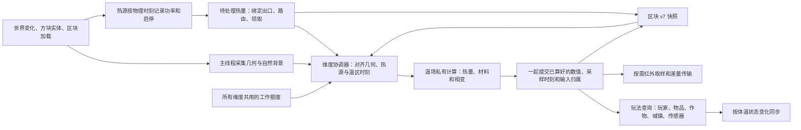

# 百人热模拟架构审视：从世界输入到玩家读数

- Time: `2026-11-19 20:14:31 +08:00`
- Authors: `OpenAI Codex，架构检查与已有运行记录复核`
- Status: `completed`（架构审视完成，候选改动的收益分别列在下文）
- Scope: Frosted Heart 服务端固定温场、主线程交接、查询与玩法消费者、区块生命周期、客户端同步接口。
- Related: [运行时合同](../docs/climate/thermal-runtime-control.md) · [预算因果对照](../docs/climate/validation/thermal-validation-reports-2026-11-19-to-20.md#thermal-service-delay-2026-11-19) · [百人服迭代记录](../docs/climate/validation/thermal-100p-validation-2026-11-18-to-19.json)

## 审视结论

启动高峰超过共享额度会推迟普通温度更新，实服改变额度和固定任务停顿对照都已复现。最大一笔执行成本来自温场推进。节省 CPU 最值得量的是同一份物理结果用了多少格、面、输入和数组遍历。改善 40 tick 及时率最值得量的是一个可推进温区从就绪到提交的时间，以及其中花在预算等待、其他温区和取消重算上的时间。

上一轮把合批排在首位，证据只够确认其作用范围。进一步追踪到 `SpatialHeatStore.Claim`、`SpatialHeatBuffer.seal` 和 `TiledThermalField.begin`，发现缩小计算批次也会增加整表筛选次数。先用同一组输入对比提前发布的收益和增加的工作，再决定批次大小。[数值调度][engine] · [输入领取][store] · [缓冲][buffer] · [温场][field]

## 实际链路与审视范围

核对工作区 `5edad63b6` 基础上的 H3 路径，盘点 `src/main/java/com/teammoeg/frostedheart/content/climate/thermal` 下 20 个目录的 114 个 Java 文件。按核心类型名交叉检索 `src/main/java` 时找到 46 个外围 Java 文件，另从 Forge 事件、Mixin、世界温度、玩家体温包和红外请求追到实际入口。文件数描述静态范围。检查内容还包括解析热场、辐射遮挡、休眠冷却、相变回执、保存、重入和关闭。蒸汽热网有自己的热量库存，接入物理温场的边界是机器报告的热源。客户端显示的范围到服务端供数和同步协议为止。[正式入口][input] · [事件][events] · [物理源与热网](../docs/climate/heat-production-and-network.md) · [红外协议](../docs/climate/infrared-view.md)

空间分组、输入归属和采样时刻各有现成所有者。`ThermalPageHandle` / `PageSignatures` 管区块寿命和几何，`SpatialHeatStore` 的领取与确认管输入热量，`Tile` 的已提交帧和 `sampleTick` 管数值与时间，`Domain` 只持有成员集合。`ThermalSolver` 仍向拓扑安装提供片段，正式数值推进由 `TiledThermalField` 执行。排查直接使用 `ThermalWorkerPool.chargeService` 的实际计费路径。配方重载经 `invalidateGameplayProfilesForRecipeReload` 关闭现有运行时、清除物性快照，下一次创建重建；应单独核对重载到首个新值的延迟和跨寿命资源释放。[运行时合同](../docs/climate/thermal-runtime-control.md)

H3 的实测字节码中仍是 `injectAirFace(long,int,double)` 和 `cornerMask(...)`。工作区另有上轮暂停的热源分配草稿。以下运行数字都来自 H3 或明确标注的历史对照，草稿的正确性和收益仍待验证。

## 这次百人负载的量级

原额度短测为 100 名客户端、25 座基地、点燃 1,600 个营火、1,400 个测量 tick、6,000 次驻地查询。新读取方式在 250 ms/s 下得到 4,144 次及时、942 次过期和 914 次缺失。只改变诊断服额度的独立运行分别得到 5,478、57、465，预算延期请求从 3,819 次变为 0 次。原额度组的 942 次过期，在读数分类时都落在 Section 数值时钟落后一类。工作线程时序会随运行改变。原版 H2/H3 全程净差 1,452 次的逐笔归因仍然开放。[四组实服与固定任务对照](../docs/climate/validation/thermal-validation-reports-2026-11-19-to-20.md#thermal-service-delay-2026-11-19)

原额度组 20,537 笔观测到的区域任务在测量窗口累计计费 **15.378 秒**。下表为互斥阶段的**任务经过时间**。包含该段执行中发生的系统抢占、GC 和观测开销。各百分比的分母是 15.378 秒。

| 阶段 | 秒 | 占比 | 口径 |
|---|---:|---:|---|
| 温场推进 | 8.941 | 58.1% | `TiledThermalField.advance`，含数值推进及几何提交时调用此方法的部分 |
| 拓扑准备 | 1.352 | 8.8% | `TopologyUpdatePlanner` 准备阶段的独占时间 |
| 更新各区的物理截止时刻 | 1.035 | 6.7% | `refreshFixedBoundaries` |
| 内存计账 | 0.787 | 5.1% | `reserveAirBacking` 和几何存储交接 |
| 几何推进 | 0.674 | 4.4% | `FixedGeometry.advance` 扣除已单列的子阶段 |
| 就绪检查和选区 | 0.493 | 3.2% | 包括 `nextFixedDomain` 以及几何选择 |
| 热源进入、驻留维护、几何写入准备 | 0.388 / 0.276 / 0.263 | 2.5% / 1.8% / 1.7% | 三项分别计量 |
| Page 的方块签名投影 | 0.017 | 0.1% | 仅 `PageSignatures.copyBricksTo` |

放宽额度组的同一新版在约 70 秒内累计任务计费 16.837 秒，平均 **240.6 ms/s**。其中第 100–200 tick 实际经过 4.769 秒，即使初始全额可用，按原规则也只有 1.442 秒。在剔除控制与几何任务、扣去全部重叠 GC 后，单算温场推进已用 1.833 秒。该区间完整普通任务中可辨认的阶段合计至少 2.362 秒。若这一批工作仍须在同一时间窗口完成，单就已筛出的 1.833 秒推进，要进 1.442 秒的额度，耗时至少要降低约 21%。其他普通工作还要占用同一额度。这个比例只用于这一段任务流。

## 20 个具体的优化位置

| # | 位置与代码依据 | 可能的改进、采用条件和判据 |
|---:|---|---|
| 1 | **首次加载与世界采集**。`attachLoadedWorld` 首次接管已加载区块，`tickOpen` 处理发现、方块变动和按 20 tick 提交。`MinecraftPageManager` 已对新 Page、Brick 捕获和全同步分别限量。 | 区分首次源发现、首次 Page 几何和首次可读值三段延迟。若首读主要等采集，可按已有热源或实际接收方调整有界队列的先后。记录首读与主线程 tick P99。[入口][input] · [Page 管理][pages] |
| 2 | **空间范围**。`Page` 描述 16³ 块，`Brick` 以 4³ 分配，`Tile` 保存逐格焓和采样时刻。`domains()` 把相邻的已分配、未冻结 Tile 和已启用的传热路径连成温区。 | 统计每个温区的 Tile、常驻 Brick、实际参与交换的格与跨界路径。若空间相邻经常覆盖物理上互不影响的部分，可收紧温区边界。验证要包含跨面、角点供热、通风连线以及合并与分离事件。[温场][field] |
| 3 | **几何和通风的重建范围**。`continuationBoundary` 按已捕获、待安装及通风依赖向外扩。短测 426 次几何提交累计登记 102,849 个边界 Section，其中 315 次提交与前次同输入序号、同物理切点。JFR 分配采样按栈中首个热模块方法归类，该边界方法约 85.5 MiB。 | 给边界成员、真正改写的 Brick、变化路由分别计数，比较同切点前后集合的交集。若交集和重复准备成本都高，优先复用未变化的几何依赖。分开的两个基地可能在同一时刻各做一次必要提交。[拓扑准备][planner] · [几何就绪控制实验](../diary/2026-11-20_03-02-02_thermal-runtime-and-material-history.md#thermal-geometry-readiness-cpu) |
| 4 | **输入交接与截止时刻**。`processFixedRound` 在几何入口交接完后更新 `transportThrough`。`refreshFixedBoundaries` 有缓存，但结构或温区成员变更会清缓存，控制版本变化也会遍历待处理输入。普通路由尚有就绪项时，这轮可先返回。 | 记录某温区的输入都齐了却还在等哪个 Section、哪条路由。若经常等无关区域，可按实际受影响成员更新截止与放行。原额度组两份迟滞快照里的 `offeredThrough` 与 `transportThrough` 相等，现有证据只确认截止计算成本。[协调器][engine] |
| 5 | **热源启停、绑定与重试**。原功率按窗口结算，熄火后最后一段热量仍须交付。`SpatialSourceIngress.hasReadyWork/advance` 检查或轮转待处理源，`dependenciesChanged()` 使用共享版本，部分几何变化还会重新排入待路由热流。 | 数每次依赖变化实际唤醒多少源、检查多少、推进多少。若改一个出口使许多无关源重查，利用现有 Section、出口、Chunk 索引定向唤醒，保留最后一笔热与跨区出口归属。[源入口][ingress] · [输入仓][store] |
| 6 | **小范围任务仍筛整份输入和 Tile 目录**。`SpatialHeatStore.Claim.prepare` 从所属输入流链表筛接收方，`SpatialHeatBuffer.seal` 扫数组至已用过的最高槽位，`TiledThermalField.begin` 扫已分配 Tile。短测各次发布时累计分配的 Tile 为 150,252，实际报告发布 14,542。这是提交时的两个规模计数。 | 在每处记实际访问数和选中数。小范围命中率低时，优先复用 Chunk 输入索引与既有温区成员，只访问有关输入和 Tile。保留跨窗口领取、当次新增输入及延迟热量的单一所有者。把这项成本一并纳入拆批试验。[输入仓][store] · [缓冲][buffer] · [温场][field] |
| 7 | **独立温区的合批、发布与取消**。`nextFixedDomain` 已优先选真实时钟最旧且可推进的温区。`fixedNumericalScope` 按相同物理区间和已付费输入容量合并独立域。一个域收到落入当前步内的旧输入可以触发整笔 `cancelFixedStep`。一次快照的在途范围为 144 个 Section。 | 分别量就绪到首次发布、每批独立域数、提交或取消前投入的工作及取消原因。若互等或返工占主要部分，在开算前按活跃规模和最旧采样余量限制独立域合批。两座独立基地的同输入同物理时刻有现成等价性用例。[协调器][engine] · [独立域对照][domain-test] |
| 8 | **工作线程、轮次与公平性**。每维的 mailbox 调用一个协调器，`processFixedRound` 按约 2 ms 的截止分片推进。保存控制可唤醒负责人。每轮有选择、检查和继续入队的固定开销。 | 分开记录有效推进、只处理控制、只探测就绪的轮次及各维最久等待。先减少无进展重查。若多维或大基地场景仍有空闲核心且预算有余，再评估独立域并行，同时计入同步、内存峰值和总周期。[mailbox][mailbox] · [协调器][engine] |
| 9 | **长期额度、短时峰值与执行暂停**。`serviceReadyAt` 将突发容量与每秒偿还量绑定到同一配置，所有热线程共用。已入场任务中的 GC 也进入计费。250 ms/s 是该存档配置，源码默认 1,000。 | 峰值导致的延迟已做因果对照。若允许短时占用更多服务时间，可独立设定有上限的突发余量，长时间按既定速率偿还。验收同时看及时读数、债额恢复与主线程 P99。持续超出长期容量时，仍要减少计算需求。[线程池][pool] · [预算实测](../docs/climate/validation/thermal-validation-reports-2026-11-19-to-20.md#thermal-service-delay-2026-11-19) |
| 10 | **有效数值工作与双帧复制**。一次物理步对选中 Tile 做工作帧准备、输入、浮力、正反交换和提交。`prepareTile` 在几何稳定时也会复制焓、分支以及签名和材料代次等数组。 | 先度量每一真实提交复制多少字节、扫描多少格和面、多少格产生了交换或相变。若稳定几何的复制占比高，可使与几何版本绑定的数据共享，只复制会变的状态。只有已证明在该步输入、边界、自然背景和相变条件下保持原值的区域，才适合精确跳算。[温场][field] · [数值模型文档](../docs/climate/thermal-gameplay-representation-exploration.md) |
| 11 | **静态几何与每步重新计算的关系**。实测 H3 的热源分配在角点寻找可接热格，写入时再定位接收方。浮力每步识别 4³ 区域内的空气连通组，再用当前温度求系数。JFR 执行栈两处均有样本，现有阶段计时只量到外层 `advance`。 | 把随方块布局变化的连通关系与每步必变的热量分配、温度梯度分别计时。可先验证单次分配内复用，再评估跨步复用的失效和内存成本。同一输入比较每格焓、面朝向、障碍、正负热和跨区结果。先前的 64 位混合覆盖与稀疏 Page 投影已有独立验证。[温场][field] · [已验证的页读取路径](../diary/2026-11-20_03-02-02_thermal-runtime-and-material-history.md#thermal-sparse-page-projection) |
| 12 | **材料相变和主线程回执**。一次正常数值提交之后会调用 `collectMaterialRequests`，把所有已登记的可相变材料列为待检查，再处理到请求容量上限。主线程核对方块并回执，材料控制变化可能取消在途计算。 | 在冰、水等材料密集区，量每次遍历数、真到相变阈值数、回执耗时和取消范围。若大多未变化，从实际提交或被修改的材料产生候选，保留未回执请求、材料身份与同一热量账。[相变管理][phase] · [主线程回执][phase-main] |
| 13 | **自然背景与天气变化**。主线程按列和 Section 有界更新遮盖、天空与自然背景。背景集合版本变化时 `refreshNaturalProfiles` 遍历已分配 Tile，对确有变化的 Tile 调整逐格自然背景。 | 分别量改一根柱、覆盖变化、天气/昼夜更新引发的刷新数与耗时。若局部事件经常触发全目录核对，可直接交接变更 Section 集合。保留逐格海拔、遮盖与相对于当地背景的温差。[环境捕获][env] · [自然背景合同](../docs/climate/thermal-runtime-control.md#自然背景) |
| 14 | **热区扩大、缩小与常驻维护**。`WorkerPageStore.advanceMaintenance` 已从变更 Section 开始并检查实际边界。空气和材料前沿可申请邻 Brick。`grow` 调整 Tile 存储。可选扩容有独立的容量等待。 | 数每次进入/退出以及不久后反向变化的 Brick、等待首次可读时间和搬迁字节数，再选取可复用数据或合并搬迁。必须区分物理修改、纯扩容和生命周期替换。短测可选准入拒绝计数为零，过去内存满时的故障另有修复回执。[驻留维护][resident] · [容量历史](../docs/climate/validation/thermal-load-100p-2026-11-15.json) |
| 15 | **内存计账、临时分配与 GC**。物理存储、拓扑准备、共享数组和快照有交接与复核。原额度短测中计账阶段占 5.1%，工作线程分配约 635.8 MiB，运行记录的热计账峰值约 115.1 MiB，目标 128 MiB。累计分配与同一时刻仍保留的内存描述不同现象。 | 先看分配栈和存活期，再选择减少临时集合或按变更增量计账，保留几何交接和偶尔全量复核。原额度窗口内 JFR 有 67 次 GC 暂停，暂停合计约 1.36 秒，与计费任务重叠累计约 0.25 秒。长期泄漏用可达对象验证。[计账入口][engine] · [内存与持有历史](../docs/climate/thermal-server-memory-evidence.md) |
| 16 | **发布与查询缓存**。玩家只能读取已提交帧。`QueryPublication.publishFixed` 在提交时遍历已有 Section 查退休项，`acceptedTick()` 又遍历已分配 Tile 取最早采样时刻。`invalidateQueries` 清除整个维度的 128 格查询缓存，缓存失效后分数坐标的读点需要重建角点和梯度。发布和部分读路径共享监视器。 | 分开看命中/未命中、与提交空间无关的失效数、读锁等待和重建时间。若频繁发生，可按真实退休集合更新目录，以覆盖插值邻域的局部版本控制缓存。该短测测量窗口记录的 `jdk.JavaMonitorEnter` 事件为零，小于录制阈值的等待另需采样。[查询发布][query] · [温场][field] |
| 17 | **保存、卸载、重入与恢复**。v7 存实际温度/焓、采样时刻和待接纳热量。普通保存可取已提交快照，卸载需要冻结相应归属，取消卸载后还需在边界恢复。H2/H3 同点同物理时刻的 21,960 对温度中有 26 对超出既有容差（1°C 与相对当地自然温度的基线偏差绝对值的 5% 取较大者），均在最近一次卸载保存的采样范围不同的组。 | 分开量普通保存、卸载、冻结、等待命令和重入首个新读数。重放相同输入及卸载时刻，再判断温差和应优化的复制或等待。v7 重启、工作线程故障、关闭后对象可回收分别验收。[区块生命周期](../docs/climate/thermal-runtime-control.md#区块热数据v7) · [H3 核对](../diary/2026-11-20_03-02-02_thermal-runtime-and-material-history.md#thermal-sparse-page-projection) |
| 18 | **玩法读取和回退**。玩家、物品、作物、传感器和城镇使用温度的频率与范围不同。原额度短测 `gameplayPassiveEnvironment` 触发 3,047,459 次，主线程独占约 0.526 秒。驻地探针的 914 次缺失与实际玩家走休眠或自然背景回退分别计数。 | 按调用方、同一时刻同一位置、实际读数类型汇总。需要时复用一次已确认版本的环境读数。保留分数坐标、自然背景、随机扰动、各消费者的采样节奏和休眠语义。[玩法入口][input] · [世界温度](../docs/climate/world-climate-and-temperature.md) · [玩家体温](../docs/climate/player-temperature.md) |
| 19 | **解析热场与辐射**。供热范围等解析场有自己的空间索引。辐射按接收方筛选源和遮挡路径，静态火/熔岩也有增量索引。两者会增加查询费用，并与数值温场在玩法侧合成。 | 在发电机与火源密集、遮挡反复变化的场景量候选源数、真实射线数和失效范围。基于既有的源与遮挡版本复用结果，同时核对相对玩家位置和遮挡后的实际体感。[解析场][analytic] · [辐射][radiation] |
| 20 | **体温包、红外和外围网络**。玩家体温更新已按玩家错峰，`shouldSyncThermalState` 决定体温包。红外由请求触发，自有视图缓存与差量编码。一旦建了红外变更掩码表，`publishFixed` 会在提交时遍历已发布 Section，将各自的活动 Brick 交给红外变更记录。原额度短测编码 4,922 个体温包，载荷 34,454 B。 | 对照本步实际变更、红外记录及最终发送的 Brick 数，再按体温包、红外响应和区块流量区分字节、编码 CPU、Netty 工作量与线程数。普通驻地测量覆盖服务端及无渲染客户端，红外全量、差量及真实客户端显示有独立场景。根据各自的耗时决定是否调整发送，不将一次温度查询等同于一次发包。[体温更新][player] · [红外记录](../docs/climate/infrared-view.md) |

## 优先级怎样改变

1. **降低工作线程总成本**。先在 #10–11 的 8.941 秒内分出复制、热源输入、浮力、正反换热，再看 #3–6 中访问量和实际变更量的差额。工作线程分配样本已经把 `continuationBoundary` 指到一个可单独验证的位置。现有 Page 投影的全部时间为 16.824 ms，其局部收益已有记录。
2. **提高驻地及时率**。#9 的预算因果已确定。#7 和 #4 都可能让独立温区等待。给每笔更新关联就绪、获准执行、提交或取消的时刻，记录涉及的域和丢弃的计算量，才能决定拆批、收紧交接范围还是调突发余量。实测的 144 个 Section 是单个时点的范围。短测放宽额度后，仍有 57 次过期集中在第 160 tick。
3. **控制主线程尾延迟、内存和回档温差**。优先查 #1、#15–18；相变密集或红外开启时加入 #12、#19–20。普通读数、区块移动和真实客户端应按对应场景评价。主线程、工作线程、Netty 的时间分别记账。

同一批诊断可以按温区及物理步关联三组计数。第一组记录就绪到发布，以及等待原因。第二组记录扫描与命中的输入、格、面、复制字节和被取消任务已用时间。第三组记录四类玩家结果（当前值、已捕获值、休眠、缺失），并保留独立的及时/过期/缺失探针。固定工作用原生线程周期，实服另记调度器计费、分配、主线程 P99、相同物理时刻的逐点温度与输入能量账。Windows 线程 CPU 在本机的间歇负载上有固定工作反例，15.9% 是早先 H2/H3 的计数器差额。[固定工作计量](../docs/climate/validation/thermal-cpu-counter-diagnosis-2026-10-28.json)

## 验证范围与产物

以上结果复用了四个独立百人 JVM 的短测、H2/H3 的 8,000 tick 历史窗口和先前的受控停顿实验，本次执行的是源码检查和原始记录复算。已有历史资料覆盖相变、独立温区等价性、存盘、重启、工作线程故障及部分真实红外场景。当前负载缺少逐事务的成功/取消成本、精确提交与查询的关联，以及覆盖大型连通建筑、多维争用、相变密集区、红外高并发、8/24 小时驻留的同口径数据。这些场景会改变排序。

原始产物位于本机 `build/thermal-ab-20261118/early-service-trace/`。原额度组为 `original-budget`，放宽组为 `open-budget`，`dense-` 前缀对应整页对照。阶段计时在 `service-analysis.json`，逐笔任务和时钟在 `service-tasks.csv` / `service-frames.csv`，查询和发布计数在 `measurement.json`，空间快照在 `recovery-stall.jsonl`。分配数取 JFR `jdk.ObjectAllocationSample.weight`，在测量时钟窗口内按执行栈中第一个热模块方法归类，是抽样加权估计。监视器事件取同窗口内的 `server-profile.jfr`。长测温差分组在 `H3/temperature-by-checkpoint.json`。

[engine]: ../src/main/java/com/teammoeg/frostedheart/content/climate/thermal/runtime/minecraft/engine/ThermalDimensionEngine.java
[store]: ../src/main/java/com/teammoeg/frostedheart/content/climate/thermal/source/SpatialHeatStore.java
[buffer]: ../src/main/java/com/teammoeg/frostedheart/content/climate/thermal/source/SpatialHeatBuffer.java
[field]: ../src/main/java/com/teammoeg/frostedheart/content/climate/thermal/solver/TiledThermalField.java
[events]: ../src/main/java/com/teammoeg/frostedheart/content/climate/thermal/runtime/minecraft/MinecraftThermalEvents.java
[input]: ../src/main/java/com/teammoeg/frostedheart/content/climate/thermal/runtime/minecraft/MinecraftThermalInput.java
[pages]: ../src/main/java/com/teammoeg/frostedheart/content/climate/thermal/runtime/minecraft/input/MinecraftPageManager.java
[planner]: ../src/main/java/com/teammoeg/frostedheart/content/climate/thermal/topology/TopologyUpdatePlanner.java
[ingress]: ../src/main/java/com/teammoeg/frostedheart/content/climate/thermal/source/SpatialSourceIngress.java
[mailbox]: ../src/main/java/com/teammoeg/frostedheart/content/climate/thermal/runtime/async/ThermalDimensionMailbox.java
[pool]: ../src/main/java/com/teammoeg/frostedheart/content/climate/thermal/runtime/async/ThermalWorkerPool.java
[domain-test]: ../src/gametest/java/com/teammoeg/frostedheart/content/climate/thermal/solver/TiledThermalQueryGameTests.java
[phase]: ../src/main/java/com/teammoeg/frostedheart/content/climate/thermal/solver/PhaseTransitionRuntime.java
[phase-main]: ../src/main/java/com/teammoeg/frostedheart/content/climate/thermal/runtime/minecraft/input/MinecraftPhaseController.java
[env]: ../src/main/java/com/teammoeg/frostedheart/content/climate/thermal/runtime/minecraft/input/MinecraftEnvironmentCapture.java
[resident]: ../src/main/java/com/teammoeg/frostedheart/content/climate/thermal/topology/WorkerPageStore.java
[query]: ../src/main/java/com/teammoeg/frostedheart/content/climate/thermal/query/QueryPublication.java
[analytic]: ../src/main/java/com/teammoeg/frostedheart/content/climate/thermal/field/ThermalAnalyticFieldIndex.java
[radiation]: ../src/main/java/com/teammoeg/frostedheart/content/climate/thermal/radiation/RadiationService.java
[player]: ../src/main/java/com/teammoeg/frostedheart/content/climate/player/PlayerTemperatureUpdate.java
